<p align="center">
  <a href="https://instalanding.ai"></a>
</p>

# InstaLanding.ai

**Premium pages built for humans and agents. One file. No dependencies. Copy it, remix it, ship it.**

Every page in this repo is a complete landing page in a single HTML file — CSS, JavaScript, SVG art
and images all inline — that opens straight from disk. Nothing to install and no build step: fonts
come from Google Fonts, and a few pages load GSAP or Three.js from a CDN. Next to each one is the
**one-shot prompt**: the same file with a short instruction on top, so an AI builder or coding agent
builds exactly that page in one pass. No prose to interpret: the code is the specification.

Alongside the pages are **design systems**: the visual language behind a page, pulled out of it so
you (or your agent) can build more in that style — design tokens as CSS custom properties, the
page's own components scoped so they can't clash with yours, and the conventions that hold them
together. See [Design systems](#design-systems).
<!-- SYSTEMS-INTRO -->

And now **motion**: studies of one movement each — a carousel, an accordion, an endless loop, a scroll
parallax, petals on the wind, water that rises into words — as a
single HTML file, with the choreography written out (what moves, when, on which ease), the inputs
that drive it, and the one-shot prompt that builds it. See [Motion](#motion).
<!-- MOTION-INTRO -->

Browse them live at **[instalanding.ai/pages](https://instalanding.ai/pages)**, **[instalanding.ai/systems](https://instalanding.ai/systems)** and **[instalanding.ai/motion](https://instalanding.ai/motion)**.

## New drops

<!-- NEW-DROPS:START -->
**Updated Nov 9, 2026 · 95 pages.** New pages land here first. Every page is listed under [The pages](#the-pages).

<table>
<tr><td width="260"><a href="pages/nimbus-ai-assistant-page">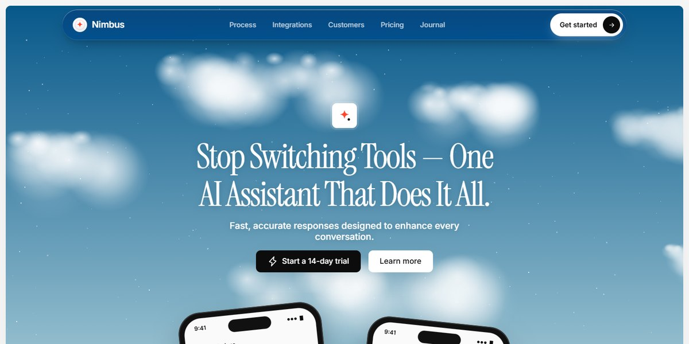</a></td><td><b><a href="pages/nimbus-ai-assistant-page">Nimbus AI Assistant Page</a></b> · <sub>Nov 8, 2026</sub><br>A light, coral-accented page for an all-in-one AI assistant, with two tilted phones under a parallax sky of canvas clouds and tool tiles orbiting the logo on three rings<br><sub><a href="pages/nimbus-ai-assistant-page/index.html">Code</a> · <a href="pages/nimbus-ai-assistant-page/PROMPT.md">Prompt</a> · <a href="https://instalanding.ai/demos/nimbus-ai-assistant.html">Live demo</a></sub></td></tr>
<tr><td width="260"><a href="pages/bryo-ai-moss-cultivation-page">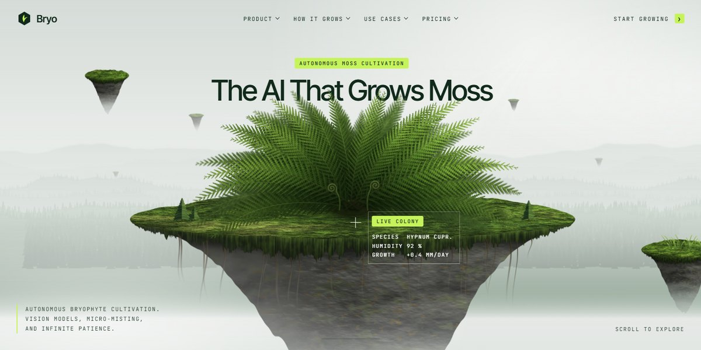</a></td><td><b><a href="pages/bryo-ai-moss-cultivation-page">Bryo AI Moss Cultivation Page</a></b> · <sub>Nov 8, 2026</sub><br>A misty sage-and-lime page for an AI that grows moss, painted in code, where a scroll-driven camera dollies from a floating moss island down into a fogged conifer valley<br><sub><a href="pages/bryo-ai-moss-cultivation-page/index.html">Code</a> · <a href="pages/bryo-ai-moss-cultivation-page/PROMPT.md">Prompt</a> · <a href="https://instalanding.ai/demos/bryo-ai-moss-cultivation.html">Live demo</a></sub></td></tr>
<tr><td width="260"><a href="pages/landra-ai-landing-page-generator-page">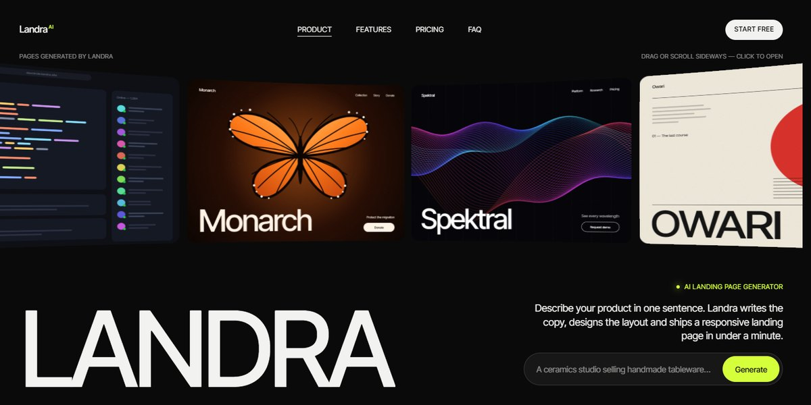</a></td><td><b><a href="pages/landra-ai-landing-page-generator-page">Landra AI Landing Page Generator Page</a></b> · <sub>Nov 8, 2026</sub><br>A black-and-lime page for an AI that turns one sentence into a landing page, with a WebGL strip of generated pages that bends as you drag and a live demo that builds a mock site from your prompt<br><sub><a href="pages/landra-ai-landing-page-generator-page/index.html">Code</a> · <a href="pages/landra-ai-landing-page-generator-page/PROMPT.md">Prompt</a> · <a href="https://instalanding.ai/demos/landra-ai-landing-page-generator.html">Live demo</a></sub></td></tr>
<tr><td width="260"><a href="pages/buttonzilla-glass-console-page">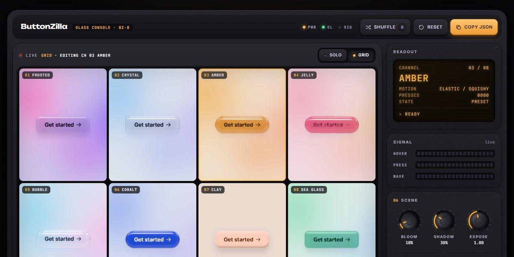</a></td><td><b><a href="pages/buttonzilla-glass-console-page">ButtonZilla Glass Console Page</a></b> · <sub>Nov 8, 2026</sub><br>A dark hardware-style console for live 3D glass buttons, with a refracting pill that tilts, squashes and ripples on press, an amber LCD readout and rotary knobs for shape, glass and scene<br><sub><a href="pages/buttonzilla-glass-console-page/index.html">Code</a> · <a href="pages/buttonzilla-glass-console-page/PROMPT.md">Prompt</a> · <a href="https://instalanding.ai/demos/buttonzilla-glass-console.html">Live demo</a></sub></td></tr>
<tr><td width="260"><a href="pages/forgewave-vibe-manufacturing-studio-page">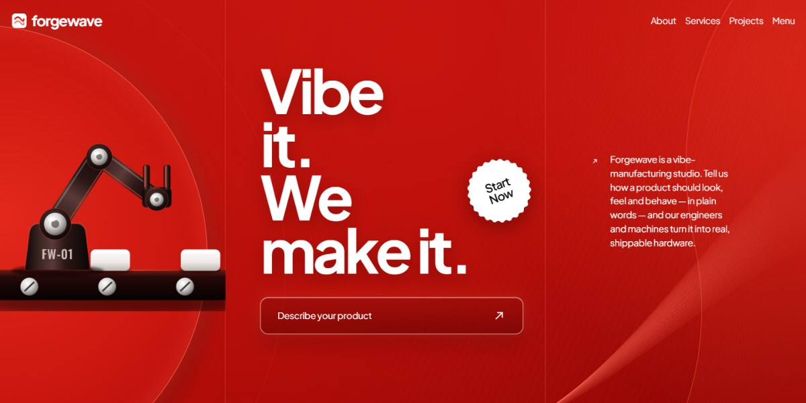</a></td><td><b><a href="pages/forgewave-vibe-manufacturing-studio-page">Forgewave Vibe-Manufacturing Studio Page</a></b> · <sub>Nov 8, 2026</sub><br>A red-and-ink page for a studio that turns a described vibe into a real product, drawn entirely in animated SVG from a robot arm loading a conveyor to a factory-belt footer<br><sub><a href="pages/forgewave-vibe-manufacturing-studio-page/index.html">Code</a> · <a href="pages/forgewave-vibe-manufacturing-studio-page/PROMPT.md">Prompt</a> · <a href="https://instalanding.ai/demos/forgewave-vibe-manufacturing-studio.html">Live demo</a></sub></td></tr>
<tr><td width="260"><a href="pages/kyma-ai-automation-agency-page">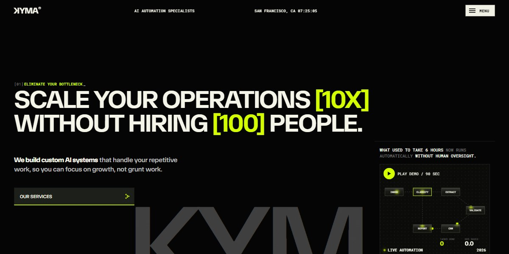</a></td><td><b><a href="pages/kyma-ai-automation-agency-page">KYMA AI Automation Agency Page</a></b> · <sub>Nov 8, 2026</sub><br>A brutalist black, paper and lime page for an AI automation agency on a visible four-column grid, with a playable automation pipeline, pain points that fly off as you scroll and an ROI calculator<br><sub><a href="pages/kyma-ai-automation-agency-page/index.html">Code</a> · <a href="pages/kyma-ai-automation-agency-page/PROMPT.md">Prompt</a> · <a href="https://instalanding.ai/demos/kyma-ai-automation-agency.html">Live demo</a></sub></td></tr>
</table>
<!-- NEW-DROPS:END -->

## Use a page

**Open it.** Every `pages/<name>/index.html` runs from `file://`. No install, no build step.

**Remix it.** Each file opens with a header comment written for whoever edits it next: where the
design tokens live, the sections in order, what each script drives, and what breaks when you change
it. Every top-level region carries a `data-section` attribute (`nav`, `hero`, `pricing`, `footer`, …),
so you can lift one section into your own project.

**Rebuild it in your stack.** `PROMPT.md` beside each page is the prompt: a short instruction, then
the page's whole HTML file. Paste it into Claude Code, Codex, Cursor, OpenCode, Lovable, v0 or any
agent, name your framework, and it converts the page faithfully: same hex values, radii, easing,
breakpoints and motion, because they are all right there in the code.

**Replace the content.** Every brand, product, number, logo and testimonial here is fictional.

## For agents

Start with [`AGENTS.md`](AGENTS.md). [`index.json`](index.json) lists every page with what it is best
for, its style, its sections in order, its stack (libraries, fonts, WebGL/canvas) and its file
paths, so an agent can choose a page without opening one. The same library is served as flat files
at [instalanding.ai/llms.txt](https://instalanding.ai/llms.txt),
[instalanding.ai/prompts.json](https://instalanding.ai/prompts.json) and
`instalanding.ai/p/<slug>.txt`.

## The pages

<!-- PAGES:START -->
<table>
<tr><td width="260"><a href="pages/nimbus-ai-assistant-page"></a></td><td><b><a href="pages/nimbus-ai-assistant-page">Nimbus AI Assistant Page</a></b><br>A light, coral-accented page for an all-in-one AI assistant, with two tilted phones under a parallax sky of canvas clouds and tool tiles orbiting the logo on three rings<br><sub>light · serif-display · sky · glassmorphism</sub></td></tr>
<tr><td width="260"><a href="pages/bryo-ai-moss-cultivation-page"></a></td><td><b><a href="pages/bryo-ai-moss-cultivation-page">Bryo AI Moss Cultivation Page</a></b><br>A misty sage-and-lime page for an AI that grows moss, painted in code, where a scroll-driven camera dollies from a floating moss island down into a fogged conifer valley<br><sub>light · nature · scroll-story · canvas-art</sub></td></tr>
<tr><td width="260"><a href="pages/landra-ai-landing-page-generator-page"></a></td><td><b><a href="pages/landra-ai-landing-page-generator-page">Landra AI Landing Page Generator Page</a></b><br>A black-and-lime page for an AI that turns one sentence into a landing page, with a WebGL strip of generated pages that bends as you drag and a live demo that builds a mock site from your prompt<br><sub>dark · lime · webgl · gallery</sub></td></tr>
<tr><td width="260"><a href="pages/buttonzilla-glass-console-page"></a></td><td><b><a href="pages/buttonzilla-glass-console-page">ButtonZilla Glass Console Page</a></b><br>A dark hardware-style console for live 3D glass buttons, with a refracting pill that tilts, squashes and ripples on press, an amber LCD readout and rotary knobs for shape, glass and scene<br><sub>dark · hardware · webgl · glass</sub></td></tr>
<tr><td width="260"><a href="pages/forgewave-vibe-manufacturing-studio-page"></a></td><td><b><a href="pages/forgewave-vibe-manufacturing-studio-page">Forgewave Vibe-Manufacturing Studio Page</a></b><br>A red-and-ink page for a studio that turns a described vibe into a real product, drawn entirely in animated SVG from a robot arm loading a conveyor to a factory-belt footer<br><sub>dark · factory-red · illustrated · svg-animation</sub></td></tr>
<tr><td width="260"><a href="pages/kyma-ai-automation-agency-page"></a></td><td><b><a href="pages/kyma-ai-automation-agency-page">KYMA AI Automation Agency Page</a></b><br>A brutalist black, paper and lime page for an AI automation agency on a visible four-column grid, with a playable automation pipeline, pain points that fly off as you scroll and an ROI calculator<br><sub>dark · brutalist · acid-lime · grid-lines</sub></td></tr>
<tr><td width="260"><a href="pages/cutcrew-ai-video-agents-page">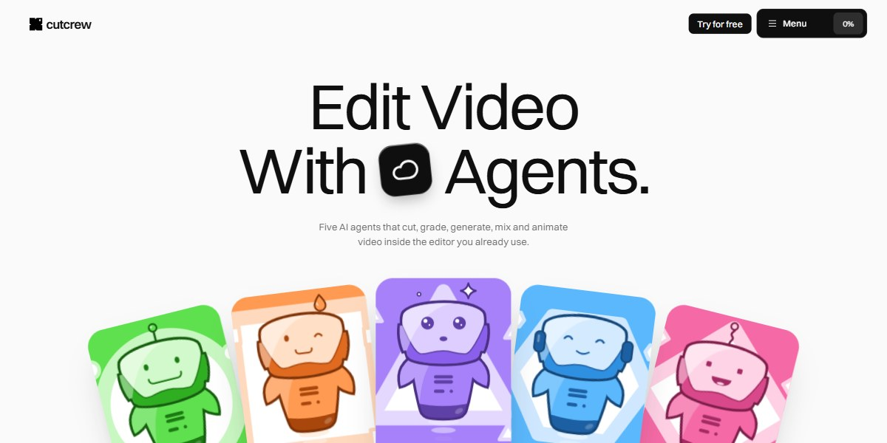</a></td><td><b><a href="pages/cutcrew-ai-video-agents-page">Cutcrew AI Video Agents Page</a></b><br>A bright, playful page for five AI video-editing agents, each a candy-coloured SVG robot mascot, with a self-typing brief, a six-week gantt with a sweeping playhead and a spinning 3D ring of covers<br><sub>light · playful · svg-mascots · bento</sub></td></tr>
<tr><td width="260"><a href="pages/foldwise-ai-product-designer-page">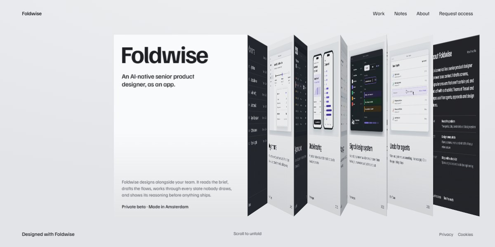</a></td><td><b><a href="pages/foldwise-ai-product-designer-page">Foldwise AI Product Designer Page</a></b><br>A quiet grey page for an AI-native product designer, laid out as a folding book whose twelve panels of SVG case studies concertina open in 3D as you scroll<br><sub>light · editorial · 3d-fold · scroll-driven</sub></td></tr>
<tr><td width="260"><a href="pages/fullday-ai-money-agent-page">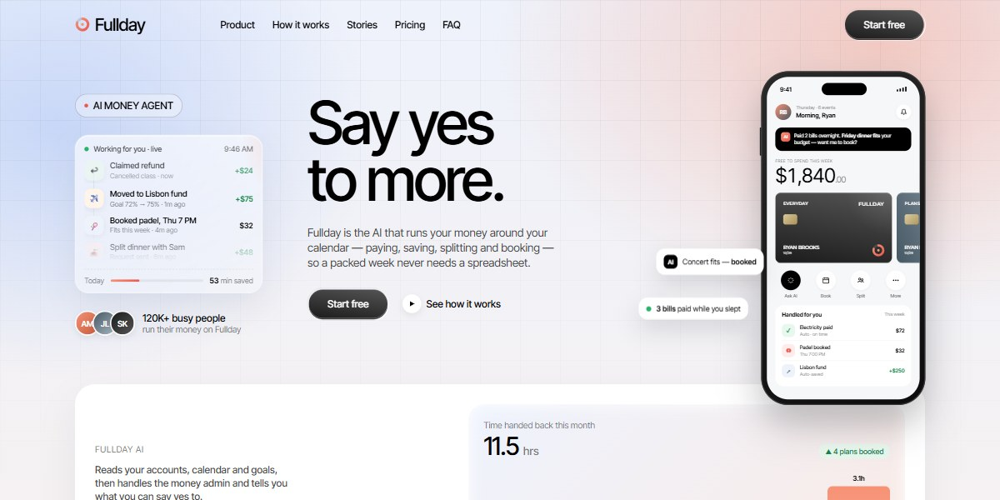</a></td><td><b><a href="pages/fullday-ai-money-agent-page">Fullday AI Money Agent Page</a></b><br>A soft blue-and-peach page for an AI money agent that works around your calendar, with a live feed of finished tasks, sliding payment cards on a phone and a self-typing can I afford it prompt<br><sub>light · soft-gradients · phone-mockups · scroll-reveals</sub></td></tr>
<tr><td width="260"><a href="pages/fortix-ai-money-copilot-app-page">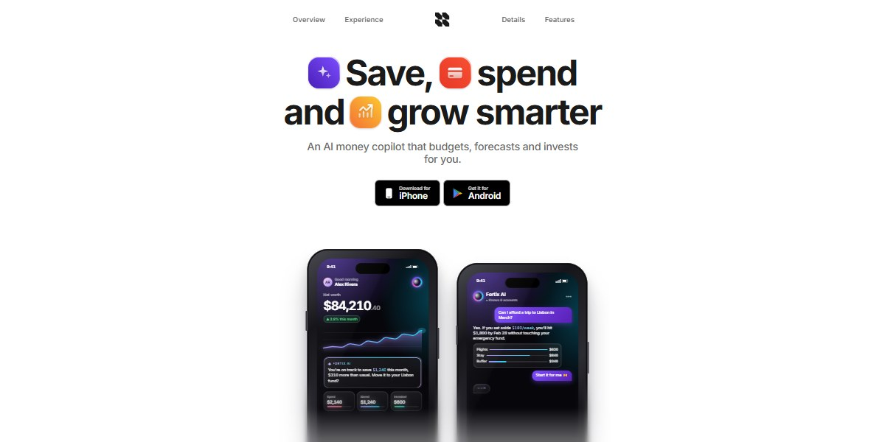</a></td><td><b><a href="pages/fortix-ai-money-copilot-app-page">Fortix AI Money Copilot App Page</a></b><br>A bright, airy app page for an AI money copilot, with six dark glass phone screens drawn in HTML and SVG, a turning 3D ring of stat cards and a tap-through 3D feature carousel<br><sub>light · glassmorphism · phone-mockups · 3d-carousel</sub></td></tr>
<tr><td width="260"><a href="pages/linnet-ai-housekeeping-swarm-page">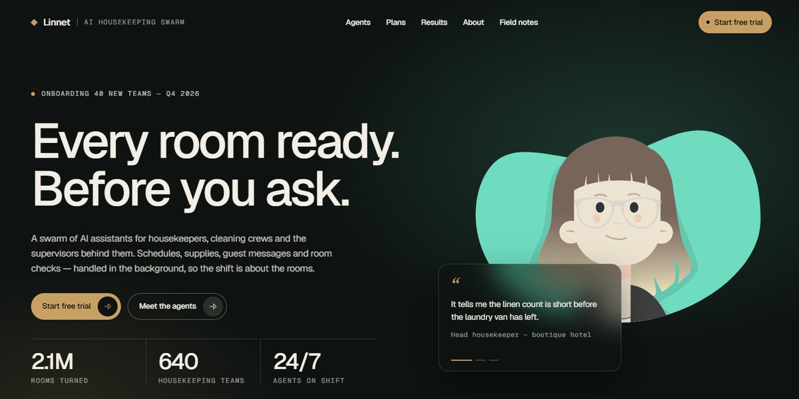</a></td><td><b><a href="pages/linnet-ai-housekeeping-swarm-page">Linnet AI Housekeeping Swarm Page</a></b><br>A pine-and-brass page for a swarm of AI housekeeping assistants, with an illustrated housekeeper who blinks and follows the pointer and four agents on a pinned scroll stage, all drawn in SVG<br><sub>dark · editorial · scroll-driven · svg-illustration</sub></td></tr>
<tr><td width="260"><a href="pages/ditherform-ai-dither-generator-page">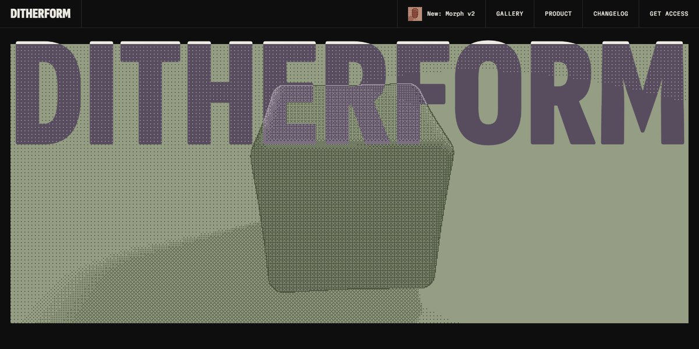</a></td><td><b><a href="pages/ditherform-ai-dither-generator-page">Ditherform AI Dither Generator Page</a></b><br>A near-black, grid-ruled page for an AI that turns a prompt into a 3D dither element, where every picture is a raymarched shape morphing between solids, Bayer-dithered in two muted inks<br><sub>dark · webgl · dithered · bold-type</sub></td></tr>
<tr><td width="260"><a href="pages/peelo-ai-sticker-printer-page">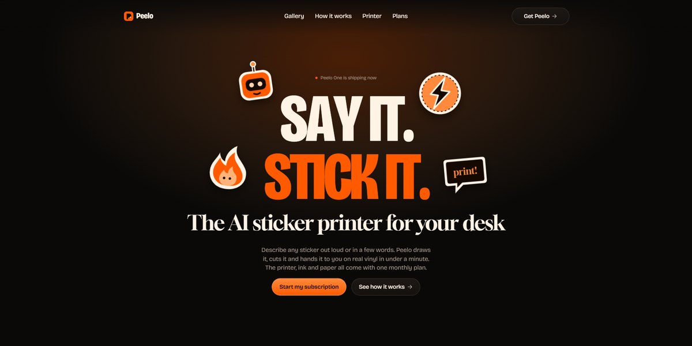</a></td><td><b><a href="pages/peelo-ai-sticker-printer-page">Peelo AI Sticker Printer Page</a></b><br>A warm-black subscription page for an AI sticker printer, with a condensed headline that blurs in under an orange glow, die-cut stickers popping around it and every picture drawn in SVG<br><sub>dark · bold-type · stickers · svg-illustration</sub></td></tr>
<tr><td width="260"><a href="pages/noctua-ai-night-owl-page">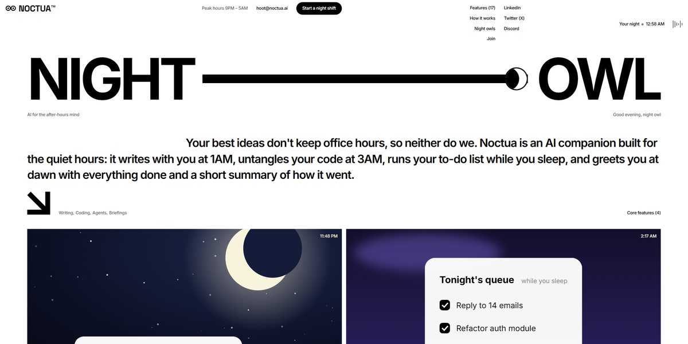</a></td><td><b><a href="pages/noctua-ai-night-owl-page">Noctua AI Night Owl Page</a></b><br>A stark black-on-white page for an AI that works the night shift, with a giant NIGHT OWL headline whose moon slides through its phases and a greeting for the viewer's own hour<br><sub>light · minimal · brutalist · editorial</sub></td></tr>
<tr><td width="260"><a href="pages/sidera-ai-astrology-page">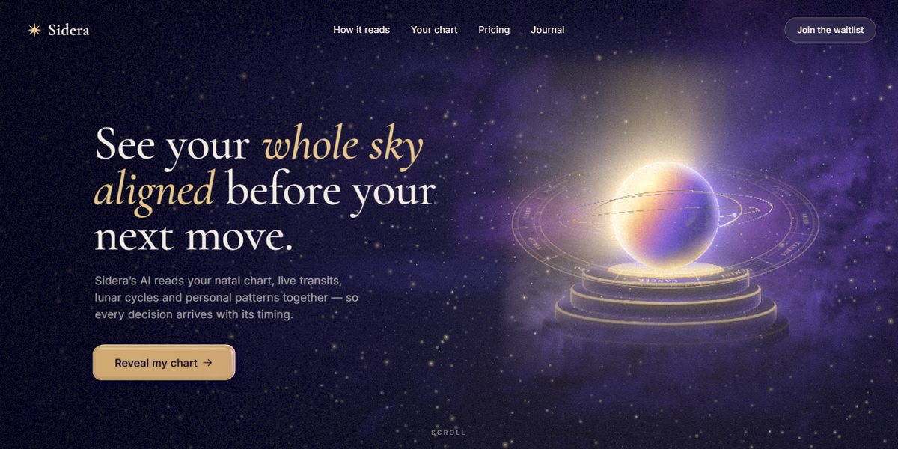</a></td><td><b><a href="pages/sidera-ai-astrology-page">Sidera AI Astrology Page</a></b><br>A midnight-and-gold page for an AI astrologer, with a Three.js glass orb on an obsidian podium inside a turning zodiac wheel, a live natal chart per sun sign and today's real moon phase<br><sub>dark · webgl · three-js · glassmorphism</sub></td></tr>
<tr><td width="260"><a href="pages/linework-ai-architect-assistant-page">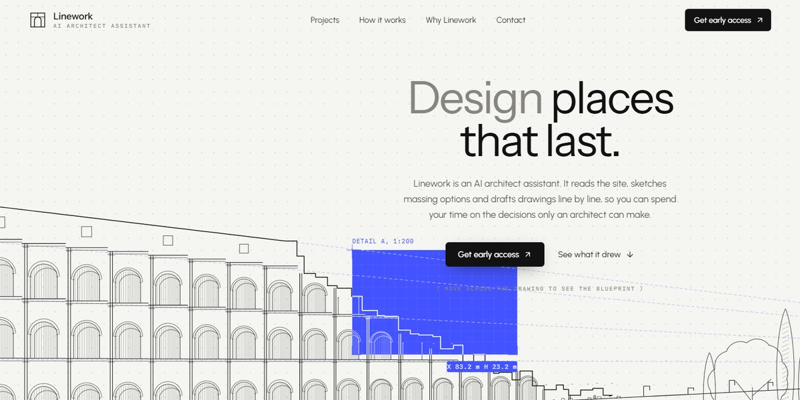</a></td><td><b><a href="pages/linework-ai-architect-assistant-page">Linework AI Architect Assistant Page</a></b><br>A quiet, paper-white page for an AI architect assistant where everything is drawn line by line in code, from an ink amphitheatre under a blueprint lens to a house that draws itself as you scroll<br><sub>light · minimal · line-drawing · svg-illustration</sub></td></tr>
<tr><td width="260"><a href="pages/ai-conf-frontier-ai-conference-page">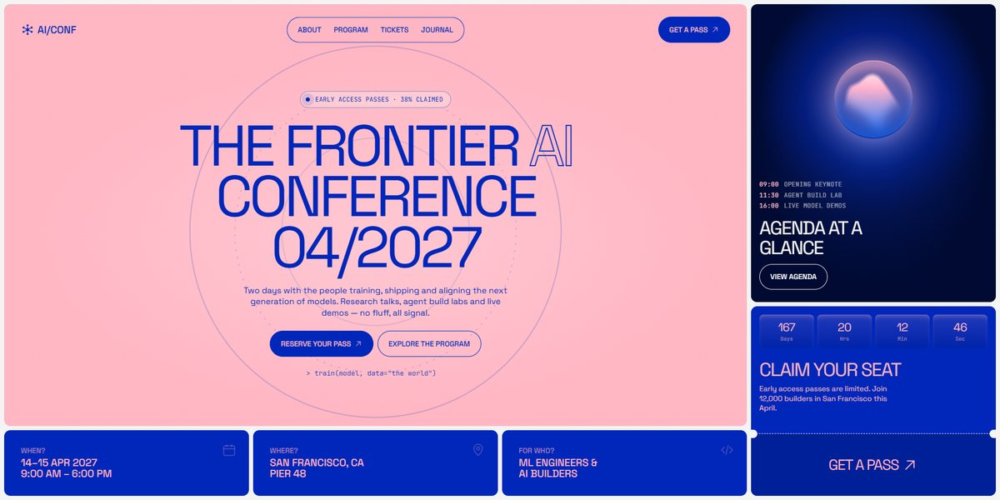</a></td><td><b><a href="pages/ai-conf-frontier-ai-conference-page">AI/CONF Frontier AI Conference Page</a></b><br>A pink-and-cobalt bento page for a frontier AI conference, with a huge outlined headline over slow orbit rings, a live countdown ticket and navy scenes in liquid glass<br><sub>light · bento · liquid-glass · svg-illustration</sub></td></tr>
<tr><td width="260"><a href="pages/synthra-ai-workspace-page">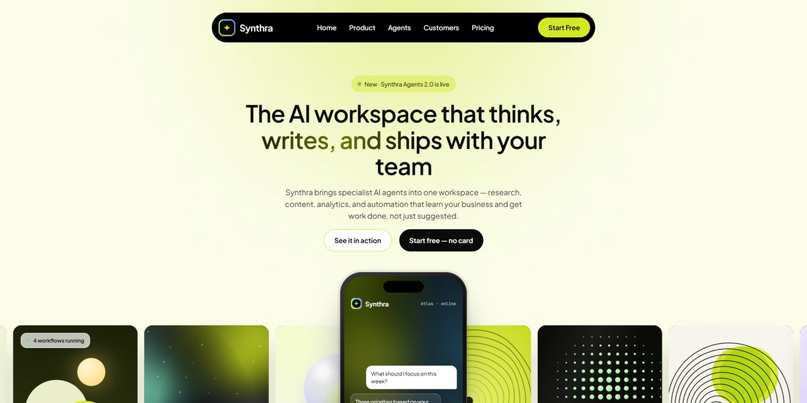</a></td><td><b><a href="pages/synthra-ai-workspace-page">Synthra AI Workspace Page</a></b><br>A bright lime SaaS page for an AI workspace of specialist agents, with a phone running a live chat over a ticker of generative art, six glowing agent orbs and a rotating 3D ring of product tiles<br><sub>light · glassmorphism · mesh-gradient · generative-art</sub></td></tr>
<tr><td width="260"><a href="pages/quillo-ai-tutor-page">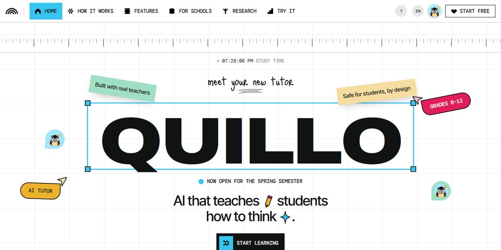</a></td><td><b><a href="pages/quillo-ai-tutor-page">Quillo AI Tutor Page</a></b><br>A bright, hand-made page for an AI tutor on a graph-paper grid, with a giant QUILLO in a selection box, draggable polaroids and a googly-eyed blob that follows your cursor<br><sub>light · playful · brutalist · svg-illustration</sub></td></tr>
<tr><td width="260"><a href="pages/auren-ai-meditation-guide-page">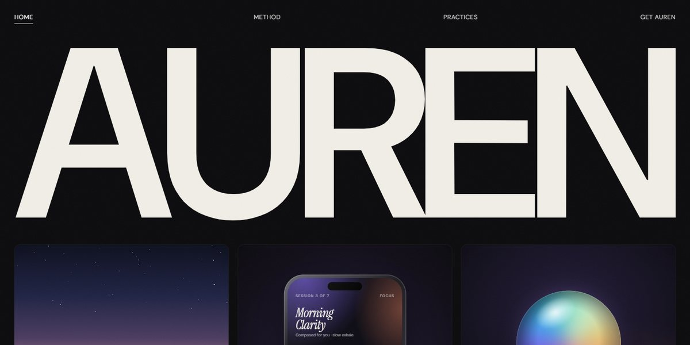</a></td><td><b><a href="pages/auren-ai-meditation-guide-page">Auren AI Meditation Guide Page</a></b><br>A hushed, near-black landing page for an AI meditation guide, with a full-width AUREN wordmark, a WebGL aurora band and seventeen generative art scenes drawn in code<br><sub>dark · minimal · generative-art · webgl</sub></td></tr>
<tr><td width="260"><a href="pages/lumora-ai-home-solar-page">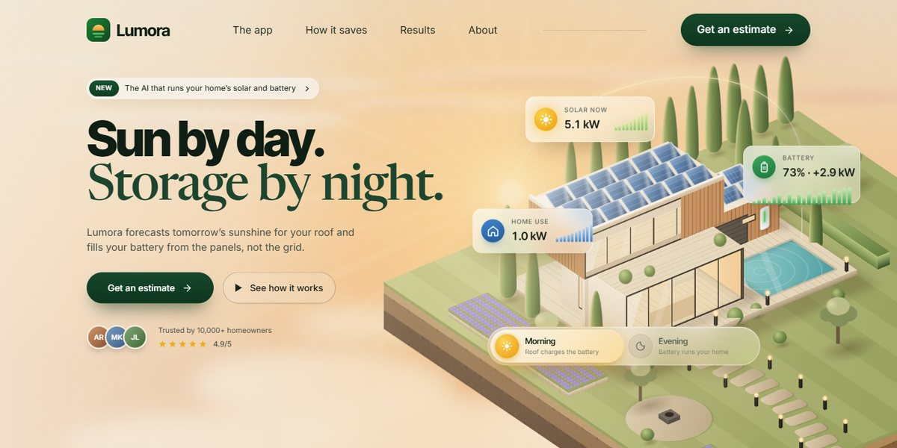</a></td><td><b><a href="pages/lumora-ai-home-solar-page">Lumora AI Home Solar Page</a></b><br>A warm, sunlit page for an AI that runs a home's solar and battery, with a 3D villa built from CSS boxes that turns to evening with one switch and a working energy dashboard<br><sub>light · 3d-css · svg-illustration · scroll-driven</sub></td></tr>
<tr><td width="260"><a href="pages/orrery-ai-services-ring-page">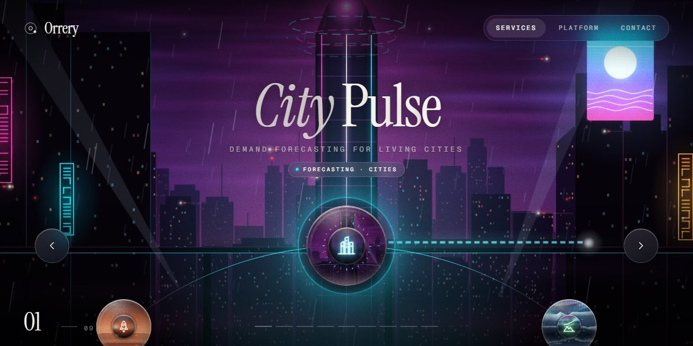</a></td><td><b><a href="pages/orrery-ai-services-ring-page">Orrery AI Services Ring Page</a></b><br>A single-screen carousel for an AI platform of nine services, where glass lenses on a ticked ring each open a full-screen world painted live in canvas<br><sub>dark · canvas-art · glassmorphism · carousel</sub></td></tr>
<tr><td width="260"><a href="pages/orvane-ai-lidar-drone-page">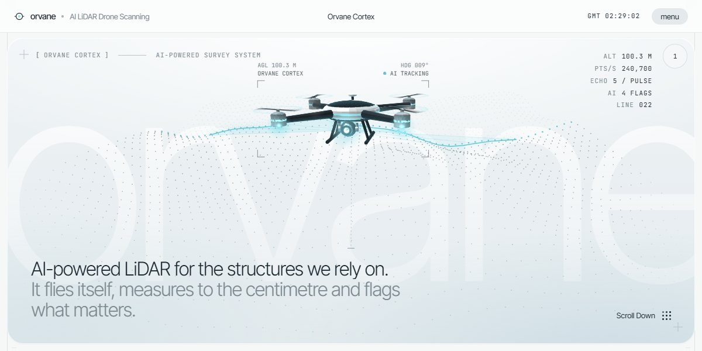</a></td><td><b><a href="pages/orvane-ai-lidar-drone-page">Orvane AI LiDAR Drone Page</a></b><br>A pale survey-instrument page for an AI LiDAR drone, with a shaded 3D drone sweeping a laser across scanned terrain, morphing point clouds and a controller that lets you fly it<br><sub>light · minimal · canvas-art · 3d-canvas</sub></td></tr>
<tr><td width="260"><a href="pages/kairo-ai-time-assistant-page">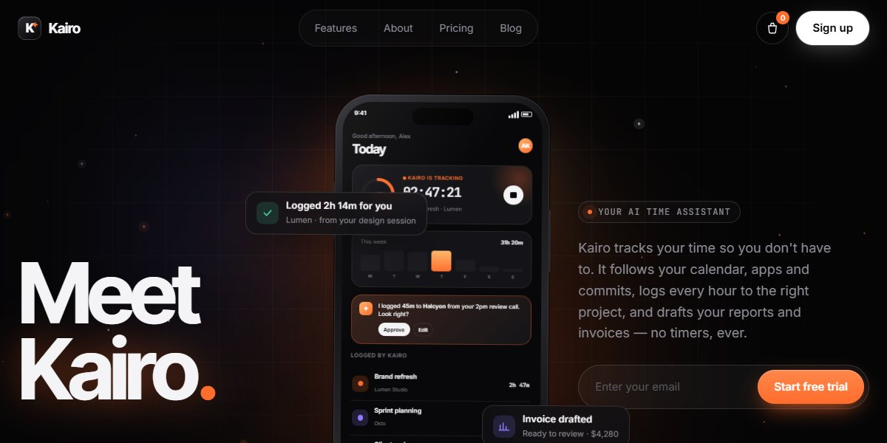</a></td><td><b><a href="pages/kairo-ai-time-assistant-page">Kairo AI Time Assistant Page</a></b><br>A near-black product page for an AI time-tracking assistant, with a glowing headline that splits in letter by letter beside a tilting 3D phone whose app types its own messages<br><sub>dark · bento · css-device-mockup · glow</sub></td></tr>
<tr><td width="260"><a href="pages/plinth-ai-merchant-agents-page">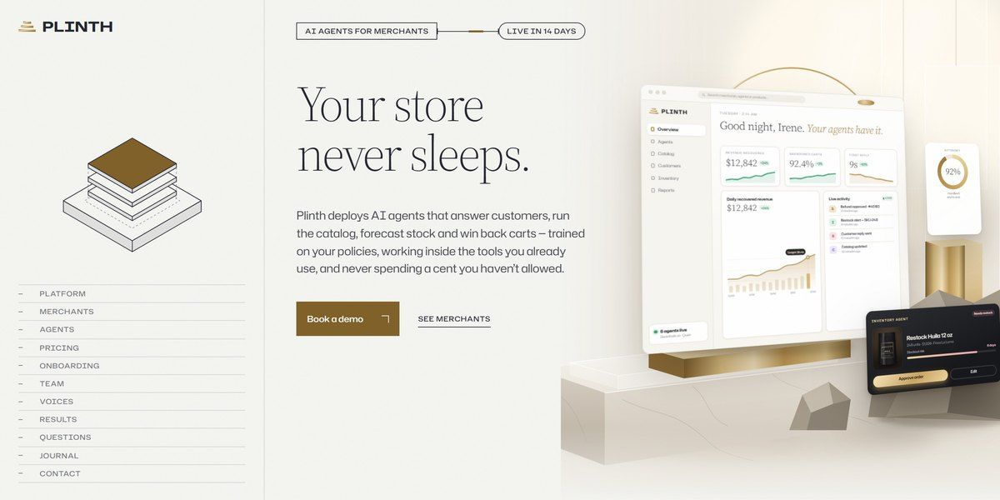</a></td><td><b><a href="pages/plinth-ai-merchant-agents-page">Plinth AI Merchant Agents Page</a></b><br>A gallery-quiet page for AI agents that run online stores, with the store console on a 3D marble and brass plinth and onboarding running sideways along a lit wire<br><sub>editorial · luxury · 3d-css · svg-illustration</sub></td></tr>
<tr><td width="260"><a href="pages/sumwise-ai-accounting-firm-page">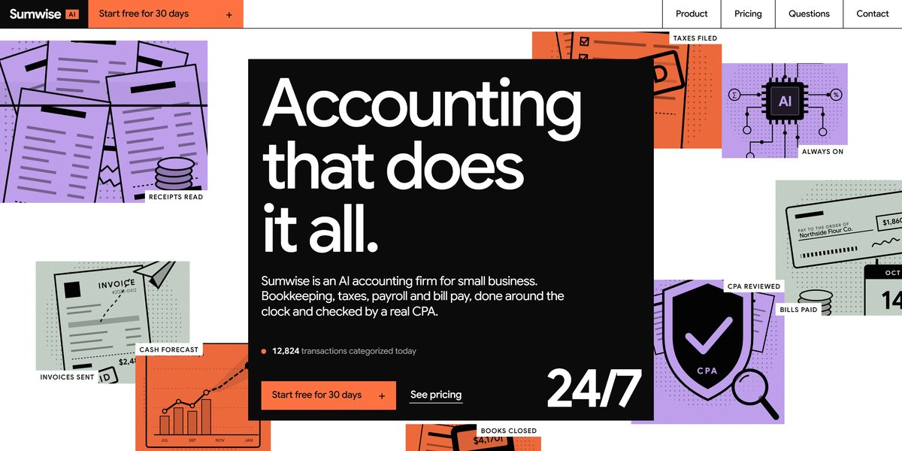</a></td><td><b><a href="pages/sumwise-ai-accounting-firm-page">Sumwise AI Accounting Firm Page</a></b><br>A print-shop page for an AI accounting firm, where an ink cover opens as eight duotone tiles fly out and back and a sample monthly close walks itself through<br><sub>duotone · editorial · svg-illustration · bold-color</sub></td></tr>
<tr><td width="260"><a href="pages/infra-ai-thermal-agent-page">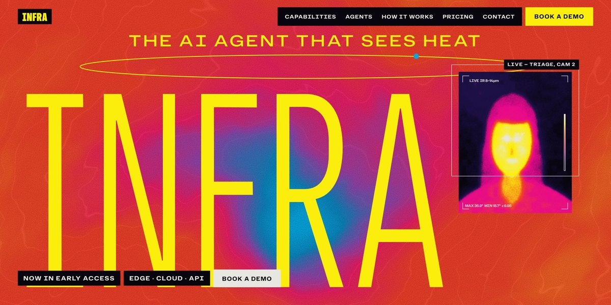</a></td><td><b><a href="pages/infra-ai-thermal-agent-page">Infra AI Thermal Agent Page</a></b><br>A thermal-camera page for an AI agent that sees heat, with a giant INFRA over a swirling WebGL heat plume and a probe that reads the temperature under your cursor<br><sub>thermal · bold-color · canvas-art · webgl</sub></td></tr>
<tr><td width="260"><a href="pages/easel-ai-artist-assistant-page">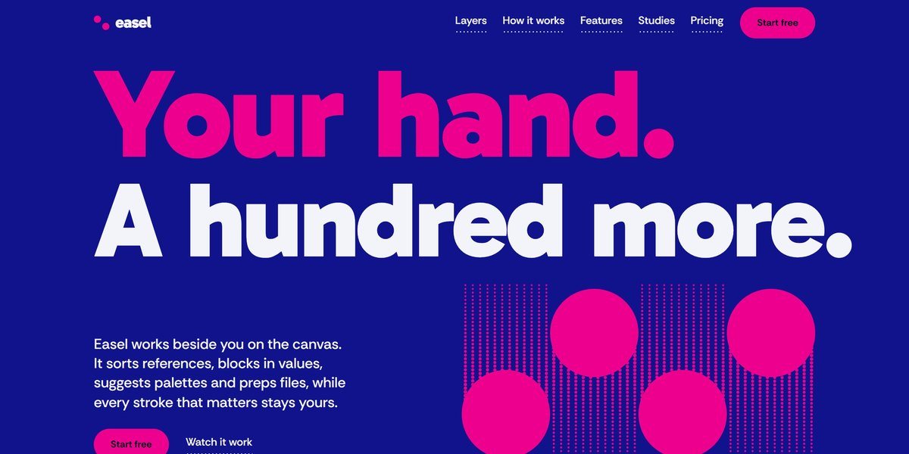</a></td><td><b><a href="pages/easel-ai-artist-assistant-page">Easel AI Artist Assistant Page</a></b><br>A two-ink risograph page for an AI assistant for artists, where four pink ink drums roll down the hero and print a panel as you scroll<br><sub>risograph · two-color · bold-type · svg-illustration</sub></td></tr>
<tr><td width="260"><a href="pages/ochre-ai-meditation-app-page">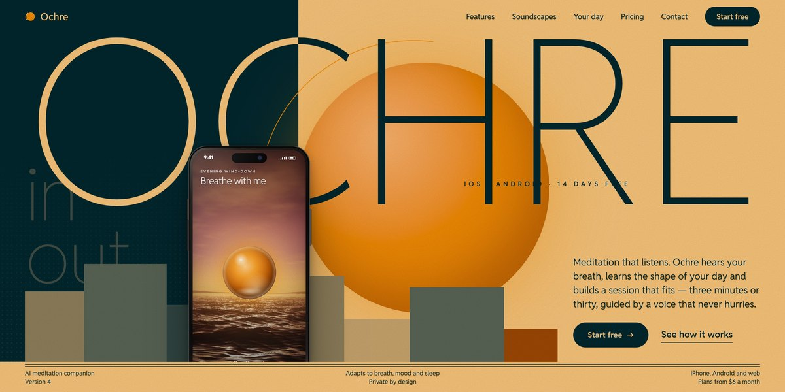</a></td><td><b><a href="pages/ochre-ai-meditation-app-page">Ochre AI Meditation App Page</a></b><br>A sunset-poster page for an AI meditation app, where a dark field sweeps across the title as the sun sets and the hero phone breathes over a live WebGL ocean<br><sub>sunset-poster · minimal-type · canvas-art · webgl</sub></td></tr>
<tr><td width="260"><a href="pages/tokenhaus-ai-design-system-academy-page">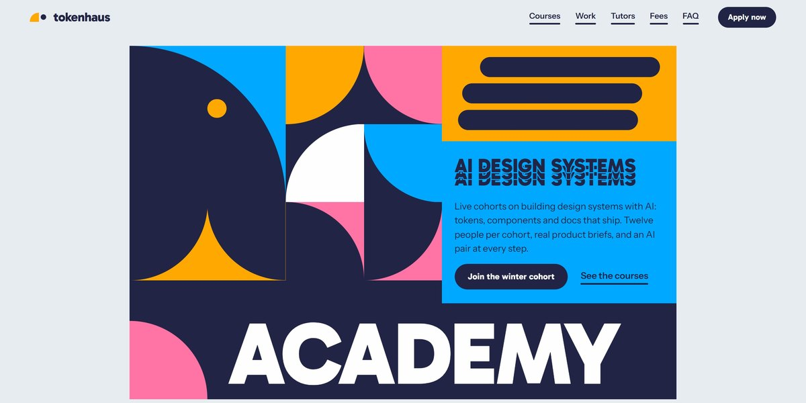</a></td><td><b><a href="pages/tokenhaus-ai-design-system-academy-page">tokenhaus AI Design System Academy Page</a></b><br>A four-ink Bauhaus page for an AI design-systems academy, with a hero grid of quarter-circle tiles that turn as you scroll and every swatch and tutor portrait drawn in SVG<br><sub>bauhaus · geometric · bold-color · svg-illustration</sub></td></tr>
<tr><td width="260"><a href="pages/ostler-ai-hotel-concierge-page">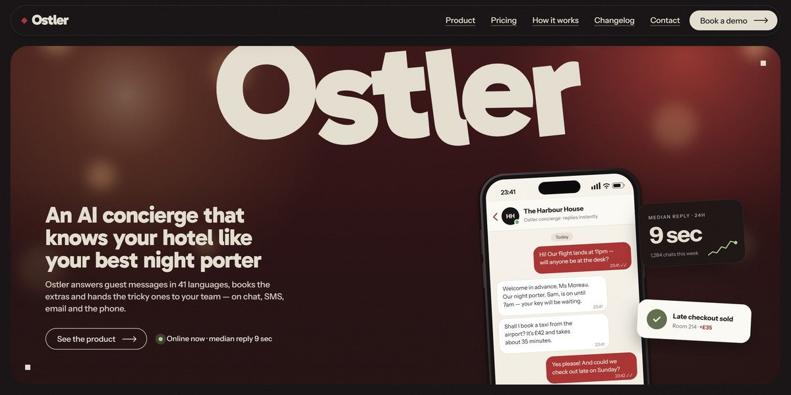</a></td><td><b><a href="pages/ostler-ai-hotel-concierge-page">Ostler AI Hotel Concierge Page</a></b><br>A late-night oxblood page for an AI hotel concierge, with a giant Ostler that springs apart letter by letter over a guest's phone chat and every room drawn in SVG<br><sub>editorial · card-stack · fill-type · svg-illustration</sub></td></tr>
<tr><td width="260"><a href="pages/wayfind-ai-travel-companion-page-v2">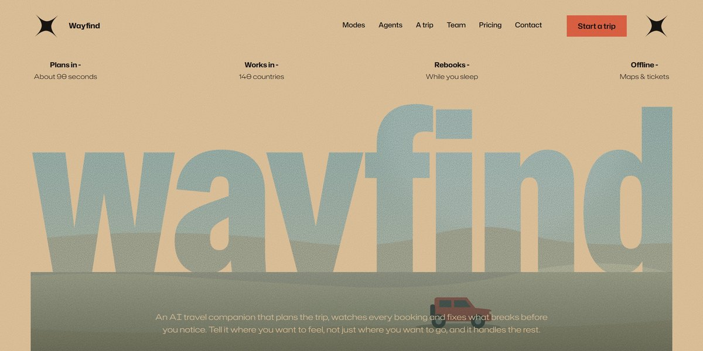</a></td><td><b><a href="pages/wayfind-ai-travel-companion-page-v2">Wayfind AI Travel Companion Page V2</a></b><br>A sand-and-sea expedition poster for an AI travel companion, with wayfind cut out of a desert photo that opens to full bleed and every photo raymarched live in WebGL<br><sub>editorial · expedition-poster · knockout-type · webgl</sub></td></tr>
<tr><td width="260"><a href="pages/tarn-file-transfer-page">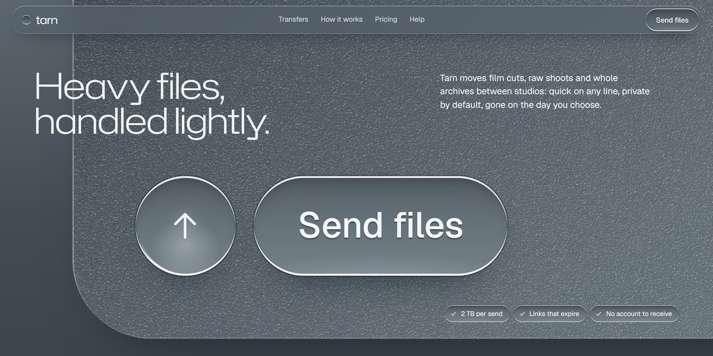</a></td><td><b><a href="pages/tarn-file-transfer-page">Tarn File Transfer Page</a></b><br>A frosted steel-grey page for a heavy-file transfer service, where the hero zooms out of a giant glass send button and a send button you can try with your own file<br><sub>glassmorphism · monochrome · frosted · svg-illustration</sub></td></tr>
<tr><td width="260"><a href="pages/somatic-ai-wellness-companion-page">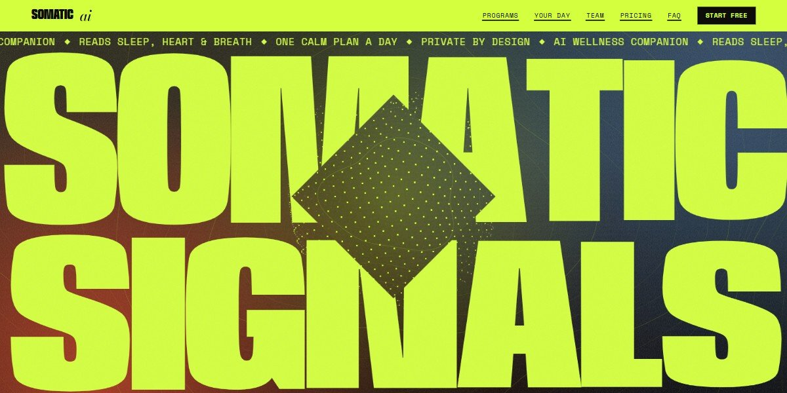</a></td><td><b><a href="pages/somatic-ai-wellness-companion-page">Somatic AI Wellness Companion Page</a></b><br>An acid-lime page for an AI wellness companion, with a breathing point-sphere orb behind full-width SOMATIC SIGNALS and every heart trace and sleep map drawn in code<br><sub>acid · bold-type · stretched-type · canvas</sub></td></tr>
<tr><td width="260"><a href="pages/latent-ai-fashion-atelier-page">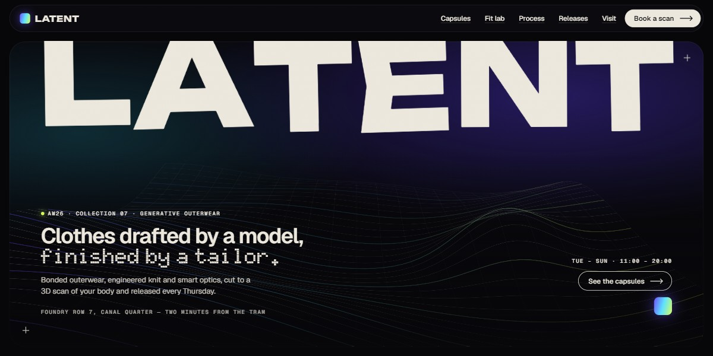</a></td><td><b><a href="pages/latent-ai-fashion-atelier-page">Latent AI Fashion Atelier Page</a></b><br>A dark, iridescent page for an AI fashion atelier, with a wireframe cloth that ripples toward the pointer under a giant Latent and every picture generated in SVG<br><sub>dark · iridescent · generative-svg · canvas</sub></td></tr>
<tr><td width="260"><a href="pages/rowline-agronomy-ai-page">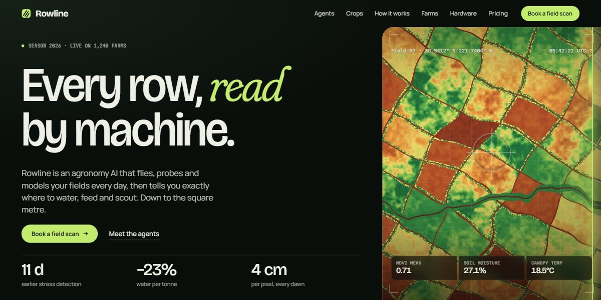</a></td><td><b><a href="pages/rowline-agronomy-ai-page">Rowline Agronomy AI Page</a></b><br>A dark-green page for a farm AI, where a live NDVI scan wipes across a field rendered pixel by pixel and the lens opens into a dawn landscape with a drone flying in<br><sub>dark · procedural-art · canvas · scroll-driven</sub></td></tr>
<tr><td width="260"><a href="pages/corvane-capital-private-equity-page">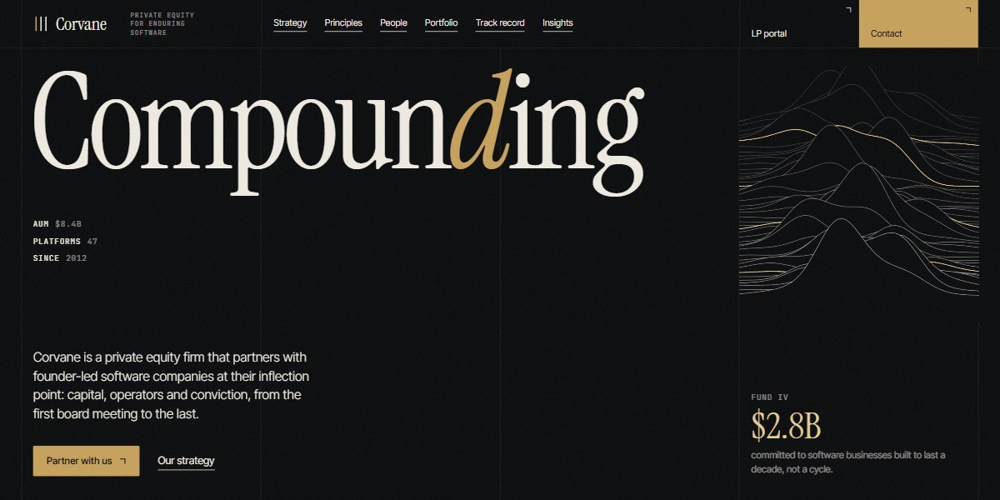</a></td><td><b><a href="pages/corvane-capital-private-equity-page">Corvane Capital Private Equity Page</a></b><br>A quiet-money private equity page on a ruled four-column grid, with a giant serif Compounding beside a window of live ridgelines that opens to full bleed as you scroll<br><sub>dark · editorial · serif · ruled-grid</sub></td></tr>
<tr><td width="260"><a href="pages/agentic-art-expo-page">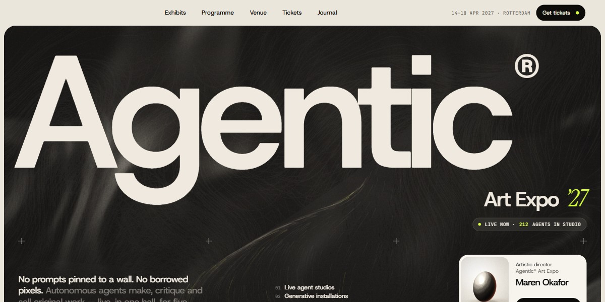</a></td><td><b><a href="pages/agentic-art-expo-page">Agentic Art Expo Page</a></b><br>An editorial event page for an expo where AI agents exhibit, with a satin hero of live particle trails and a programme that floods dark from a full stop<br><sub>dark · editorial · generative-art · canvas</sub></td></tr>
<tr><td width="260"><a href="pages/geo-lab-planetary-geography-page">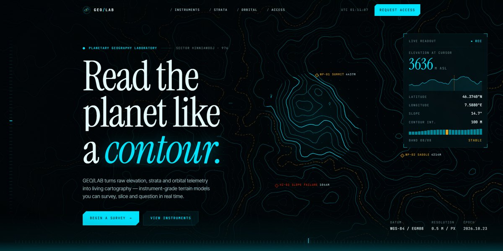</a></td><td><b><a href="pages/geo-lab-planetary-geography-page">GEO/LAB Planetary Geography Page</a></b><br>A cyan-on-black instrument page for a geography lab, where live contour lines drift under a HUD that reads elevation and slope at your cursor<br><sub>dark · fui · hud · canvas</sub></td></tr>
<tr><td width="260"><a href="pages/tessel-ai-infrastructure-page">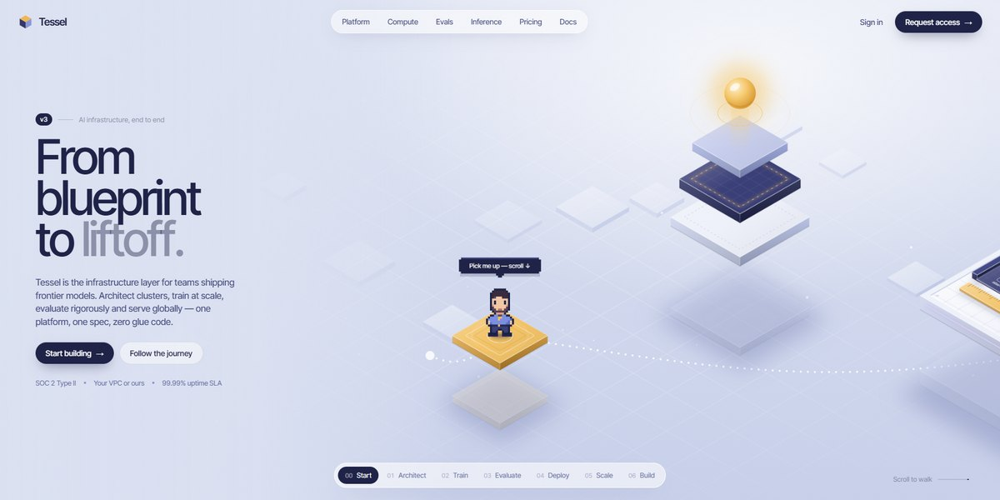</a></td><td><b><a href="pages/tessel-ai-infrastructure-page">Tessel AI Infrastructure Page</a></b><br>A pinned isometric journey for an AI infrastructure platform, where a pixel-art engineer walks a glowing route past six code-drawn scenes as you scroll<br><sub>light · isometric · pixel-art · svg</sub></td></tr>
<tr><td width="260"><a href="pages/hearthly-ai-home-care-page">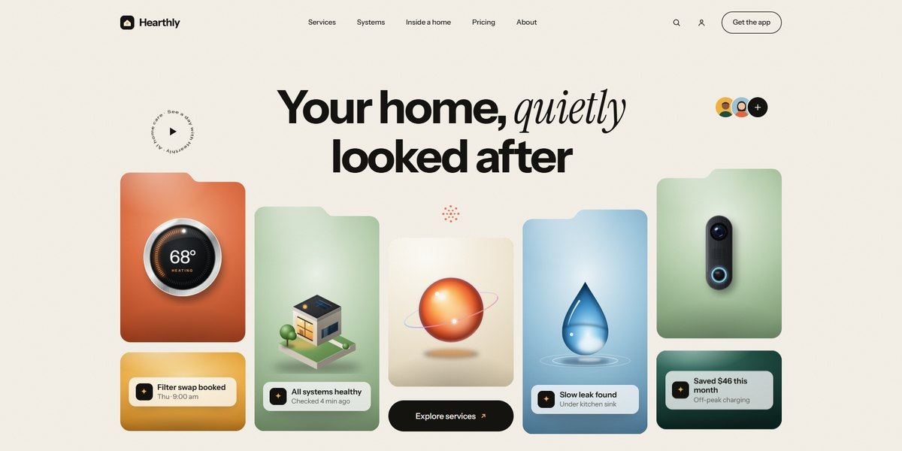</a></td><td><b><a href="pages/hearthly-ai-home-care-page">Hearthly AI Home Care Page</a></b><br>A warm, illustrated page for an AI home assistant, with a floating collage of glossy home-system cards that floods open into a night scene of the house<br><sub>light · illustrated · svg · gsap</sub></td></tr>
<tr><td width="260"><a href="pages/nota-wearable-ai-page">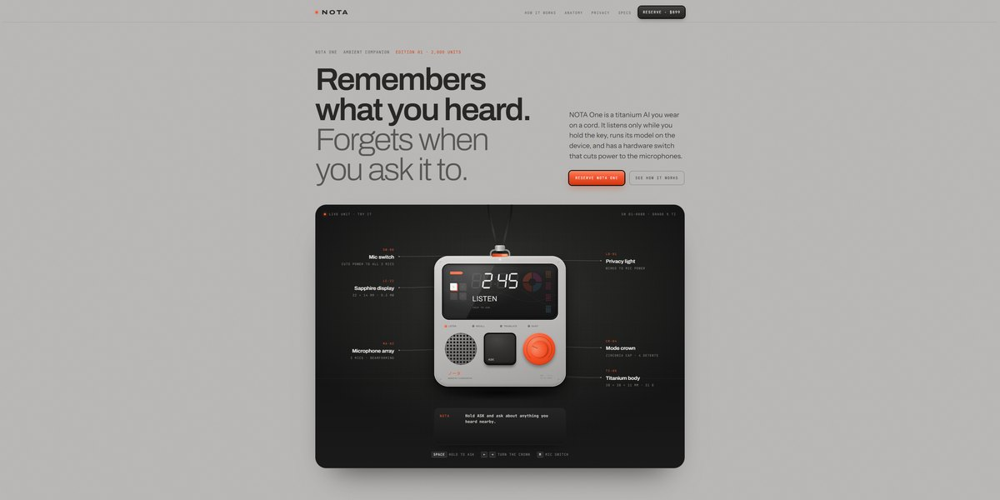</a></td><td><b><a href="pages/nota-wearable-ai-page">NOTA Wearable AI Page</a></b><br>A quiet-luxury catalogue for a titanium AI wearable, with a live device in the hero you can hold to ask, turn by the crown and mute with the mic switch<br><sub>light · skeuomorphic · interactive · hardware</sub></td></tr>
<tr><td width="260"><a href="pages/mirai-ai-companion-page">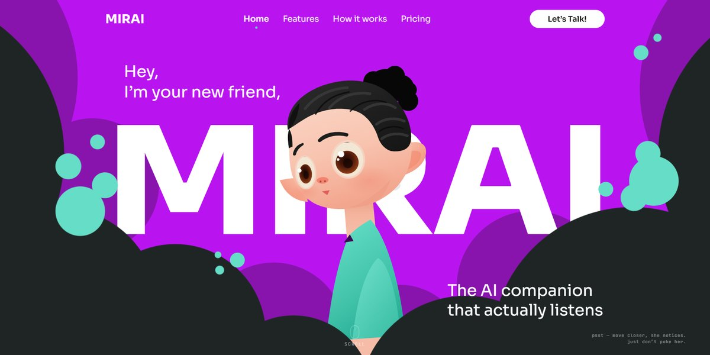</a></td><td><b><a href="pages/mirai-ai-companion-page">Mirai AI Companion Page</a></b><br>A purple, mint and charcoal page for an AI companion, with an illustrated character who peeks over giant type, follows your cursor, blinks and frowns when you poke her<br><sub>dark · illustrated · svg · character</sub></td></tr>
<tr><td width="260"><a href="pages/orvyn-autonomous-car-page">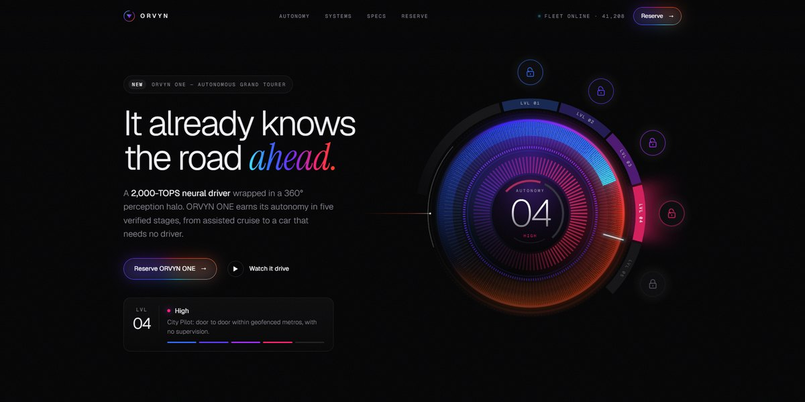</a></td><td><b><a href="pages/orvyn-autonomous-car-page">ORVYN Autonomous Car Page</a></b><br>An AI-native grand tourer on a near-black page, with a spectrum autonomy dial that steps through five levels over a radar, live telemetry and a horizon of light<br><sub>dark · svg · spectrum · dashboard</sub></td></tr>
<tr><td width="260"><a href="pages/myriad-agent-swarm-page">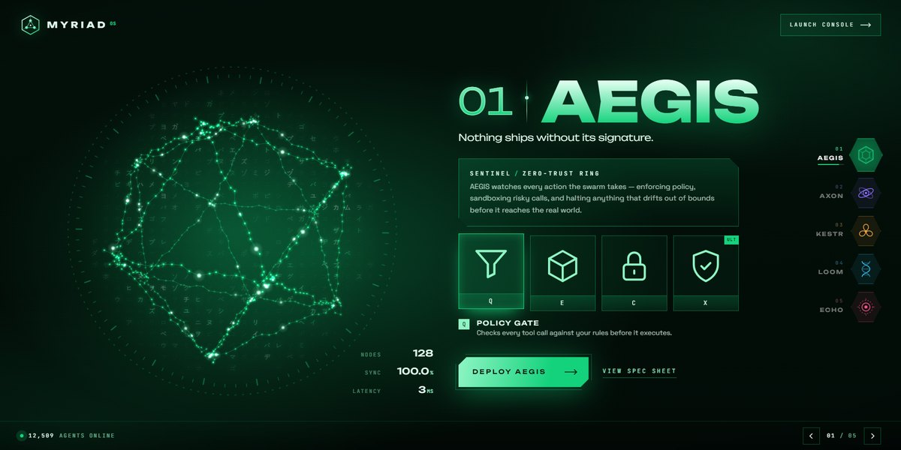</a></td><td><b><a href="pages/myriad-agent-swarm-page">Myriad Agent Swarm Page</a></b><br>An agent-select screen for an AI swarm, where picking one of five agents reforms a 640-point particle swarm into its shape and recolours the page<br><sub>dark · canvas · particles · game-ui</sub></td></tr>
<tr><td width="260"><a href="pages/mirador-observability-page">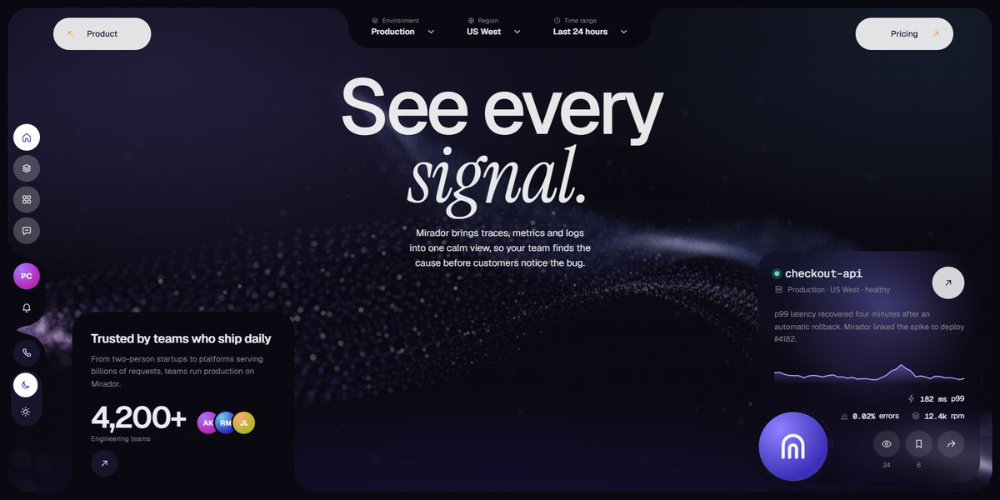</a></td><td><b><a href="pages/mirador-observability-page">Mirador Observability Page</a></b><br>An observability platform in a framed night console, with a WebGL ribbon of glowing fibers behind the hero and stacking feature cards with live trace mockups<br><sub>dark · webgl · gsap · glass</sub></td></tr>
<tr><td width="260"><a href="pages/side-quest-adoption-center-page">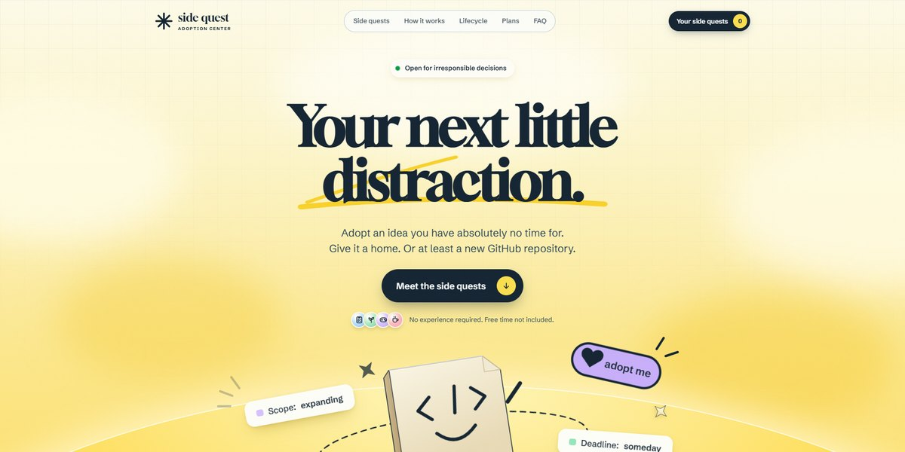</a></td><td><b><a href="pages/side-quest-adoption-center-page">Side Quest Adoption Center Page</a></b><br>A butter-yellow adoption center for ideas you have no time for, with a waving mascot, six illustrated side quests to adopt with confetti and a spark-to-archive lifecycle<br><sub>light · playful · illustrated · svg</sub></td></tr>
<tr><td width="260"><a href="pages/orrery-reasoning-engine-page">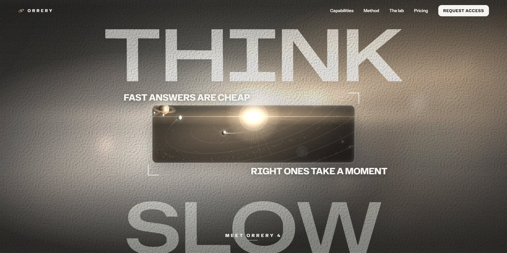</a></td><td><b><a href="pages/orrery-reasoning-engine-page">Orrery Reasoning Engine Page</a></b><br>An AI reasoning engine that shows its work, where the hero window opens onto a canvas orrery and every picture is a live rendering drawn in code<br><sub>dark · generative · canvas · gsap</sub></td></tr>
<tr><td width="260"><a href="pages/siliq-ai-hardware-lab-page">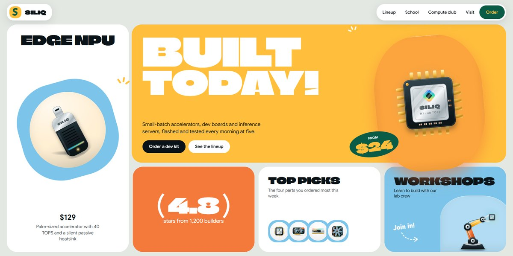</a></td><td><b><a href="pages/siliq-ai-hardware-lab-page">Siliq AI Hardware Lab Page</a></b><br>A sticker-bright bento for a small-batch AI hardware lab and school, with SVG chips and GPUs and a hero board that breaks apart into a honey flood<br><sub>light · bento · playful · illustrated</sub></td></tr>
<tr><td width="260"><a href="pages/thorn-music-controller-page">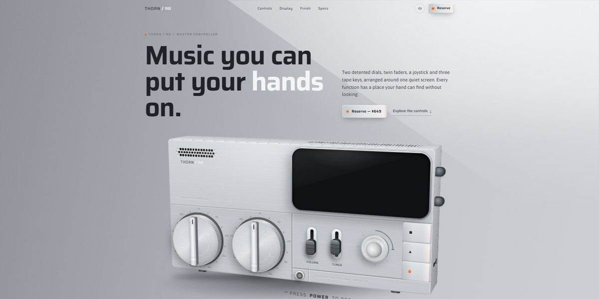</a></td><td><b><a href="pages/thorn-music-controller-page">Thorn Music Controller Page</a></b><br>A desktop music controller built in CSS 3D, where every dial, fader, joystick and tape key works with clicks you can hear<br><sub>light · 3d · skeuomorphic · interactive</sub></td></tr>
<tr><td width="260"><a href="pages/corvel-hard-tech-capital-page"></a></td><td><b><a href="pages/corvel-hard-tech-capital-page">Corvel Hard-Tech Capital Page</a></b><br>A risograph-print page for a firm investing in fabs, satellites and fusion, with halftone art drawn in code and a sunburst arch that blows apart on scroll<br><sub>light · risograph · halftone · editorial</sub></td></tr>
<tr><td width="260"><a href="pages/corelane-build-cluster-page"></a></td><td><b><a href="pages/corelane-build-cluster-page">Corelane Build Cluster Page</a></b><br>An isometric dev-tool page with laptops and a core server on a glowing circuit field, and a 96-machine fleet board you can put to sleep and run a build across<br><sub>dark · isometric · illustrated · interactive</sub></td></tr>
<tr><td width="260"><a href="pages/halden-clinical-equipment-page"></a></td><td><b><a href="pages/halden-clinical-equipment-page">Halden Clinical Equipment Page</a></b><br>A clinical equipment service in ink and paper, with a dot-matrix wordmark that splits apart, a pinned 12-check inspection board and a scroll-driven pre-owned shelf<br><sub>dark · editorial · monospace · gsap</sub></td></tr>
<tr><td width="260"><a href="pages/calibre-grading-bench-page"></a></td><td><b><a href="pages/calibre-grading-bench-page">Calibre Grading Bench Page</a></b><br>A glass grading bench on a planet horizon that reads an AI answer claim by claim, highlights each in its verdict colour and swings a needle to the score<br><sub>dark · glass · glow · highlighter</sub></td></tr>
<tr><td width="260"><a href="pages/kestrel-ai-finance-landing-page"></a></td><td><b><a href="pages/kestrel-ai-finance-landing-page">Kestrel AI Finance Landing Page</a></b><br>A bright fintech page for an AI finance platform, with a 3D-tilting cash-runway dashboard, a self-drawing forecast chart and a live agent feed<br><sub>light · fintech · glassmorphism · 3d-tilt</sub></td></tr>
<tr><td width="260"><a href="pages/facetry-security-landing-page"></a></td><td><b><a href="pages/facetry-security-landing-page">Facetry Security Landing Page</a></b><br>A black-and-chrome security platform page, with an extruded metal logo spring-morphing between three shapes on a stone pedestal in a CSS 3D scene<br><sub>dark · chrome · css-3d · monochrome</sub></td></tr>
<tr><td width="260"><a href="pages/cyber-bird-arcade-game-page"></a></td><td><b><a href="pages/cyber-bird-arcade-game-page">Cyber Bird Arcade Game Page</a></b><br>A pixel-art arcade game launch page with the game playable in the hero, where a one-button flyer threads an armored cyber-pickup through stainless rocket stacks<br><sub>dark · pixel-art · retro · playable-game</sub></td></tr>
<tr><td width="260"><a href="pages/starfork-game-studio-landing-page"></a></td><td><b><a href="pages/starfork-game-studio-landing-page">Starfork Game Studio Landing Page</a></b><br>A premium indie game studio page in a cosmic toy world, with eight sprite-rigged characters on a glowing planet and a playable 30-second endless runner<br><sub>dark · playful · cosmic · characters</sub></td></tr>
<tr><td width="260"><a href="pages/social-work-agent-swarm-landing-page"></a></td><td><b><a href="pages/social-work-agent-swarm-landing-page">Social Work Agent Swarm Landing Page</a></b><br>A loud neo-brutalist page for a swarm of AI agents that help social workers, with huge stencil type over op-art rings and animoji characters whose eyes follow the cursor<br><sub>bold · playful · neo-brutalist · stencil-type</sub></td></tr>
<tr><td width="260"><a href="pages/game-dev-agent-landing-page"></a></td><td><b><a href="pages/game-dev-agent-landing-page">Game Dev Agent Landing Page</a></b><br>An AI agent for game studios whose hero is a playable three.js diorama of a corgi-piloted toy biplane flying a low-poly cherry-blossom road<br><sub>light · playful · three.js · low-poly</sub></td></tr>
<tr><td width="260"><a href="pages/peptide-skincare-store-landing-page"></a></td><td><b><a href="pages/peptide-skincare-store-landing-page">Peptide Skincare Store Landing Page</a></b><br>A warm, cream-toned peptide skincare store whose hero is a spinning sphere of code-drawn product tiles behind a glass search bar that types its own queries<br><sub>light · warm · premium · glassmorphism</sub></td></tr>
<tr><td width="260"><a href="pages/ai-work-assistant-chat-landing-page"></a></td><td><b><a href="pages/ai-work-assistant-chat-landing-page">AI Work Assistant Chat Landing Page</a></b><br>A soft pastel AI-assistant launch page whose hero is a working chat that types its own first question and streams answers with drafts and calendar slots<br><sub>light · minimal · pastel · chat-ui</sub></td></tr>
<tr><td width="260"><a href="pages/maasai-inspired-event-landing-page"></a></td><td><b><a href="pages/maasai-inspired-event-landing-page">Maasai-Inspired Event Landing Page</a></b><br>A cultural events studio page on a Maasai-inspired dusk, with a hero where four warriors leap into the adumu and a scroll-driven frieze of leaping silhouettes<br><sub>light · warm · editorial · illustrated</sub></td></tr>
<tr><td width="260"><a href="pages/blackletter-biology-workbench"></a></td><td><b><a href="pages/blackletter-biology-workbench">Blackletter Biology Workbench</a></b><br>A computational biology platform set like an illuminated manuscript, with blackletter headings lit by a WebGL shader and hand-drawn lab sketches in the margins<br><sub>light · editorial · blackletter · webgl</sub></td></tr>
<tr><td width="260"><a href="pages/led-metro-tech-storefront"></a></td><td><b><a href="pages/led-metro-tech-storefront">LED Metro Tech Storefront</a></b><br>A big-tech devices homepage in warm clay and glass, with a live LED metro map for a hero, a Personal/Business switch that rewrites the page, and a dot-matrix ticker<br><sub>light · claymorphism · glassmorphism · led-dot-matrix</sub></td></tr>
<tr><td width="260"><a href="pages/hazard-terminal-security-page"></a></td><td><b><a href="pages/hazard-terminal-security-page">Hazard Terminal Security Page</a></b><br>Antivirus as an amber hazard terminal, with a spinning seal HUD, a live scan where three cores vote and a searchable grid of 72 spirits guarding threats<br><sub>dark · hud · terminal · amber</sub></td></tr>
<tr><td width="260"><a href="pages/retro-messenger-agent-page"></a></td><td><b><a href="pages/retro-messenger-agent-page">Retro Messenger Agent Page</a></b><br>An AI agent pitched as your old instant-messenger buddy, with a working chat window that plans and runs tasks and nudges that shake the screen<br><sub>dark · y2k · retro-ui · skeuomorphic</sub></td></tr>
<tr><td width="260"><a href="pages/event-horizon-orbital-page"></a></td><td><b><a href="pages/event-horizon-orbital-page">Event Horizon Orbital Page</a></b><br>Satellite servicing under a ray-marched black hole you can drag to orbit, with nine live three.js mission scenes inside amber glass cards<br><sub>dark · amber · webgl · shader</sub></td></tr>
<tr><td width="260"><a href="pages/faceted-iceberg-platform-page"></a></td><td><b><a href="pages/faceted-iceberg-platform-page">Faceted Iceberg Platform Page</a></b><br>An AI agent platform drawn in low-poly crystal, with a shape-mosaic hero and an iceberg whose waterline drops as the platform takes on the stack<br><sub>dark · low-poly · faceted · spectrum-gradient</sub></td></tr>
<tr><td width="260"><a href="pages/card-scanner-finance-page"></a></td><td><b><a href="pages/card-scanner-finance-page">Card Scanner Finance Page</a></b><br>Autonomous finance agents with tilted cards in an orbit ring and a scroll-pinned scanner that turns cards into code<br><sub>dark · violet · glassmorphism · scroll-pinned</sub></td></tr>
<tr><td width="260"><a href="pages/paper-sun-agent-page"></a></td><td><b><a href="pages/paper-sun-agent-page">Paper Sun Agent Page</a></b><br>AI agents for the night shift, with a paper-cut sunset panel you can slap stickers on and a run log that stops to ask<br><sub>dark · night · sunset-gradient · paper-cut</sub></td></tr>
<tr><td width="260"><a href="pages/tide-reveal-agent-page"></a></td><td><b><a href="pages/tide-reveal-agent-page">Tide Reveal Agent Page</a></b><br>An AI agent platform over a live WebGL sea that, on scroll, ebbs into a terminal window, then a clickable workspace and a run trace<br><sub>dark · navy · webgl · shader</sub></td></tr>
<tr><td width="260"><a href="pages/manga-panel-dev-tool-page"></a></td><td><b><a href="pages/manga-panel-dev-tool-page">Manga Panel Dev Tool Page</a></b><br>A deploy CLI pitched as a black-and-white manga issue, with a sliced retro sun over a city skyline and a typing terminal<br><sub>light · black-and-white · manga · comic</sub></td></tr>
<tr><td width="260"><a href="pages/ghost-agent-landing-page"></a></td><td><b><a href="pages/ghost-agent-landing-page">Ghost Agent Landing Page</a></b><br>Invisible AI agents pitched as ghosts, where pixel ghosts float up a curved hero and three SVG ghosts clear a 100-task board live<br><sub>dark · neon-gradient · playful · pixel-art</sub></td></tr>
<tr><td width="260"><a href="pages/sunset-scroll-story-page"></a></td><td><b><a href="pages/sunset-scroll-story-page">Sunset Scroll Story Page</a></b><br>A fusion company told as one long sunset, where the sun goes down over a layered SVG landscape as you scroll and a live canvas tokamak takes over at night<br><sub>light · illustrated · parallax · scroll-driven</sub></td></tr>
<tr><td width="260"><a href="pages/radiating-rings-hero-page"></a></td><td><b><a href="pages/radiating-rings-hero-page">Radiating Rings Hero Page</a></b><br>Concentric stadium rings radiating out of the call to action, under a streaked orb, with glass readouts floating in the gaps<br><sub>dark · blue · glassmorphism · concentric-rings</sub></td></tr>
<tr><td width="260"><a href="pages/highlighter-markup-page"></a></td><td><b><a href="pages/highlighter-markup-page">Highlighter Markup Page</a></b><br>A marked-up document where every highlight is a real highlighter, rough-edged by an SVG displacement filter, with a colour per verdict<br><sub>light · editorial · paper · serif</sub></td></tr>
<tr><td width="260"><a href="pages/recessed-aperture-hero-page"></a></td><td><b><a href="pages/recessed-aperture-hero-page">Recessed Aperture Hero Page</a></b><br>Soft UI in a violet palette, with an aperture sunk into the page, tokens drifting across it and a working run dial below<br><sub>dark · purple · neumorphic · soft-ui</sub></td></tr>
<tr><td width="260"><a href="pages/stage-light-launch-page"></a></td><td><b><a href="pages/stage-light-launch-page">Stage Light Launch Page</a></b><br>A product announcement lit like a stage, with conic spotlights, rising dust and a light sweep running through the wordmark<br><sub>dark · theatrical · spotlight · conic-gradients</sub></td></tr>
<tr><td width="260"><a href="pages/machine-front-panel-page"></a></td><td><b><a href="pages/machine-front-panel-page">Machine Front Panel Page</a></b><br>A landing page that is the front panel, booting itself on load and running a needle self-test before it hands the switches to you<br><sub>dark · industrial · skeuomorphic · monospace</sub></td></tr>
<tr><td width="260"><a href="pages/neon-glass-app-landing-page"></a></td><td><b><a href="pages/neon-glass-app-landing-page">Neon Glass App Landing Page</a></b><br>Frosted panels lit by a comet that races their border, and a chat bar that opens into a breathing voice orb<br><sub>dark · glassmorphism · neon · blue</sub></td></tr>
<tr><td width="260"><a href="pages/grain-motion-system-page"></a></td><td><b><a href="pages/grain-motion-system-page">Grain Motion System Page</a></b><br>An autumn lake painted in pure CSS, die-cut sticker type, and a live agent run that stops for a human checkpoint<br><sub>light · illustrated · css-art · sticker</sub></td></tr>
<tr><td width="260"><a href="pages/icon-cut-card-stack-page"></a></td><td><b><a href="pages/icon-cut-card-stack-page">Icon-Cut Card Stack Page</a></b><br>Glass cards with their icon punched clean through, on gradient throughlines that travel as you scroll<br><sub>dark · monospace · spectrum-gradient · scroll-driven</sub></td></tr>
<tr><td width="260"><a href="pages/holographic-ticket-landing-page"></a></td><td><b><a href="pages/holographic-ticket-landing-page">Holographic Ticket Landing Page</a></b><br>A WebGL agent swarm you can shove out of the way, and die-cut holographic tickets masked out of one conic gradient<br><sub>light · pastel · holographic · webgl</sub></td></tr>
<tr><td width="260"><a href="pages/notched-panel-catalog-page"></a></td><td><b><a href="pages/notched-panel-catalog-page">Notched Panel Catalog Page</a></b><br>Interlocking cobalt panels, moulded-plastic controls, model cards with CSS benchmark plates<br><sub>light · poster · cobalt-yellow · notched-panels</sub></td></tr>
<tr><td width="260"><a href="pages/squircle-keycap-product-page"></a></td><td><b><a href="pages/squircle-keycap-product-page">Squircle Keycap Product Page</a></b><br>Generated SVG keycaps inside a neo-brutalist bento shell, with a hero key that runs a live runbook<br><sub>light · neo-brutalist · bento · isometric</sub></td></tr>
<tr><td width="260"><a href="pages/generative-editorial-product-page"></a></td><td><b><a href="pages/generative-editorial-product-page">Generative Editorial Product Page</a></b><br>Fashion-editorial layout for an AI product, every image a gooey generative composition<br><sub>light · editorial · generative-art · gooey</sub></td></tr>
<tr><td width="260"><a href="pages/wind-field-routing-page"></a></td><td><b><a href="pages/wind-field-routing-page">Wind Field Routing Page</a></b><br>Live WebGL wind field hero, six pressure presets, broken-frame buttons and cards<br><sub>dark · webgl · data-viz · editorial</sub></td></tr>
<tr><td width="260"><a href="pages/clay-constellation-saas-hero"></a></td><td><b><a href="pages/clay-constellation-saas-hero">Clay Constellation SaaS Hero</a></b><br>A tilted live chat demo in a cloud of clay stat cards, pixel-type accents, and buttons that measure themselves<br><sub>light · clay · warm-paper · pixel-type</sub></td></tr>
<tr><td width="260"><a href="pages/smartcare-clinical-ai-landing-page"></a></td><td><b><a href="pages/smartcare-clinical-ai-landing-page">SmartCare Clinical AI Landing Page</a></b><br>An iridescent shader hero and a CSS power switch, with one light source shared by the buttons, cards and charts<br><sub>dark · clinical · webgl · iridescent</sub></td></tr>
<tr><td width="260"><a href="pages/craft-studio-webgl-landing-page"></a></td><td><b><a href="pages/craft-studio-webgl-landing-page">CRAFT Studio WebGL Landing Page</a></b><br>Glass torus knot refracting giant type, scroll-lit statement, Swiss monochrome AI platform site<br><sub>light · swiss · monochrome · webgl</sub></td></tr>
<tr><td width="260"><a href="pages/canvas-fire-button"></a></td><td><b><a href="pages/canvas-fire-button">Canvas Fire Button</a></b><br>Procedural canvas flame toggle with embers, hold-to-supercharge and a live playground<br><sub>dark · canvas · particles · glass</sub></td></tr>
<tr><td width="260"><a href="pages/monax-analytics-landing-page"></a></td><td><b><a href="pages/monax-analytics-landing-page">Monax Analytics Landing Page</a></b><br>Dithered WebGL halftone panels, glossy 3D orbs, tabbed product demo, bento + pricing<br><sub>light · warm-paper · 3d-orbs · webgl</sub></td></tr>
<tr><td width="260"><a href="pages/clay-saas-platform-page"></a></td><td><b><a href="pages/clay-saas-platform-page">Clay SaaS Platform Page</a></b><br>Liquid-glass agent platform with a three-theme switcher, dark terminal cards and circuit-trace module graphics<br><sub>light · clay · neumorphic · soft-ui</sub></td></tr>
<tr><td width="260"><a href="pages/skewed-marquee-wall"></a></td><td><b><a href="pages/skewed-marquee-wall">Skewed Marquee Wall</a></b><br>Skewed marquee lanes of agent runs behind a working run console, with approval gates and a fleet kill switch<br><sub>dark · industrial · pixel-type · marquee</sub></td></tr>
</table>
<!-- PAGES:END -->

## Design systems

<!-- SYSTEMS:START -->
Each system is extracted from one of the pages above. Open `specimen.html` to see every component,
link the system's CSS to use it, or explore it live with a token playground at
[instalanding.ai/systems](https://instalanding.ai/systems).

<table>
<tr><td width="260"><a href="systems/kind-swarm"></a></td><td><b><a href="systems/kind-swarm">Kind Swarm</a></b> · <sub><code>kind-swarm@1.0.0</code></sub><br>Loud neo-brutalism: stencil type, op-art rings, hard shadows and animoji<br><sub>14 components · 89 tokens · from <a href="pages/social-work-agent-swarm-landing-page">Social Work Agent Swarm Landing Page</a></sub></td></tr>
<tr><td width="260"><a href="systems/kiln"></a></td><td><b><a href="systems/kiln">Kiln</a></b> · <sub><code>kiln@1.0.0</code></sub><br>Dark machined hardware: anodised plates, copper screws, recessed wells and amber lamps<br><sub>14 components · 85 tokens · from <a href="pages/machine-front-panel-page">Machine Front Panel Page</a></sub></td></tr>
<tr><td width="260"><a href="systems/footnote"></a></td><td><b><a href="systems/footnote">Footnote</a></b> · <sub><code>footnote@1.0.0</code></sub><br>Quiet editorial paper: serif type, mono labels and a real, rough-edged highlighter<br><sub>14 components · 65 tokens · from <a href="pages/highlighter-markup-page">Highlighter Markup Page</a></sub></td></tr>
<tr><td width="260"><a href="systems/hollr"></a></td><td><b><a href="systems/hollr">Hollr</a></b> · <sub><code>hollr@1.0.0</code></sub><br>Y2K messenger chrome on a night-indigo page: glossy titlebars, bevelled buttons, a purple-to-magenta glow<br><sub>14 components · 88 tokens · from <a href="pages/retro-messenger-agent-page">Retro Messenger Agent Page</a></sub></td></tr>
<tr><td width="260"><a href="systems/overclock"></a></td><td><b><a href="systems/overclock">Overclock</a></b> · <sub><code>overclock@1.0.0</code></sub><br>A black-and-white manga issue: ink panels, screentone, shouted lettering and a sliced retro sun<br><sub>14 components · 69 tokens · from <a href="pages/manga-panel-dev-tool-page">Manga Panel Dev Tool Page</a></sub></td></tr>
<tr><td width="260"><a href="systems/meridian"></a></td><td><b><a href="systems/meridian">Meridian</a></b> · <sub><code>meridian@1.0.0</code></sub><br>Light big-tech storefront: warm clay, frosted glass, an LED dot-matrix display and a Fraunces italic accent<br><sub>14 components · 84 tokens · from <a href="pages/led-metro-tech-storefront">LED Metro Tech Storefront</a></sub></td></tr>
<tr><td width="260"><a href="systems/thorn"></a></td><td><b><a href="systems/thorn">Thorn</a></b> · <sub><code>thorn@1.0.0</code></sub><br>Machined hardware: bead-blasted alloy in three finishes, tape-key buttons and working controls extruded in CSS 3D<br><sub>11 components · 83 tokens · from <a href="pages/thorn-music-controller-page">Thorn Music Controller Page</a></sub></td></tr>
<tr><td width="260"><a href="systems/arcline"></a></td><td><b><a href="systems/arcline">Arcline</a></b> · <sub><code>arcline@1.0.0</code></sub><br>Dark neon glass: blue-black frosted panels lit by a comet racing their border, and lowercase type<br><sub>14 components · 69 tokens · from <a href="pages/neon-glass-app-landing-page">Neon Glass App Landing Page</a></sub></td></tr>
<tr><td width="260"><a href="systems/prism"></a></td><td><b><a href="systems/prism">Prism</a></b> · <sub><code>prism@1.0.0</code></sub><br>Light generative editorial: huge Asul caps, a handwritten accent and gooey six-colour art behind mono product UI<br><sub>14 components · 74 tokens · from <a href="pages/generative-editorial-product-page">Generative Editorial Product Page</a></sub></td></tr>
<tr><td width="260"><a href="systems/siliq"></a></td><td><b><a href="systems/siliq">Siliq</a></b> · <sub><code>siliq@1.0.0</code></sub><br>Sticker-bright bento: rounded tone tiles, Climate Crisis fitted to every tile and glossy SVG products on squircle blobs<br><sub>14 components · 44 tokens · from <a href="pages/siliq-ai-hardware-lab-page">Siliq AI Hardware Lab Page</a></sub></td></tr>
<tr><td width="260"><a href="systems/orrery"></a></td><td><b><a href="systems/orrery">Orrery</a></b> · <sub><code>orrery@1.0.0</code></sub><br>Dark cinematic AI lab: warm greys, one ember accent, wide Hubot caps, corner brackets and live art drawn in code<br><sub>14 components · 47 tokens · from <a href="pages/orrery-reasoning-engine-page">Orrery Reasoning Engine Page</a></sub></td></tr>
<tr><td width="260"><a href="systems/halden"></a></td><td><b><a href="systems/halden">Halden</a></b> · <sub><code>halden@1.0.0</code></sub><br>Clinical ink and paper: one cobalt signal, monitor green for live readouts, light Geist with serif italics and a dot-matrix wordmark<br><sub>14 components · 45 tokens · from <a href="pages/halden-clinical-equipment-page">Halden Clinical Equipment Page</a></sub></td></tr>
<tr><td width="260"><a href="systems/tessel"></a></td><td><b><a href="systems/tessel">Tessel</a></b> · <sub><code>tessel@1.0.0</code></sub><br>Soft periwinkle AI infrastructure: navy ink, one gold accent, frosted cards, pill buttons and generated isometric blocks<br><sub>14 components · 71 tokens · from <a href="pages/tessel-ai-infrastructure-page">Tessel AI Infrastructure Page</a></sub></td></tr>
<tr><td width="260"><a href="systems/agentic"></a></td><td><b><a href="systems/agentic">Agentic</a></b> · <sub><code>agentic@1.0.0</code></sub><br>Editorial paper and ink: giant tight grotesk with round full stops, one italic word, mono labels, a lime accent and art painted in code<br><sub>19 components · 52 tokens · from <a href="pages/agentic-art-expo-page">Agentic Art Expo Page</a></sub></td></tr>
<tr><td width="260"><a href="systems/hearthly"></a></td><td><b><a href="systems/hearthly">Hearthly</a></b> · <sub><code>hearthly@1.0.0</code></sub><br>Warm illustrated home care: paper and five soft tones, one serif italic word, highlighter links and folder-tab cards drawn in code<br><sub>18 components · 54 tokens · from <a href="pages/hearthly-ai-home-care-page">Hearthly AI Home Care Page</a></sub></td></tr>
<tr><td width="260"><a href="systems/corvane"></a></td><td><b><a href="systems/corvane">Corvane</a></b> · <sub><code>corvane@1.0.0</code></sub><br>Dark editorial private equity: huge Instrument Serif with one gold italic letter, a four-column ruled grid and dark, ivory, bone and gold tones<br><sub>18 components · 53 tokens · from <a href="pages/corvane-capital-private-equity-page">Corvane Capital Private Equity Page</a></sub></td></tr>
<tr><td width="260"><a href="systems/lemegeton"></a></td><td><b><a href="systems/lemegeton">Lemegeton</a></b> · <sub><code>lemegeton@1.0.0</code></sub><br>Hazard-terminal HUD: outlined amber chips on black, red danger labels, kanji stamps, hex-cell meters and an occult seal drawn in SVG<br><sub>18 components · 67 tokens · from <a href="pages/hazard-terminal-security-page">Hazard Terminal Security Page</a></sub></td></tr>
<tr><td width="260"><a href="systems/ochre"></a></td><td><b><a href="systems/ochre">Ochre</a></b> · <sub><code>ochre@1.0.0</code></sub><br>Mid-century poster calm: a teal field split against ochre, a giant thin wordmark, an orange sun disc and muted colour blocks<br><sub>18 components · 49 tokens · from <a href="pages/ochre-ai-meditation-app-page">Ochre AI Meditation App Page</a></sub></td></tr>
<tr><td width="260"><a href="systems/easel"></a></td><td><b><a href="systems/easel">Easel</a></b> · <sub><code>easel@1.0.0</code></sub><br>Risograph two-colour print: electric blue and fluorescent pink overprinted on paper, huge Gabarito, halftone plates and dotted trails<br><sub>14 components · 45 tokens · from <a href="pages/easel-ai-artist-assistant-page">Easel AI Artist Assistant Page</a></sub></td></tr>
<tr><td width="260"><a href="systems/kairo"></a></td><td><b><a href="systems/kairo">Kairo</a></b> · <sub><code>kairo@1.0.0</code></sub><br>Dark product UI: near-black bento cards, one hot orange with soft signal colours, phones drawn in CSS and a spotlight that follows the pointer<br><sub>12 components · 67 tokens · from <a href="pages/kairo-ai-time-assistant-page">Kairo AI Time Assistant Page</a></sub></td></tr>
<tr><td width="260"><a href="systems/tokenhaus"></a></td><td><b><a href="systems/tokenhaus">Tokenhaus</a></b> · <sub><code>tokenhaus@1.0.0</code></sub><br>Bauhaus-bright geometry: four inks on cool paper, heavy uppercase Gabarito and one tile primitive that builds every picture<br><sub>16 components · 41 tokens · from <a href="pages/tokenhaus-ai-design-system-academy-page">tokenhaus AI Design System Academy Page</a></sub></td></tr>
<tr><td width="260"><a href="systems/cyber-bird"></a></td><td><b><a href="systems/cyber-bird">Cyber Bird</a></b> · <sub><code>cyber-bird@1.0.0</code></sub><br>Pixel night arcade: Jersey 10 with a hard black step, one cyan glow, keycaps with a key hint and a Night / Dawn / Day sky switch<br><sub>12 components · 79 tokens · from <a href="pages/cyber-bird-arcade-game-page">Cyber Bird Arcade Game Page</a></sub></td></tr>
<tr><td width="260"><a href="systems/mistfold"></a></td><td><b><a href="systems/mistfold">Mistfold</a></b> · <sub><code>mistfold@1.0.0</code></sub><br>An illuminated manuscript for a biology lab: shader-lit blackletter, sage and violet ink on cream, scooped frames ringed in turning colour<br><sub>12 components · 115 tokens · from <a href="pages/blackletter-biology-workbench">Blackletter Biology Workbench</a></sub></td></tr>
<tr><td width="260"><a href="systems/modelyard"></a></td><td><b><a href="systems/modelyard">Modelyard</a></b> · <sub><code>modelyard@1.0.0</code></sub><br>A cobalt-and-yellow poster: notched panels that interlock, huge Anton capitals, moulded yellow pills and every number in mono<br><sub>14 components · 67 tokens · from <a href="pages/notched-panel-catalog-page">Notched Panel Catalog Page</a></sub></td></tr>
<tr><td width="260"><a href="systems/kyma"></a></td><td><b><a href="systems/kyma">KYMA</a></b> · <sub><code>kyma@1.0.0</code></sub><br>Brutalist black, paper and acid lime on a visible four-column grid: uppercase display type, mono [01] kickers and a playable automation pipeline<br><sub>15 components · 59 tokens · from <a href="pages/kyma-ai-automation-agency-page">KYMA AI Automation Agency Page</a></sub></td></tr>
<tr><td width="260"><a href="systems/cutcrew"></a></td><td><b><a href="systems/cutcrew">Cutcrew</a></b> · <sub><code>cutcrew@1.0.0</code></sub><br>Bright and playful: candy robot mascots, grey trays of white cards, big tight Switzer and one electric green<br><sub>14 components · 77 tokens · from <a href="pages/cutcrew-ai-video-agents-page">Cutcrew AI Video Agents Page</a></sub></td></tr>
<tr><td width="260"><a href="systems/fortix"></a></td><td><b><a href="systems/fortix">Fortix</a></b> · <sub><code>fortix@1.0.0</code></sub><br>A bright app page for AI money: glossy gradient icons in the headline, dark glass phones drawn in code, a turning ring of stat cards<br><sub>14 components · 97 tokens · from <a href="pages/fortix-ai-money-copilot-app-page">Fortix AI Money Copilot App Page</a></sub></td></tr>
</table>
<!-- SYSTEMS:END -->

## Motion

<!-- MOTION:START -->
Each study is one movement in one HTML file. Open `index.html` to run it, read its README for the
choreography, or explore it live in the lab — slow motion, stepping and live knobs — at
[instalanding.ai/motion](https://instalanding.ai/motion).

<table>
<tr><td width="260"><a href="motion/conveyor-gallery"></a></td><td><b><a href="motion/conveyor-gallery">Conveyor Gallery</a></b> · <sub>webgl conveyor</sub><br>A portfolio printed on a looping 3D conveyor belt: scroll and the covers glide round, and the camera turns from three-quarter to face-on<br><sub>WebGL 1.0 · no libraries · Canvas 2D covers · 4 tracks · <a href="https://instalanding.ai/motion/conveyor-gallery">Open the lab</a> · <a href="motion/conveyor-gallery/PROMPT.md">Prompt</a></sub></td></tr>
<tr><td width="260"><a href="motion/maison-noir-disintegrate"></a></td><td><b><a href="motion/maison-noir-disintegrate">Maison Noir Disintegrate</a></b> · <sub>disintegrate loop</sub><br>A black metal members&#x27; card that crumbles into gold dust from its left edge to its right, then flies back together, on a loop<br><sub>GSAP 3.12.5 · quickTo · html2canvas 1.4.1 · 5 tracks · <a href="https://instalanding.ai/motion/maison-noir-disintegrate">Open the lab</a> · <a href="motion/maison-noir-disintegrate/PROMPT.md">Prompt</a></sub></td></tr>
<tr><td width="260"><a href="motion/glow-boards"></a></td><td><b><a href="motion/glow-boards">Glow Boards</a></b> · <sub>hover stack</sub><br>A stack of neon boards in isometric depth: hover one and it lifts out of the line, leave and it settles back<br><sub>Canvas 2D decoded .riv · no runtime · state machine · 3 tracks · <a href="https://instalanding.ai/motion/glow-boards">Open the lab</a> · <a href="motion/glow-boards/PROMPT.md">Prompt</a></sub></td></tr>
<tr><td width="260"><a href="motion/hello-world-water"></a></td><td><b><a href="motion/hello-world-water">Hello World Water</a></b> · <sub>webgl simulation</sub><br>A tiled pool seen from above where the water itself rises into HELLO, holds, and collapses into ripples before WORLD rises<br><sub>three.js 0.180 · GLSL shaders · GPU wave sim · 7 tracks · <a href="https://instalanding.ai/motion/hello-world-water">Open the lab</a> · <a href="motion/hello-world-water/PROMPT.md">Prompt</a></sub></td></tr>
<tr><td width="260"><a href="motion/only-the-wind"></a></td><td><b><a href="motion/only-the-wind">Only the Wind</a></b> · <sub>ambient scene</sub><br>A backlit evening by a lake where cherry petals ride the wind in three depths, and a click sends a gust through everything<br><sub>Canvas 2D + SVG · no libraries · SMIL · CSS keyframes · 8 tracks · <a href="https://instalanding.ai/motion/only-the-wind">Open the lab</a> · <a href="motion/only-the-wind/PROMPT.md">Prompt</a></sub></td></tr>
<tr><td width="260"><a href="motion/dusk-valley-parallax"></a></td><td><b><a href="motion/dusk-valley-parallax">Dusk Valley Parallax</a></b> · <sub>scroll parallax</sub><br>One long scroll from sunset to starlight: hills peel apart in depth, the sun sinks and swells, bats scatter and a star falls<br><sub>GSAP 3.12.5 · ScrollTrigger · 9 tracks · <a href="https://instalanding.ai/motion/dusk-valley-parallax">Open the lab</a> · <a href="motion/dusk-valley-parallax/PROMPT.md">Prompt</a></sub></td></tr>
<tr><td width="260"><a href="motion/coverflow-carousel"></a></td><td><b><a href="motion/coverflow-carousel">Coverflow Carousel</a></b> · <sub>carousel</sub><br>An endless 3D cover flow driven by the page&#x27;s own scroll: swing, lift, reflect, snap<br><sub>GSAP 3.7.0 · ScrollTrigger · Draggable · 6 tracks · <a href="https://instalanding.ai/motion/coverflow-carousel">Open the lab</a> · <a href="motion/coverflow-carousel/PROMPT.md">Prompt</a></sub></td></tr>
<tr><td width="260"><a href="motion/elastic-portrait-accordion"></a></td><td><b><a href="motion/elastic-portrait-accordion">Elastic Portrait Accordion</a></b> · <sub>accordion</sub><br>An editorial portrait row that springs open on a click: one card stretches wide, zooms in and names its sitter, the rest squeeze thin<br><sub>GSAP 3.12.5 · 5 tracks · <a href="https://instalanding.ai/motion/elastic-portrait-accordion">Open the lab</a> · <a href="motion/elastic-portrait-accordion/PROMPT.md">Prompt</a></sub></td></tr>
<tr><td width="260"><a href="motion/neon-room-loop"></a></td><td><b><a href="motion/neon-room-loop">Neon Room Loop</a></b> · <sub>infinite loop</sub><br>Three columns of cards drift forever in opposite directions, and every scroll kicks them faster<br><sub>GSAP 3.12.5 · ScrollTrigger · 4 tracks · <a href="https://instalanding.ai/motion/neon-room-loop">Open the lab</a> · <a href="motion/neon-room-loop/PROMPT.md">Prompt</a></sub></td></tr>
<tr><td width="260"><a href="motion/jelly-squeeze"></a></td><td><b><a href="motion/jelly-squeeze">Jelly Squeeze</a></b> · <sub>drag scrub</sub><br>Drag down and an acrylic press squashes a glossy jelly flat; let go and it springs back up, wobbling<br><sub>Canvas 2D 1.0 · no libraries · spring physics · 5 tracks · <a href="https://instalanding.ai/motion/jelly-squeeze">Open the lab</a> · <a href="motion/jelly-squeeze/PROMPT.md">Prompt</a></sub></td></tr>
<tr><td width="260"><a href="motion/stretch-type"></a></td><td><b><a href="motion/stretch-type">Stretch Type</a></b> · <sub>loop</sub><br>MOTION in three stacked copies whose letters stretch and shrink against each other, each column on its own clock<br><sub>SVG 1.1 · no libraries · parametric glyphs · 4 tracks · <a href="https://instalanding.ai/motion/stretch-type">Open the lab</a> · <a href="motion/stretch-type/PROMPT.md">Prompt</a></sub></td></tr>
<tr><td width="260"><a href="motion/t-minus"></a></td><td><b><a href="motion/t-minus">T−Minus</a></b> · <sub>loop</sub><br>A nine-to-zero countdown on a 5×5 grid of glass tiles, each pulse rippling out from the centre<br><sub>CSS 3 · no libraries · @property · text-box trim · 6 tracks · <a href="https://instalanding.ai/motion/t-minus">Open the lab</a> · <a href="motion/t-minus/PROMPT.md">Prompt</a></sub></td></tr>
<tr><td width="260"><a href="motion/pixel-swell"></a></td><td><b><a href="motion/pixel-swell">Pixel Swell</a></b> · <sub>scroll wave</sub><br>Four pixelated wave bands roll under a red sun as you scroll, and the sky deepens from honeydew to navy<br><sub>CSS 3 · no libraries · scroll timelines · @property · sibling-index() · random() · 7 tracks · <a href="https://instalanding.ai/motion/pixel-swell">Open the lab</a> · <a href="motion/pixel-swell/PROMPT.md">Prompt</a></sub></td></tr>
</table>
<!-- MOTION:END -->

## Repo layout

```
pages/<slug>/
  index.html    the page: one file, every asset inlined, opens from disk
  PROMPT.md     the prompt: a short instruction, then this page's whole HTML file
  README.md     what it is for, its style, sections, stack, and credits
  preview.jpg   1200x600 screenshot
systems/<slug>/
  specimen.html every component of the system, live, in one file
  tokens.css    the design tokens as CSS custom properties
  <slug>.css    tokens + component CSS, scoped under the system's root class
  README.md     how to use it, its components, conventions and source page
  poster.jpg    1200x600 cover, drawn in the system's own type and colours
  preview.jpg   1200x600 the full board
motion/<slug>/
  index.html    the study: one movement, one file, opens from disk
  PROMPT.md     the one-shot prompt that builds it
  README.md     its choreography, inputs, how it works, pages it pairs with
  preview.jpg   1200x600 poster
index.json      every page's metadata, for agents and scripts
AGENTS.md       how an agent should use this repo
```

## Credits

Some pages are built around someone else's work — a CodePen, a Uiverse button, a Rive marketplace
file. Each of those pages credits its source in its own README (under **Built on**) and in the page
itself. Keep that attribution if you redistribute the component; the original's own terms apply to
the parts taken from it.

## License

[MIT](LICENSE). Use the pages and prompts in personal and commercial work, change them, ship them.

---

Made by [Ray Velez](https://instalanding.ai/about) ·
[X](https://x.com/pascowebdesigns) ·
[LinkedIn](https://www.linkedin.com/in/raymond-velez-96aa4a172/)
