<p align="center">
  <a href="https://instalanding.ai"></a>
</p>

# InstaLanding.ai

**Premium pages built for humans and agents. One file. No dependencies. Copy it, remix it, ship it.**

Every page in this repo is a complete landing page in a single HTML file — CSS, JavaScript, SVG art
and images all inline — that opens straight from disk. Nothing to install and no build step: fonts
come from Google Fonts, and a few pages load GSAP or Three.js from a CDN. Next to each one is the
**one-shot prompt** it was built from: a brief detailed enough that an AI builder or coding agent
produces the page in one pass.

Browse them live at **[instalanding.ai](https://instalanding.ai)**.

## New drops

<!-- NEW-DROPS:START -->
**Updated Oct 15, 2026 · 32 pages.** New pages land here first. Every page is listed under [The pages](#the-pages).

| | |
| --- | --- |
| <a href="pages/blackletter-biology-workbench">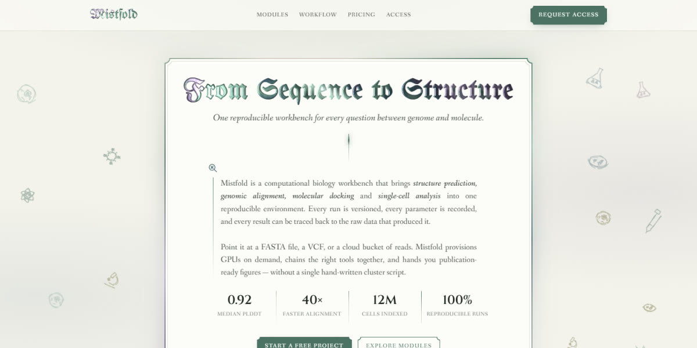</a> | **[Blackletter Biology Workbench](pages/blackletter-biology-workbench)** · <sub>Oct 15, 2026</sub><br>A computational biology platform set like an illuminated manuscript: blackletter headings lit by a WebGL shader, spinning conic frame borders, and hand-drawn lab sketches in the margins<br><sub>[Live demo](https://instalanding.ai/demos/mistfold-biology-workbench.html) · [Prompt](pages/blackletter-biology-workbench/PROMPT.md)</sub> |
| <a href="pages/led-metro-tech-storefront">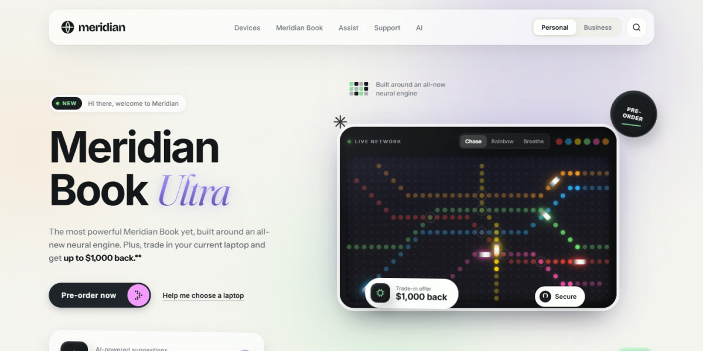</a> | **[LED Metro Tech Storefront](pages/led-metro-tech-storefront)** · <sub>Oct 15, 2026</sub><br>A big-tech devices homepage in warm clay and glass, with a live LED metro map for a hero, a Personal/Business switch that rewrites the page, and a dot-matrix ticker<br><sub>[Live demo](https://instalanding.ai/demos/meridian-led-storefront.html) · [Prompt](pages/led-metro-tech-storefront/PROMPT.md)</sub> |
| <a href="pages/hazard-terminal-security-page">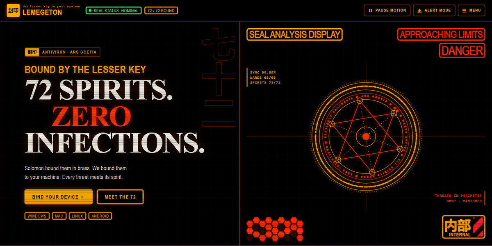</a> | **[Hazard Terminal Security Page](pages/hazard-terminal-security-page)** · <sub>Oct 14, 2026</sub><br>Antivirus as an amber hazard terminal: a spinning seal HUD, a live scan where three cores vote, and a searchable grid of 72 spirits, each guarding a threat<br><sub>[Live demo](https://instalanding.ai/demos/lemegeton-antivirus.html) · [Prompt](pages/hazard-terminal-security-page/PROMPT.md)</sub> |
| <a href="pages/retro-messenger-agent-page">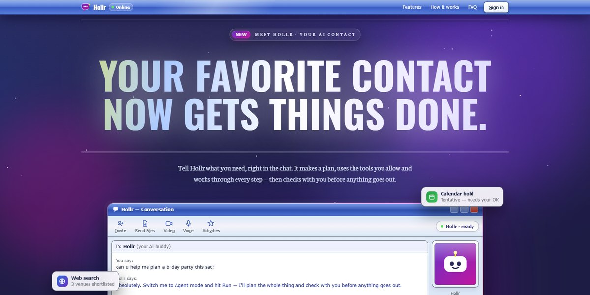</a> | **[Retro Messenger Agent Page](pages/retro-messenger-agent-page)** · <sub>Oct 13, 2026</sub><br>An AI agent pitched as your old instant-messenger buddy: a working chat window that plans and runs tasks, nudges that shake the screen, and a buddy-list footer<br><sub>[Live demo](https://instalanding.ai/demos/hollr-messenger.html) · [Prompt](pages/retro-messenger-agent-page/PROMPT.md)</sub> |
| <a href="pages/event-horizon-orbital-page">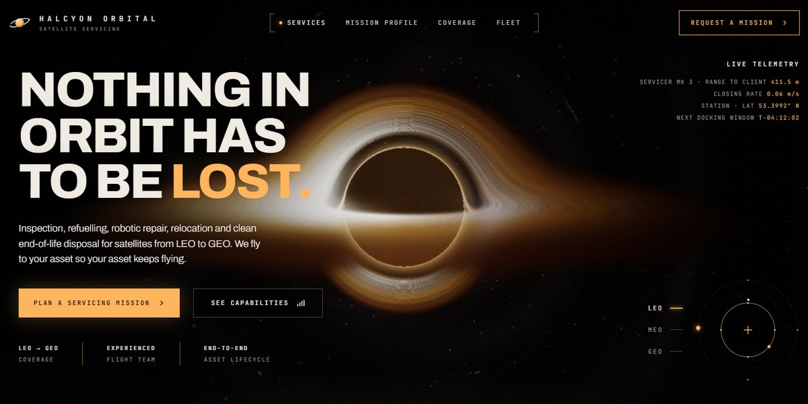</a> | **[Event Horizon Orbital Page](pages/event-horizon-orbital-page)** · <sub>Oct 13, 2026</sub><br>Satellite servicing under a ray-marched black hole you can drag to orbit, with nine live three.js mission scenes inside amber glass cards<br><sub>[Live demo](https://instalanding.ai/demos/halcyon-orbital.html) · [Prompt](pages/event-horizon-orbital-page/PROMPT.md)</sub> |
| <a href="pages/faceted-iceberg-platform-page">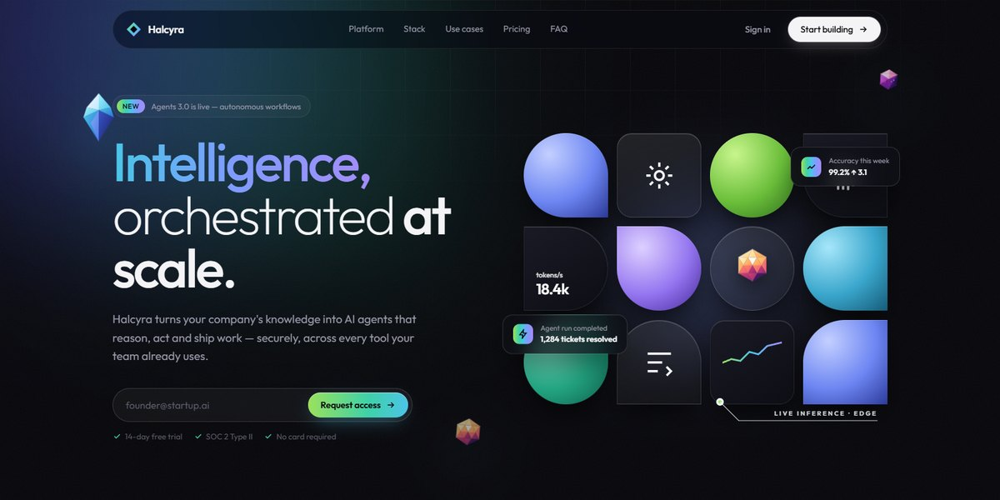</a> | **[Faceted Iceberg Platform Page](pages/faceted-iceberg-platform-page)** · <sub>Oct 13, 2026</sub><br>An AI agent platform drawn in low-poly crystal: a shape-mosaic hero, an iceberg whose waterline drops as the platform takes on the stack, and a faceted sunrise footer<br><sub>[Live demo](https://instalanding.ai/demos/halcyra-agents.html) · [Prompt](pages/faceted-iceberg-platform-page/PROMPT.md)</sub> |
<!-- NEW-DROPS:END -->

## Use a page

**Open it.** Every `pages/<name>/index.html` runs from `file://`. No install, no build step.

**Remix it.** Each file opens with a header comment written for whoever edits it next: where the
design tokens live, the sections in order, what each script drives, and what breaks when you change
it. Every top-level region carries a `data-section` attribute (`nav`, `hero`, `pricing`, `footer`, …),
so you can lift one section into your own project.

**Rebuild it in your stack.** `PROMPT.md` beside each page is the brief. Paste it into Claude Code,
Codex, Cursor, OpenCode, Lovable, v0 or any agent, and ask for the output in your framework. The
brief gives the design as numbers — hex values, radii, easing, breakpoints — and calls out the
details that usually break, which is what makes the result look designed rather than generic.

**Replace the content.** Every brand, product, number, logo and testimonial here is fictional.

## For agents

Start with [`AGENTS.md`](AGENTS.md). [`index.json`](index.json) lists every page with what it is best
for, its style, its sections in order, its stack (libraries, fonts, WebGL/canvas) and its file
paths, so an agent can choose a page without opening one. The same library is served as flat files
at [instalanding.ai/llms.txt](https://instalanding.ai/llms.txt),
[instalanding.ai/prompts.json](https://instalanding.ai/prompts.json) and
`instalanding.ai/p/<slug>.txt`.

## The pages

<!-- PAGES:START -->
| | |
| --- | --- |
| <a href="pages/blackletter-biology-workbench"></a> | **[Blackletter Biology Workbench](pages/blackletter-biology-workbench)**<br>A computational biology platform set like an illuminated manuscript: blackletter headings lit by a WebGL shader, spinning conic frame borders, and hand-drawn lab sketches in the margins<br><sub>light · editorial · blackletter · webgl</sub> |
| <a href="pages/led-metro-tech-storefront"></a> | **[LED Metro Tech Storefront](pages/led-metro-tech-storefront)**<br>A big-tech devices homepage in warm clay and glass, with a live LED metro map for a hero, a Personal/Business switch that rewrites the page, and a dot-matrix ticker<br><sub>light · claymorphism · glassmorphism · led-dot-matrix</sub> |
| <a href="pages/hazard-terminal-security-page"></a> | **[Hazard Terminal Security Page](pages/hazard-terminal-security-page)**<br>Antivirus as an amber hazard terminal: a spinning seal HUD, a live scan where three cores vote, and a searchable grid of 72 spirits, each guarding a threat<br><sub>dark · hud · terminal · amber</sub> |
| <a href="pages/retro-messenger-agent-page"></a> | **[Retro Messenger Agent Page](pages/retro-messenger-agent-page)**<br>An AI agent pitched as your old instant-messenger buddy: a working chat window that plans and runs tasks, nudges that shake the screen, and a buddy-list footer<br><sub>dark · y2k · retro-ui · skeuomorphic</sub> |
| <a href="pages/event-horizon-orbital-page"></a> | **[Event Horizon Orbital Page](pages/event-horizon-orbital-page)**<br>Satellite servicing under a ray-marched black hole you can drag to orbit, with nine live three.js mission scenes inside amber glass cards<br><sub>dark · amber · webgl · shader</sub> |
| <a href="pages/faceted-iceberg-platform-page"></a> | **[Faceted Iceberg Platform Page](pages/faceted-iceberg-platform-page)**<br>An AI agent platform drawn in low-poly crystal: a shape-mosaic hero, an iceberg whose waterline drops as the platform takes on the stack, and a faceted sunrise footer<br><sub>dark · low-poly · faceted · spectrum-gradient</sub> |
| <a href="pages/card-scanner-finance-page">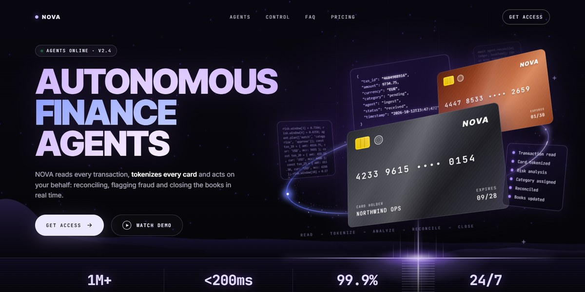</a> | **[Card Scanner Finance Page](pages/card-scanner-finance-page)**<br>Autonomous finance agents: tilted cards in an orbit ring, a scroll-pinned scanner that turns cards into code, and a live control bento<br><sub>dark · violet · glassmorphism · scroll-pinned</sub> |
| <a href="pages/paper-sun-agent-page"></a> | **[Paper Sun Agent Page](pages/paper-sun-agent-page)**<br>AI agents for the night shift: a paper-cut sunset panel you can slap stickers on, a dusk-to-daybreak arc, and a run log that stops to ask<br><sub>dark · night · sunset-gradient · paper-cut</sub> |
| <a href="pages/tide-reveal-agent-page">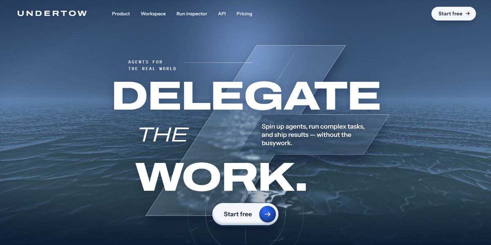</a> | **[Tide Reveal Agent Page](pages/tide-reveal-agent-page)**<br>An AI agent platform over a live WebGL sea that, on scroll, ebbs into a terminal window, then a clickable workspace and a run trace<br><sub>dark · navy · webgl · shader</sub> |
| <a href="pages/manga-panel-dev-tool-page">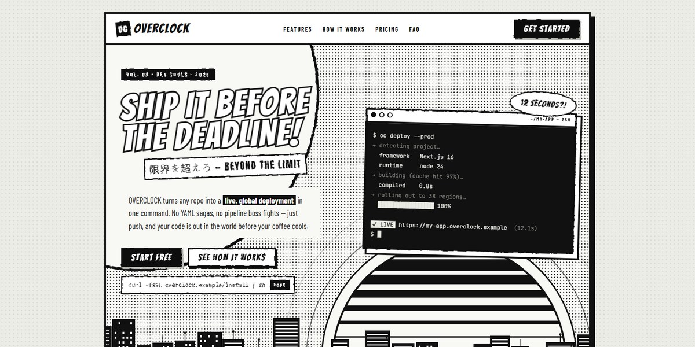</a> | **[Manga Panel Dev Tool Page](pages/manga-panel-dev-tool-page)**<br>A deploy CLI pitched as a black-and-white manga issue: a sliced retro sun over a city skyline, a typing terminal, three villains defeated and a reader-mail FAQ<br><sub>light · black-and-white · manga · comic</sub> |
| <a href="pages/ghost-agent-landing-page">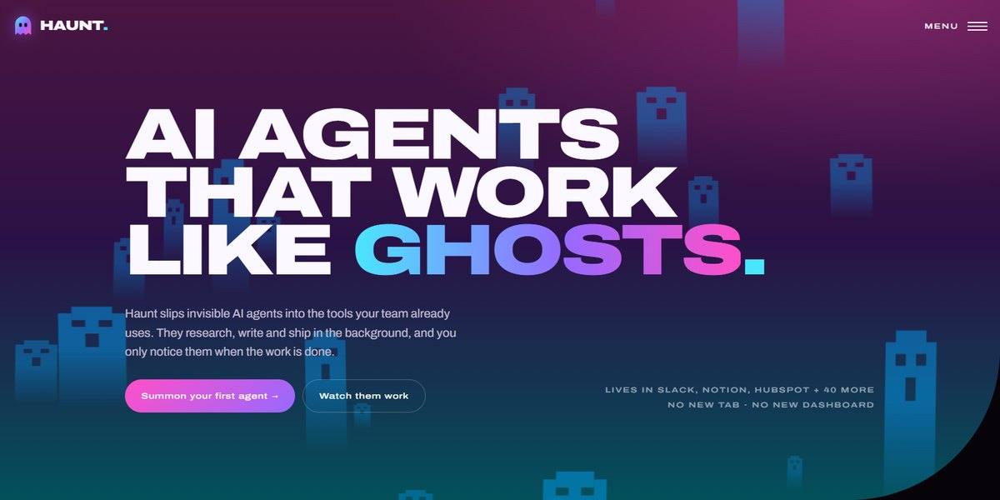</a> | **[Ghost Agent Landing Page](pages/ghost-agent-landing-page)**<br>Invisible AI agents pitched as ghosts: pixel ghosts float up a curved hero, and three SVG ghosts clear a 100-task board live<br><sub>dark · neon-gradient · playful · pixel-art</sub> |
| <a href="pages/sunset-scroll-story-page">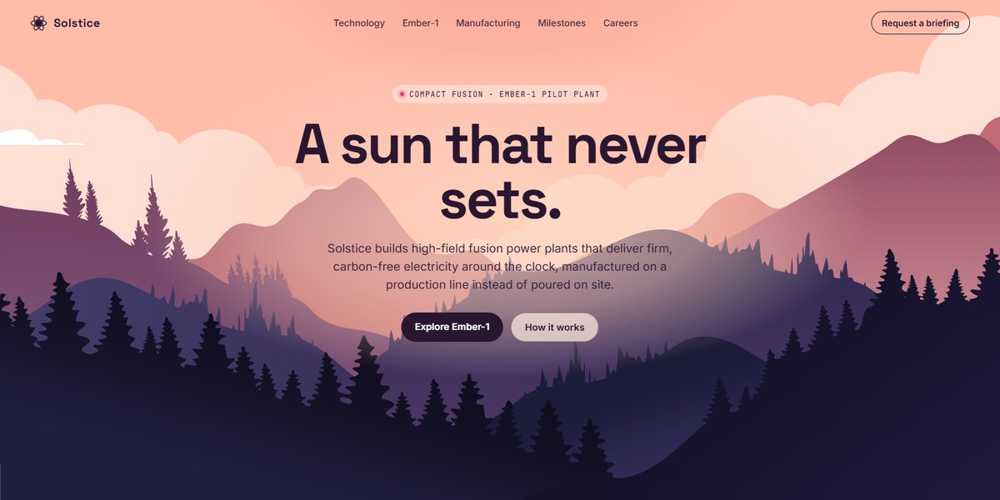</a> | **[Sunset Scroll Story Page](pages/sunset-scroll-story-page)**<br>A fusion company told as one long sunset: scroll and the sun goes down over a layered SVG landscape, night falls, then a live canvas tokamak takes over<br><sub>light · illustrated · parallax · scroll-driven</sub> |
| <a href="pages/radiating-rings-hero-page">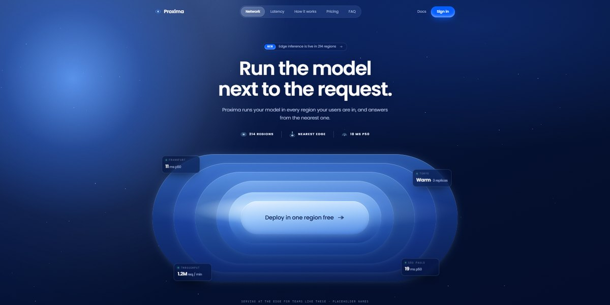</a> | **[Radiating Rings Hero Page](pages/radiating-rings-hero-page)**<br>Concentric stadium rings radiating out of the call to action, under a streaked orb, with glass readouts floating in the gaps<br><sub>dark · blue · glassmorphism · concentric-rings</sub> |
| <a href="pages/highlighter-markup-page"></a> | **[Highlighter Markup Page](pages/highlighter-markup-page)**<br>A marked-up document: every highlight is a real highlighter, rough-edged by an SVG displacement filter, with a colour per verdict<br><sub>light · editorial · paper · serif</sub> |
| <a href="pages/recessed-aperture-hero-page">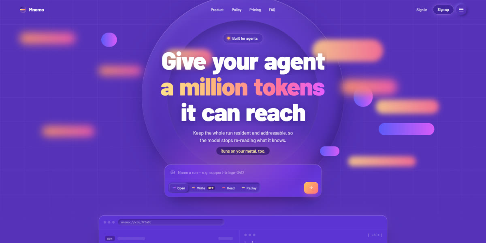</a> | **[Recessed Aperture Hero Page](pages/recessed-aperture-hero-page)**<br>Soft UI in a violet palette: an aperture sunk into the page, tokens drifting across it, and a working run dial below<br><sub>dark · purple · neumorphic · soft-ui</sub> |
| <a href="pages/stage-light-launch-page"></a> | **[Stage Light Launch Page](pages/stage-light-launch-page)**<br>A product announcement lit like a stage: conic spotlights, rising dust, a hairline grid and a light sweep running through the wordmark<br><sub>dark · theatrical · spotlight · conic-gradients</sub> |
| <a href="pages/machine-front-panel-page"></a> | **[Machine Front Panel Page](pages/machine-front-panel-page)**<br>The landing page is the front panel: it boots itself on load, runs a needle self-test, then hands the switches to you<br><sub>dark · industrial · skeuomorphic · monospace</sub> |
| <a href="pages/neon-glass-app-landing-page"></a> | **[Neon Glass App Landing Page](pages/neon-glass-app-landing-page)**<br>Frosted panels lit by a comet that races their border, and a chat bar that opens into a breathing voice orb<br><sub>dark · glassmorphism · neon · blue</sub> |
| <a href="pages/grain-motion-system-page"></a> | **[Grain Motion System Page](pages/grain-motion-system-page)**<br>An autumn lake painted in pure CSS, die-cut sticker type, and a live agent run that stops for a human checkpoint<br><sub>light · illustrated · css-art · sticker</sub> |
| <a href="pages/icon-cut-card-stack-page"></a> | **[Icon-Cut Card Stack Page](pages/icon-cut-card-stack-page)**<br>Glass cards with their icon punched clean through, on gradient throughlines that travel as you scroll<br><sub>dark · monospace · spectrum-gradient · scroll-driven</sub> |
| <a href="pages/holographic-ticket-landing-page"></a> | **[Holographic Ticket Landing Page](pages/holographic-ticket-landing-page)**<br>A WebGL agent swarm you can shove out of the way, and die-cut holographic tickets masked out of one conic gradient<br><sub>light · pastel · holographic · webgl</sub> |
| <a href="pages/notched-panel-catalog-page"></a> | **[Notched Panel Catalog Page](pages/notched-panel-catalog-page)**<br>Interlocking cobalt panels, moulded-plastic controls, model cards with CSS benchmark plates<br><sub>light · poster · cobalt-yellow · notched-panels</sub> |
| <a href="pages/squircle-keycap-product-page"></a> | **[Squircle Keycap Product Page](pages/squircle-keycap-product-page)**<br>Generated SVG keycaps inside a neo-brutalist bento shell, with a hero key that runs a live runbook<br><sub>light · neo-brutalist · bento · isometric</sub> |
| <a href="pages/generative-editorial-product-page"></a> | **[Generative Editorial Product Page](pages/generative-editorial-product-page)**<br>Fashion-editorial layout for an AI product, every image a gooey generative composition<br><sub>light · editorial · generative-art · gooey</sub> |
| <a href="pages/wind-field-routing-page"></a> | **[Wind Field Routing Page](pages/wind-field-routing-page)**<br>Live WebGL wind field hero, six pressure presets, broken-frame buttons and cards<br><sub>dark · webgl · data-viz · editorial</sub> |
| <a href="pages/clay-constellation-saas-hero"></a> | **[Clay Constellation SaaS Hero](pages/clay-constellation-saas-hero)**<br>A tilted live chat demo in a cloud of clay stat cards, pixel-type accents, and buttons that measure themselves<br><sub>light · clay · warm-paper · pixel-type</sub> |
| <a href="pages/smartcare-clinical-ai-landing-page">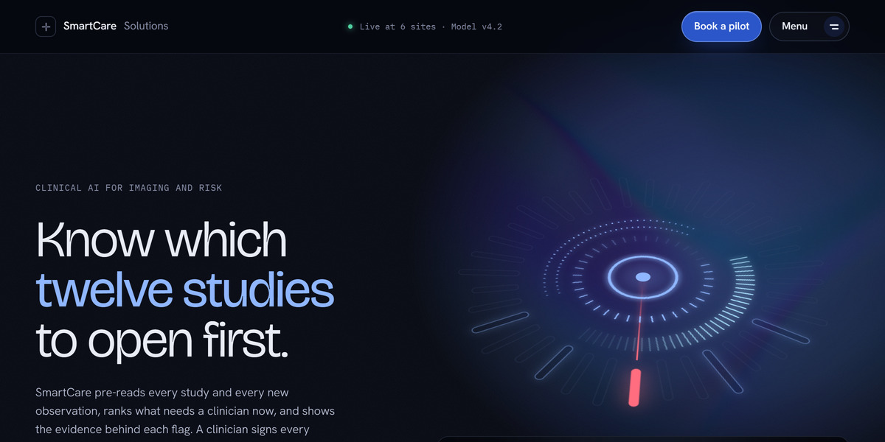</a> | **[SmartCare Clinical AI Landing Page](pages/smartcare-clinical-ai-landing-page)**<br>Iridescence shader hero + CSS power switch: one light source for buttons, cards and charts<br><sub>dark · clinical · webgl · iridescent</sub> |
| <a href="pages/craft-studio-webgl-landing-page"></a> | **[CRAFT Studio WebGL Landing Page](pages/craft-studio-webgl-landing-page)**<br>Glass torus knot refracting giant type, scroll-lit statement, Swiss monochrome AI platform site<br><sub>light · swiss · monochrome · webgl</sub> |
| <a href="pages/canvas-fire-button"></a> | **[Canvas Fire Button](pages/canvas-fire-button)**<br>Procedural canvas flame toggle with embers, hold-to-supercharge and a live playground<br><sub>dark · canvas · particles · glass</sub> |
| <a href="pages/monax-analytics-landing-page">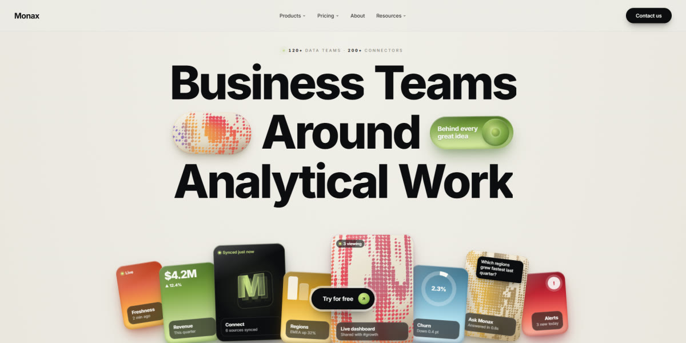</a> | **[Monax Analytics Landing Page](pages/monax-analytics-landing-page)**<br>Dithered WebGL halftone panels, glossy 3D orbs, tabbed product demo, bento + pricing<br><sub>light · warm-paper · 3d-orbs · webgl</sub> |
| <a href="pages/clay-saas-platform-page"></a> | **[Clay SaaS Platform Page](pages/clay-saas-platform-page)**<br>Liquid-glass agent platform with a three-theme switcher, dark terminal cards and circuit-trace module graphics<br><sub>light · clay · neumorphic · soft-ui</sub> |
| <a href="pages/skewed-marquee-wall"></a> | **[Skewed Marquee Wall](pages/skewed-marquee-wall)**<br>Skewed marquee lanes of agent runs behind a working run console, with approval gates and a fleet kill switch<br><sub>dark · industrial · pixel-type · marquee</sub> |
<!-- PAGES:END -->

## Repo layout

```
pages/<slug>/
  index.html    the page: one file, every asset inlined, opens from disk
  PROMPT.md     the one-shot brief it was built from
  README.md     what it is for, its style, sections, stack, and credits
  preview.jpg   1200x600 screenshot
index.json      every page's metadata, for agents and scripts
AGENTS.md       how an agent should use this repo
```

## Credits

Some pages are built around someone else's work — a CodePen, a Uiverse button, a Rive marketplace
file. Each of those pages credits its source in its own README (under **Built on**) and in the page
itself. Keep that attribution if you redistribute the component; the original's own terms apply to
the parts taken from it.

## License

[MIT](LICENSE). Use the pages and prompts in personal and commercial work, change them, ship them.

---

Made by [Ray Velez](https://instalanding.ai/about) ·
[X](https://x.com/pascowebdesigns) ·
[LinkedIn](https://www.linkedin.com/in/raymond-velez-96aa4a172/)
