<p align="center">
  <a href="https://instalanding.ai"></a>
</p>

# InstaLanding.ai

**Premium pages built for humans and agents. One file. No dependencies. Copy it, remix it, ship it.**

Every page in this repo is a complete landing page in a single HTML file — CSS, JavaScript, SVG art
and images all inline — that opens straight from disk. Nothing to install and no build step: fonts
come from Google Fonts, and a few pages load GSAP or Three.js from a CDN. Next to each one is the
**one-shot prompt** it was built from: a brief detailed enough that an AI builder or coding agent
produces the page in one pass.

Alongside the pages are **design systems**: the visual language behind a page, pulled out of it so
you (or your agent) can build more in that style — design tokens as CSS custom properties, the
page's own components scoped so they can't clash with yours, and the conventions that hold them
together. See [Design systems](#design-systems).
<!-- SYSTEMS-INTRO -->

And now **motion**: studies of one movement each — a carousel, an accordion, an endless loop, a scroll
parallax, petals on the wind, water that rises into words — as a
single HTML file, with the choreography written out (what moves, when, on which ease), the inputs
that drive it, and the one-shot prompt that builds it. See [Motion](#motion).
<!-- MOTION-INTRO -->

Browse them live at **[instalanding.ai/pages](https://instalanding.ai/pages)**, **[instalanding.ai/systems](https://instalanding.ai/systems)** and **[instalanding.ai/motion](https://instalanding.ai/motion)**.

## New drops

<!-- NEW-DROPS:START -->
**Updated Oct 18, 2026 · 41 pages.** New pages land here first. Every page is listed under [The pages](#the-pages).

<table>
<tr><td width="260"><a href="pages/kestrel-ai-finance-landing-page">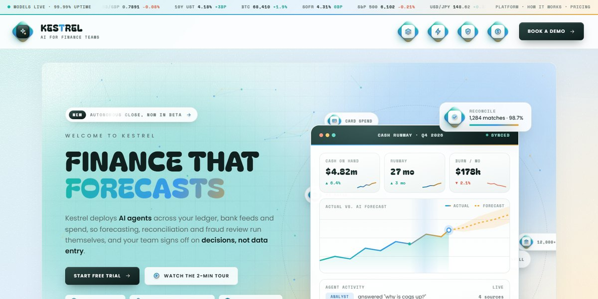</a></td><td><b><a href="pages/kestrel-ai-finance-landing-page">Kestrel AI Finance Landing Page</a></b> · <sub>Oct 18, 2026</sub><br>A bright fintech page for an AI finance platform: a 3D-tilting cash-runway dashboard with a self-drawing forecast chart and a live agent feed, orbiting integration chips, glossy diamond icon tiles, product rows with dark live panels, hover-flip agent cards and a demo booking widget<br><sub><a href="https://instalanding.ai/demos/kestrel-finance.html">Live demo</a> · <a href="pages/kestrel-ai-finance-landing-page/PROMPT.md">Prompt</a></sub></td></tr>
<tr><td width="260"><a href="pages/facetry-security-landing-page">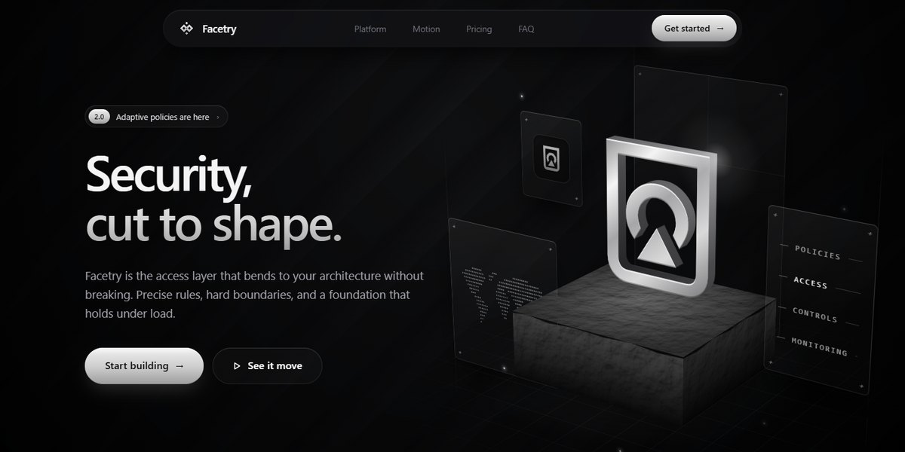</a></td><td><b><a href="pages/facetry-security-landing-page">Facetry Security Landing Page</a></b> · <sub>Oct 18, 2026</sub><br>A black-and-chrome security platform page: an extruded metal logo on a rough stone pedestal in a CSS 3D scene, spring-morphing between three shapes, glass panels floating around it, a live spring tuner, and a footer with live region clocks<br><sub><a href="https://instalanding.ai/demos/facetry-security.html">Live demo</a> · <a href="pages/facetry-security-landing-page/PROMPT.md">Prompt</a></sub></td></tr>
<tr><td width="260"><a href="pages/cyber-bird-arcade-game-page"></a></td><td><b><a href="pages/cyber-bird-arcade-game-page">Cyber Bird Arcade Game Page</a></b> · <sub>Oct 18, 2026</sub><br>A pixel-art arcade game launch page with the game playable right in the hero: a one-button flyer threading an armored cyber-pickup through stainless rocket stacks, night, dawn and day skies drawn by code, difficulty presets and a local mission log<br><sub><a href="https://instalanding.ai/demos/cyber-bird-arcade.html">Live demo</a> · <a href="pages/cyber-bird-arcade-game-page/PROMPT.md">Prompt</a></sub></td></tr>
<tr><td width="260"><a href="pages/starfork-game-studio-landing-page">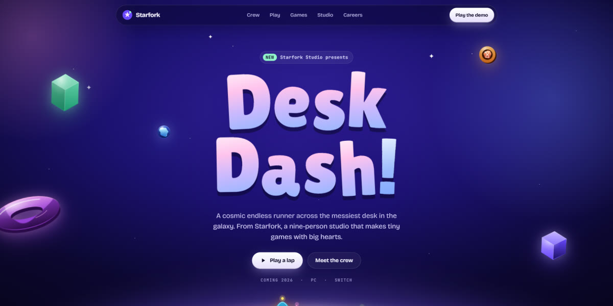</a></td><td><b><a href="pages/starfork-game-studio-landing-page">Starfork Game Studio Landing Page</a></b> · <sub>Oct 17, 2026</sub><br>A premium indie game studio page set in a cosmic toy world: eight sprite-rigged characters with real animation poses standing on a glowing planet, a character select with pose and frame-rate controls, a playable 30-second endless runner with coins and fireworks, live game cards, and a careers quiz<br><sub><a href="https://instalanding.ai/demos/starfork-studio.html">Live demo</a> · <a href="pages/starfork-game-studio-landing-page/PROMPT.md">Prompt</a></sub></td></tr>
<tr><td width="260"><a href="pages/social-work-agent-swarm-landing-page">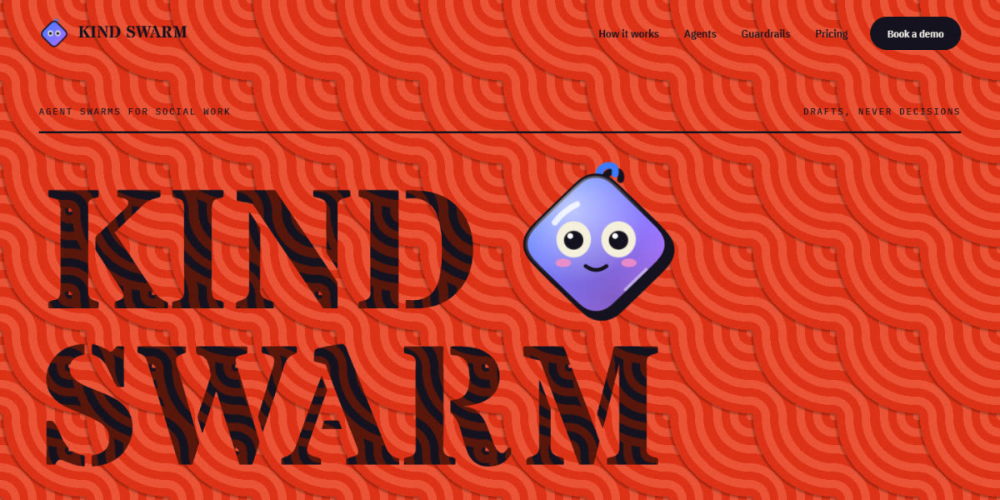</a></td><td><b><a href="pages/social-work-agent-swarm-landing-page">Social Work Agent Swarm Landing Page</a></b> · <sub>Oct 17, 2026</sub><br>A loud neo-brutalist page for a swarm of AI agents that help social workers: huge stencil type over op-art ring patterns, animoji characters whose eyes follow the cursor, a filterable crew of eight agent cards, an approval queue, guardrails and pricing<br><sub><a href="https://instalanding.ai/demos/kindswarm-casework.html">Live demo</a> · <a href="pages/social-work-agent-swarm-landing-page/PROMPT.md">Prompt</a></sub></td></tr>
<tr><td width="260"><a href="pages/game-dev-agent-landing-page">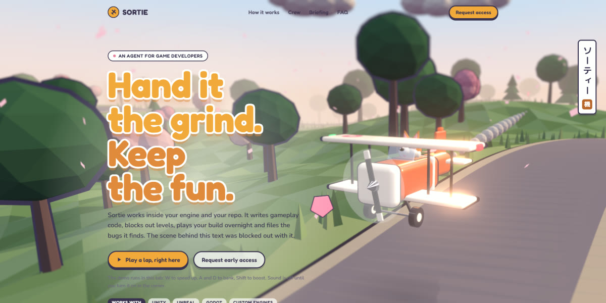</a></td><td><b><a href="pages/game-dev-agent-landing-page">Game Dev Agent Landing Page</a></b> · <sub>Oct 17, 2026</sub><br>An AI agent for game studios whose hero is a playable three.js diorama: a toy biplane with a corgi pilot flying a low-poly cherry-blossom road under bloom and tilt-shift, a full-page loader, a crew picker that repaints the plane live, in-engine card stills and generated sound<br><sub><a href="https://instalanding.ai/demos/sortie-game-agent.html">Live demo</a> · <a href="pages/game-dev-agent-landing-page/PROMPT.md">Prompt</a></sub></td></tr>
</table>
<!-- NEW-DROPS:END -->

## Use a page

**Open it.** Every `pages/<name>/index.html` runs from `file://`. No install, no build step.

**Remix it.** Each file opens with a header comment written for whoever edits it next: where the
design tokens live, the sections in order, what each script drives, and what breaks when you change
it. Every top-level region carries a `data-section` attribute (`nav`, `hero`, `pricing`, `footer`, …),
so you can lift one section into your own project.

**Rebuild it in your stack.** `PROMPT.md` beside each page is the brief. Paste it into Claude Code,
Codex, Cursor, OpenCode, Lovable, v0 or any agent, and ask for the output in your framework. The
brief gives the design as numbers — hex values, radii, easing, breakpoints — and calls out the
details that usually break, which is what makes the result look designed rather than generic.

**Replace the content.** Every brand, product, number, logo and testimonial here is fictional.

## For agents

Start with [`AGENTS.md`](AGENTS.md). [`index.json`](index.json) lists every page with what it is best
for, its style, its sections in order, its stack (libraries, fonts, WebGL/canvas) and its file
paths, so an agent can choose a page without opening one. The same library is served as flat files
at [instalanding.ai/llms.txt](https://instalanding.ai/llms.txt),
[instalanding.ai/prompts.json](https://instalanding.ai/prompts.json) and
`instalanding.ai/p/<slug>.txt`.

## The pages

<!-- PAGES:START -->
<table>
<tr><td width="260"><a href="pages/kestrel-ai-finance-landing-page"></a></td><td><b><a href="pages/kestrel-ai-finance-landing-page">Kestrel AI Finance Landing Page</a></b><br>A bright fintech page for an AI finance platform: a 3D-tilting cash-runway dashboard with a self-drawing forecast chart and a live agent feed, orbiting integration chips, glossy diamond icon tiles, product rows with dark live panels, hover-flip agent cards and a demo booking widget<br><sub>light · fintech · glassmorphism · 3d-tilt</sub></td></tr>
<tr><td width="260"><a href="pages/facetry-security-landing-page"></a></td><td><b><a href="pages/facetry-security-landing-page">Facetry Security Landing Page</a></b><br>A black-and-chrome security platform page: an extruded metal logo on a rough stone pedestal in a CSS 3D scene, spring-morphing between three shapes, glass panels floating around it, a live spring tuner, and a footer with live region clocks<br><sub>dark · chrome · css-3d · monochrome</sub></td></tr>
<tr><td width="260"><a href="pages/cyber-bird-arcade-game-page"></a></td><td><b><a href="pages/cyber-bird-arcade-game-page">Cyber Bird Arcade Game Page</a></b><br>A pixel-art arcade game launch page with the game playable right in the hero: a one-button flyer threading an armored cyber-pickup through stainless rocket stacks, night, dawn and day skies drawn by code, difficulty presets and a local mission log<br><sub>dark · pixel-art · retro · playable-game</sub></td></tr>
<tr><td width="260"><a href="pages/starfork-game-studio-landing-page"></a></td><td><b><a href="pages/starfork-game-studio-landing-page">Starfork Game Studio Landing Page</a></b><br>A premium indie game studio page set in a cosmic toy world: eight sprite-rigged characters with real animation poses standing on a glowing planet, a character select with pose and frame-rate controls, a playable 30-second endless runner with coins and fireworks, live game cards, and a careers quiz<br><sub>dark · playful · cosmic · characters</sub></td></tr>
<tr><td width="260"><a href="pages/social-work-agent-swarm-landing-page"></a></td><td><b><a href="pages/social-work-agent-swarm-landing-page">Social Work Agent Swarm Landing Page</a></b><br>A loud neo-brutalist page for a swarm of AI agents that help social workers: huge stencil type over op-art ring patterns, animoji characters whose eyes follow the cursor, a filterable crew of eight agent cards, an approval queue, guardrails and pricing<br><sub>bold · playful · neo-brutalist · stencil-type</sub></td></tr>
<tr><td width="260"><a href="pages/game-dev-agent-landing-page"></a></td><td><b><a href="pages/game-dev-agent-landing-page">Game Dev Agent Landing Page</a></b><br>An AI agent for game studios whose hero is a playable three.js diorama: a toy biplane with a corgi pilot flying a low-poly cherry-blossom road under bloom and tilt-shift, a full-page loader, a crew picker that repaints the plane live, in-engine card stills and generated sound<br><sub>light · playful · three.js · low-poly</sub></td></tr>
<tr><td width="260"><a href="pages/peptide-skincare-store-landing-page">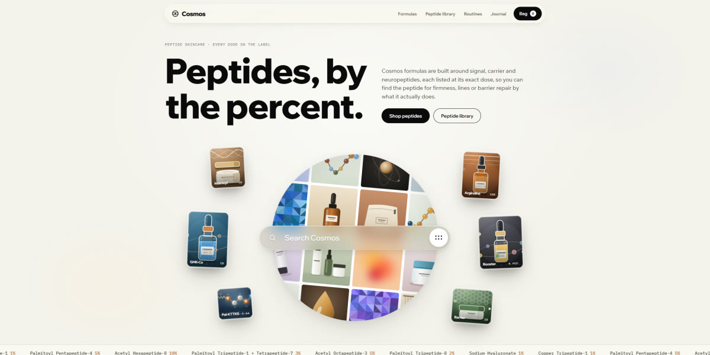</a></td><td><b><a href="pages/peptide-skincare-store-landing-page">Peptide Skincare Store Landing Page</a></b><br>A warm, cream-toned peptide skincare store whose hero is a spinning sphere of code-drawn product tiles behind a glass search bar that types its own queries, with springy lab-style product renders, a draggable Dose lab vial, bubble-popping add-to-bag and a day-to-night routine<br><sub>light · warm · premium · glassmorphism</sub></td></tr>
<tr><td width="260"><a href="pages/ai-work-assistant-chat-landing-page">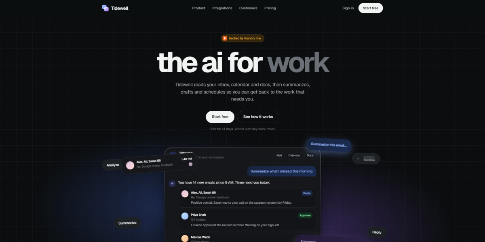</a></td><td><b><a href="pages/ai-work-assistant-chat-landing-page">AI Work Assistant Chat Landing Page</a></b><br>A soft pastel AI-assistant launch page whose hero is a working chat: it types its own first question, streams answers with thread cards, drafts and calendar slots, and is ringed by agent badges that spin, tick and fail on their own<br><sub>light · minimal · pastel · chat-ui</sub></td></tr>
<tr><td width="260"><a href="pages/maasai-inspired-event-landing-page"></a></td><td><b><a href="pages/maasai-inspired-event-landing-page">Maasai-Inspired Event Landing Page</a></b><br>A cultural events studio page on Maasai-inspired dusk: a Rive hero rebuilt in SVG where four warriors leap into the adumu, a scroll-driven frieze of leaping silhouettes, generated beadwork and gala art, and textures cut from the warriors' own shapes<br><sub>light · warm · editorial · illustrated</sub></td></tr>
<tr><td width="260"><a href="pages/blackletter-biology-workbench"></a></td><td><b><a href="pages/blackletter-biology-workbench">Blackletter Biology Workbench</a></b><br>A computational biology platform set like an illuminated manuscript: blackletter headings lit by a WebGL shader, spinning conic frame borders, and hand-drawn lab sketches in the margins<br><sub>light · editorial · blackletter · webgl</sub></td></tr>
<tr><td width="260"><a href="pages/led-metro-tech-storefront"></a></td><td><b><a href="pages/led-metro-tech-storefront">LED Metro Tech Storefront</a></b><br>A big-tech devices homepage in warm clay and glass, with a live LED metro map for a hero, a Personal/Business switch that rewrites the page, and a dot-matrix ticker<br><sub>light · claymorphism · glassmorphism · led-dot-matrix</sub></td></tr>
<tr><td width="260"><a href="pages/hazard-terminal-security-page"></a></td><td><b><a href="pages/hazard-terminal-security-page">Hazard Terminal Security Page</a></b><br>Antivirus as an amber hazard terminal: a spinning seal HUD, a live scan where three cores vote, and a searchable grid of 72 spirits, each guarding a threat<br><sub>dark · hud · terminal · amber</sub></td></tr>
<tr><td width="260"><a href="pages/retro-messenger-agent-page"></a></td><td><b><a href="pages/retro-messenger-agent-page">Retro Messenger Agent Page</a></b><br>An AI agent pitched as your old instant-messenger buddy: a working chat window that plans and runs tasks, nudges that shake the screen, and a buddy-list footer<br><sub>dark · y2k · retro-ui · skeuomorphic</sub></td></tr>
<tr><td width="260"><a href="pages/event-horizon-orbital-page"></a></td><td><b><a href="pages/event-horizon-orbital-page">Event Horizon Orbital Page</a></b><br>Satellite servicing under a ray-marched black hole you can drag to orbit, with nine live three.js mission scenes inside amber glass cards<br><sub>dark · amber · webgl · shader</sub></td></tr>
<tr><td width="260"><a href="pages/faceted-iceberg-platform-page"></a></td><td><b><a href="pages/faceted-iceberg-platform-page">Faceted Iceberg Platform Page</a></b><br>An AI agent platform drawn in low-poly crystal: a shape-mosaic hero, an iceberg whose waterline drops as the platform takes on the stack, and a faceted sunrise footer<br><sub>dark · low-poly · faceted · spectrum-gradient</sub></td></tr>
<tr><td width="260"><a href="pages/card-scanner-finance-page"></a></td><td><b><a href="pages/card-scanner-finance-page">Card Scanner Finance Page</a></b><br>Autonomous finance agents: tilted cards in an orbit ring, a scroll-pinned scanner that turns cards into code, and a live control bento<br><sub>dark · violet · glassmorphism · scroll-pinned</sub></td></tr>
<tr><td width="260"><a href="pages/paper-sun-agent-page"></a></td><td><b><a href="pages/paper-sun-agent-page">Paper Sun Agent Page</a></b><br>AI agents for the night shift: a paper-cut sunset panel you can slap stickers on, a dusk-to-daybreak arc, and a run log that stops to ask<br><sub>dark · night · sunset-gradient · paper-cut</sub></td></tr>
<tr><td width="260"><a href="pages/tide-reveal-agent-page"></a></td><td><b><a href="pages/tide-reveal-agent-page">Tide Reveal Agent Page</a></b><br>An AI agent platform over a live WebGL sea that, on scroll, ebbs into a terminal window, then a clickable workspace and a run trace<br><sub>dark · navy · webgl · shader</sub></td></tr>
<tr><td width="260"><a href="pages/manga-panel-dev-tool-page"></a></td><td><b><a href="pages/manga-panel-dev-tool-page">Manga Panel Dev Tool Page</a></b><br>A deploy CLI pitched as a black-and-white manga issue: a sliced retro sun over a city skyline, a typing terminal, three villains defeated and a reader-mail FAQ<br><sub>light · black-and-white · manga · comic</sub></td></tr>
<tr><td width="260"><a href="pages/ghost-agent-landing-page"></a></td><td><b><a href="pages/ghost-agent-landing-page">Ghost Agent Landing Page</a></b><br>Invisible AI agents pitched as ghosts: pixel ghosts float up a curved hero, and three SVG ghosts clear a 100-task board live<br><sub>dark · neon-gradient · playful · pixel-art</sub></td></tr>
<tr><td width="260"><a href="pages/sunset-scroll-story-page"></a></td><td><b><a href="pages/sunset-scroll-story-page">Sunset Scroll Story Page</a></b><br>A fusion company told as one long sunset: scroll and the sun goes down over a layered SVG landscape, night falls, then a live canvas tokamak takes over<br><sub>light · illustrated · parallax · scroll-driven</sub></td></tr>
<tr><td width="260"><a href="pages/radiating-rings-hero-page"></a></td><td><b><a href="pages/radiating-rings-hero-page">Radiating Rings Hero Page</a></b><br>Concentric stadium rings radiating out of the call to action, under a streaked orb, with glass readouts floating in the gaps<br><sub>dark · blue · glassmorphism · concentric-rings</sub></td></tr>
<tr><td width="260"><a href="pages/highlighter-markup-page"></a></td><td><b><a href="pages/highlighter-markup-page">Highlighter Markup Page</a></b><br>A marked-up document: every highlight is a real highlighter, rough-edged by an SVG displacement filter, with a colour per verdict<br><sub>light · editorial · paper · serif</sub></td></tr>
<tr><td width="260"><a href="pages/recessed-aperture-hero-page"></a></td><td><b><a href="pages/recessed-aperture-hero-page">Recessed Aperture Hero Page</a></b><br>Soft UI in a violet palette: an aperture sunk into the page, tokens drifting across it, and a working run dial below<br><sub>dark · purple · neumorphic · soft-ui</sub></td></tr>
<tr><td width="260"><a href="pages/stage-light-launch-page"></a></td><td><b><a href="pages/stage-light-launch-page">Stage Light Launch Page</a></b><br>A product announcement lit like a stage: conic spotlights, rising dust, a hairline grid and a light sweep running through the wordmark<br><sub>dark · theatrical · spotlight · conic-gradients</sub></td></tr>
<tr><td width="260"><a href="pages/machine-front-panel-page"></a></td><td><b><a href="pages/machine-front-panel-page">Machine Front Panel Page</a></b><br>The landing page is the front panel: it boots itself on load, runs a needle self-test, then hands the switches to you<br><sub>dark · industrial · skeuomorphic · monospace</sub></td></tr>
<tr><td width="260"><a href="pages/neon-glass-app-landing-page"></a></td><td><b><a href="pages/neon-glass-app-landing-page">Neon Glass App Landing Page</a></b><br>Frosted panels lit by a comet that races their border, and a chat bar that opens into a breathing voice orb<br><sub>dark · glassmorphism · neon · blue</sub></td></tr>
<tr><td width="260"><a href="pages/grain-motion-system-page"></a></td><td><b><a href="pages/grain-motion-system-page">Grain Motion System Page</a></b><br>An autumn lake painted in pure CSS, die-cut sticker type, and a live agent run that stops for a human checkpoint<br><sub>light · illustrated · css-art · sticker</sub></td></tr>
<tr><td width="260"><a href="pages/icon-cut-card-stack-page"></a></td><td><b><a href="pages/icon-cut-card-stack-page">Icon-Cut Card Stack Page</a></b><br>Glass cards with their icon punched clean through, on gradient throughlines that travel as you scroll<br><sub>dark · monospace · spectrum-gradient · scroll-driven</sub></td></tr>
<tr><td width="260"><a href="pages/holographic-ticket-landing-page"></a></td><td><b><a href="pages/holographic-ticket-landing-page">Holographic Ticket Landing Page</a></b><br>A WebGL agent swarm you can shove out of the way, and die-cut holographic tickets masked out of one conic gradient<br><sub>light · pastel · holographic · webgl</sub></td></tr>
<tr><td width="260"><a href="pages/notched-panel-catalog-page"></a></td><td><b><a href="pages/notched-panel-catalog-page">Notched Panel Catalog Page</a></b><br>Interlocking cobalt panels, moulded-plastic controls, model cards with CSS benchmark plates<br><sub>light · poster · cobalt-yellow · notched-panels</sub></td></tr>
<tr><td width="260"><a href="pages/squircle-keycap-product-page"></a></td><td><b><a href="pages/squircle-keycap-product-page">Squircle Keycap Product Page</a></b><br>Generated SVG keycaps inside a neo-brutalist bento shell, with a hero key that runs a live runbook<br><sub>light · neo-brutalist · bento · isometric</sub></td></tr>
<tr><td width="260"><a href="pages/generative-editorial-product-page"></a></td><td><b><a href="pages/generative-editorial-product-page">Generative Editorial Product Page</a></b><br>Fashion-editorial layout for an AI product, every image a gooey generative composition<br><sub>light · editorial · generative-art · gooey</sub></td></tr>
<tr><td width="260"><a href="pages/wind-field-routing-page"></a></td><td><b><a href="pages/wind-field-routing-page">Wind Field Routing Page</a></b><br>Live WebGL wind field hero, six pressure presets, broken-frame buttons and cards<br><sub>dark · webgl · data-viz · editorial</sub></td></tr>
<tr><td width="260"><a href="pages/clay-constellation-saas-hero"></a></td><td><b><a href="pages/clay-constellation-saas-hero">Clay Constellation SaaS Hero</a></b><br>A tilted live chat demo in a cloud of clay stat cards, pixel-type accents, and buttons that measure themselves<br><sub>light · clay · warm-paper · pixel-type</sub></td></tr>
<tr><td width="260"><a href="pages/smartcare-clinical-ai-landing-page"></a></td><td><b><a href="pages/smartcare-clinical-ai-landing-page">SmartCare Clinical AI Landing Page</a></b><br>Iridescence shader hero + CSS power switch: one light source for buttons, cards and charts<br><sub>dark · clinical · webgl · iridescent</sub></td></tr>
<tr><td width="260"><a href="pages/craft-studio-webgl-landing-page"></a></td><td><b><a href="pages/craft-studio-webgl-landing-page">CRAFT Studio WebGL Landing Page</a></b><br>Glass torus knot refracting giant type, scroll-lit statement, Swiss monochrome AI platform site<br><sub>light · swiss · monochrome · webgl</sub></td></tr>
<tr><td width="260"><a href="pages/canvas-fire-button"></a></td><td><b><a href="pages/canvas-fire-button">Canvas Fire Button</a></b><br>Procedural canvas flame toggle with embers, hold-to-supercharge and a live playground<br><sub>dark · canvas · particles · glass</sub></td></tr>
<tr><td width="260"><a href="pages/monax-analytics-landing-page"></a></td><td><b><a href="pages/monax-analytics-landing-page">Monax Analytics Landing Page</a></b><br>Dithered WebGL halftone panels, glossy 3D orbs, tabbed product demo, bento + pricing<br><sub>light · warm-paper · 3d-orbs · webgl</sub></td></tr>
<tr><td width="260"><a href="pages/clay-saas-platform-page"></a></td><td><b><a href="pages/clay-saas-platform-page">Clay SaaS Platform Page</a></b><br>Liquid-glass agent platform with a three-theme switcher, dark terminal cards and circuit-trace module graphics<br><sub>light · clay · neumorphic · soft-ui</sub></td></tr>
<tr><td width="260"><a href="pages/skewed-marquee-wall"></a></td><td><b><a href="pages/skewed-marquee-wall">Skewed Marquee Wall</a></b><br>Skewed marquee lanes of agent runs behind a working run console, with approval gates and a fleet kill switch<br><sub>dark · industrial · pixel-type · marquee</sub></td></tr>
</table>
<!-- PAGES:END -->

## Design systems

<!-- SYSTEMS:START -->
Each system is extracted from one of the pages above. Open `specimen.html` to see every component,
link the system's CSS to use it, or explore it live with a token playground at
[instalanding.ai/systems](https://instalanding.ai/systems).

<table>
<tr><td width="260"><a href="systems/kind-swarm">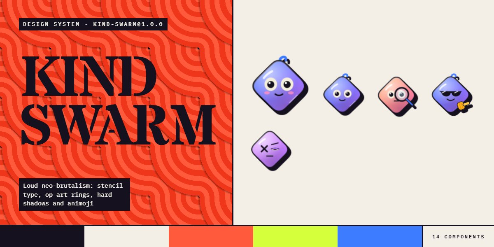</a></td><td><b><a href="systems/kind-swarm">Kind Swarm</a></b> · <sub><code>kind-swarm@1.0.0</code></sub><br>Loud neo-brutalism: stencil type, op-art rings, hard shadows and animoji<br><sub>14 components · 89 tokens · from <a href="pages/social-work-agent-swarm-landing-page">Social Work Agent Swarm Landing Page</a></sub></td></tr>
<tr><td width="260"><a href="systems/kiln">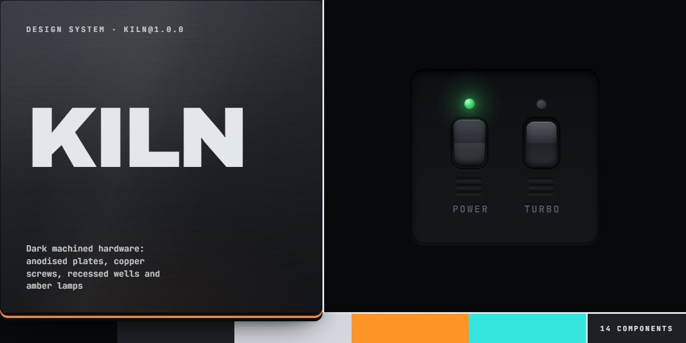</a></td><td><b><a href="systems/kiln">Kiln</a></b> · <sub><code>kiln@1.0.0</code></sub><br>Dark machined hardware: anodised plates, copper screws, recessed wells and amber lamps<br><sub>14 components · 85 tokens · from <a href="pages/machine-front-panel-page">Machine Front Panel Page</a></sub></td></tr>
<tr><td width="260"><a href="systems/footnote">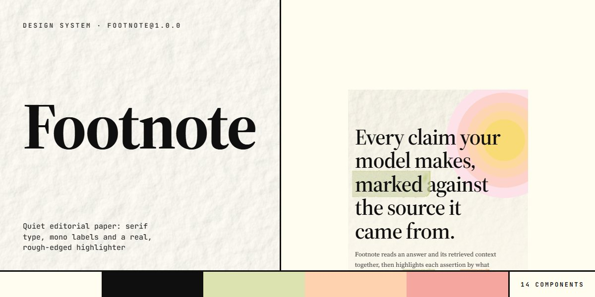</a></td><td><b><a href="systems/footnote">Footnote</a></b> · <sub><code>footnote@1.0.0</code></sub><br>Quiet editorial paper: serif type, mono labels and a real, rough-edged highlighter<br><sub>14 components · 65 tokens · from <a href="pages/highlighter-markup-page">Highlighter Markup Page</a></sub></td></tr>
<tr><td width="260"><a href="systems/hollr">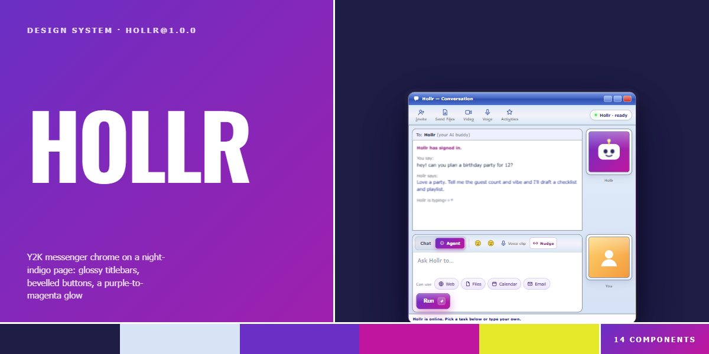</a></td><td><b><a href="systems/hollr">Hollr</a></b> · <sub><code>hollr@1.0.0</code></sub><br>Y2K messenger chrome on a night-indigo page: glossy titlebars, bevelled buttons, a purple-to-magenta glow<br><sub>14 components · 88 tokens · from <a href="pages/retro-messenger-agent-page">Retro Messenger Agent Page</a></sub></td></tr>
<tr><td width="260"><a href="systems/overclock">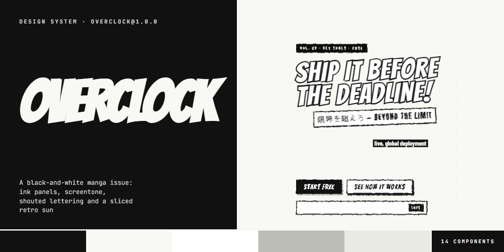</a></td><td><b><a href="systems/overclock">Overclock</a></b> · <sub><code>overclock@1.0.0</code></sub><br>A black-and-white manga issue: ink panels, screentone, shouted lettering and a sliced retro sun<br><sub>14 components · 69 tokens · from <a href="pages/manga-panel-dev-tool-page">Manga Panel Dev Tool Page</a></sub></td></tr>
<tr><td width="260"><a href="systems/meridian">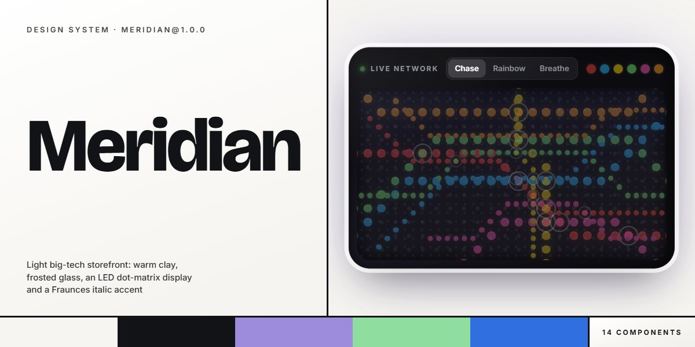</a></td><td><b><a href="systems/meridian">Meridian</a></b> · <sub><code>meridian@1.0.0</code></sub><br>Light big-tech storefront: warm clay, frosted glass, an LED dot-matrix display and a Fraunces italic accent<br><sub>14 components · 84 tokens · from <a href="pages/led-metro-tech-storefront">LED Metro Tech Storefront</a></sub></td></tr>
</table>
<!-- SYSTEMS:END -->

## Motion

<!-- MOTION:START -->
Each study is one movement in one HTML file. Open `index.html` to run it, read its README for the
choreography, or explore it live in the lab — slow motion, stepping and live knobs — at
[instalanding.ai/motion](https://instalanding.ai/motion).

<table>
<tr><td width="260"><a href="motion/hello-world-water">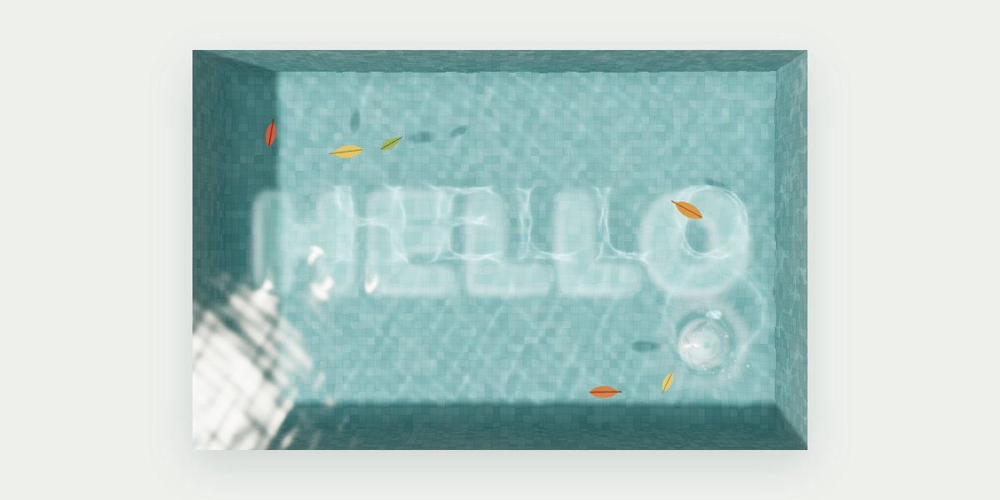</a></td><td><b><a href="motion/hello-world-water">Hello World Water</a></b> · <sub>webgl simulation</sub><br>A tiled pool seen from above where the water itself rises into HELLO, holds, and collapses into ripples before WORLD rises<br><sub>three.js 0.180 · GLSL shaders · GPU wave sim · 7 tracks · <a href="https://instalanding.ai/motion/hello-world-water">Open the lab</a> · <a href="motion/hello-world-water/PROMPT.md">Prompt</a></sub></td></tr>
<tr><td width="260"><a href="motion/only-the-wind">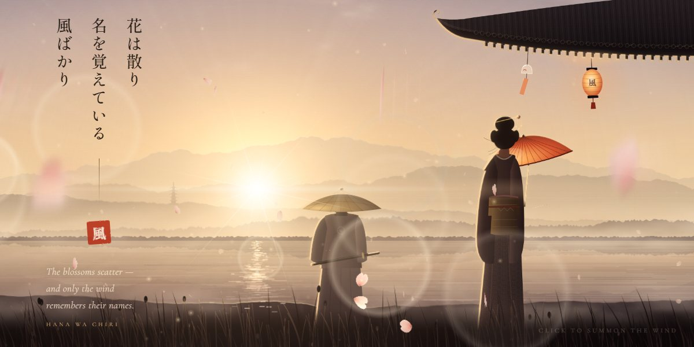</a></td><td><b><a href="motion/only-the-wind">Only the Wind</a></b> · <sub>ambient scene</sub><br>A backlit evening by a lake where cherry petals ride the wind in three depths, and a click sends a gust through everything<br><sub>Canvas 2D + SVG · no libraries · SMIL · CSS keyframes · 8 tracks · <a href="https://instalanding.ai/motion/only-the-wind">Open the lab</a> · <a href="motion/only-the-wind/PROMPT.md">Prompt</a></sub></td></tr>
<tr><td width="260"><a href="motion/dusk-valley-parallax"></a></td><td><b><a href="motion/dusk-valley-parallax">Dusk Valley Parallax</a></b> · <sub>scroll parallax</sub><br>One long scroll from sunset to starlight: hills peel apart in depth, the sun sinks and swells, bats scatter and a star falls<br><sub>GSAP 3.12.5 · ScrollTrigger · 9 tracks · <a href="https://instalanding.ai/motion/dusk-valley-parallax">Open the lab</a> · <a href="motion/dusk-valley-parallax/PROMPT.md">Prompt</a></sub></td></tr>
<tr><td width="260"><a href="motion/coverflow-carousel">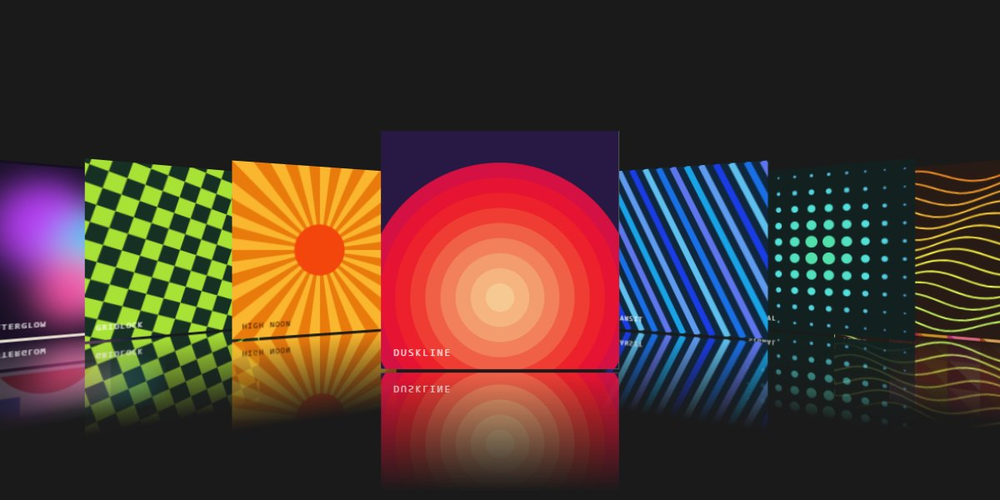</a></td><td><b><a href="motion/coverflow-carousel">Coverflow Carousel</a></b> · <sub>carousel</sub><br>An endless 3D cover flow driven by the page&#x27;s own scroll: swing, lift, reflect, snap<br><sub>GSAP 3.7.0 · ScrollTrigger · Draggable · 6 tracks · <a href="https://instalanding.ai/motion/coverflow-carousel">Open the lab</a> · <a href="motion/coverflow-carousel/PROMPT.md">Prompt</a></sub></td></tr>
<tr><td width="260"><a href="motion/elastic-portrait-accordion"></a></td><td><b><a href="motion/elastic-portrait-accordion">Elastic Portrait Accordion</a></b> · <sub>accordion</sub><br>An editorial portrait row that springs open on a click: one card stretches wide, zooms in and names its sitter, the rest squeeze thin<br><sub>GSAP 3.12.5 · 5 tracks · <a href="https://instalanding.ai/motion/elastic-portrait-accordion">Open the lab</a> · <a href="motion/elastic-portrait-accordion/PROMPT.md">Prompt</a></sub></td></tr>
<tr><td width="260"><a href="motion/neon-room-loop">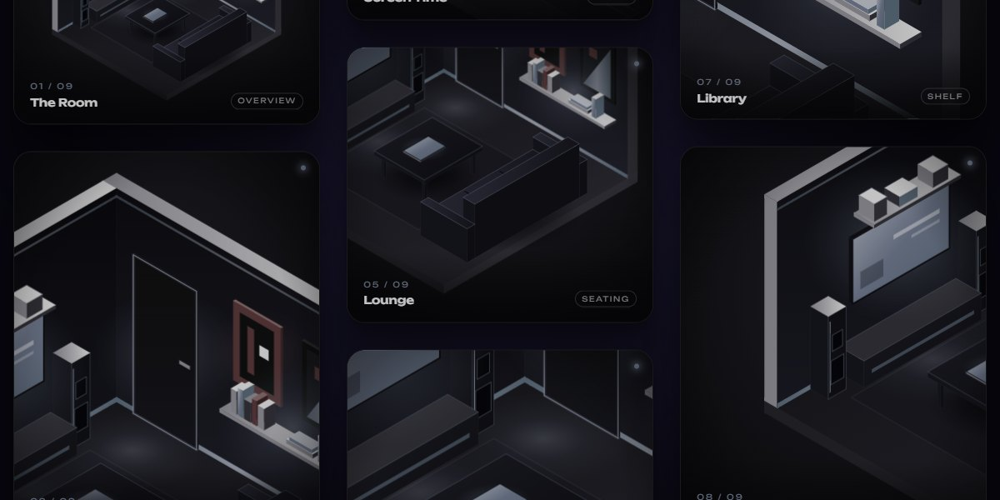</a></td><td><b><a href="motion/neon-room-loop">Neon Room Loop</a></b> · <sub>infinite loop</sub><br>Three columns of cards drift forever in opposite directions, and every scroll kicks them faster<br><sub>GSAP 3.12.5 · ScrollTrigger · 4 tracks · <a href="https://instalanding.ai/motion/neon-room-loop">Open the lab</a> · <a href="motion/neon-room-loop/PROMPT.md">Prompt</a></sub></td></tr>
</table>
<!-- MOTION:END -->

## Repo layout

```
pages/<slug>/
  index.html    the page: one file, every asset inlined, opens from disk
  PROMPT.md     the one-shot brief it was built from
  README.md     what it is for, its style, sections, stack, and credits
  preview.jpg   1200x600 screenshot
systems/<slug>/
  specimen.html every component of the system, live, in one file
  tokens.css    the design tokens as CSS custom properties
  <slug>.css    tokens + component CSS, scoped under the system's root class
  README.md     how to use it, its components, conventions and source page
  poster.jpg    1200x600 cover, drawn in the system's own type and colours
  preview.jpg   1200x600 the full board
motion/<slug>/
  index.html    the study: one movement, one file, opens from disk
  PROMPT.md     the one-shot prompt that builds it
  README.md     its choreography, inputs, how it works, pages it pairs with
  preview.jpg   1200x600 poster
index.json      every page's metadata, for agents and scripts
AGENTS.md       how an agent should use this repo
```

## Credits

Some pages are built around someone else's work — a CodePen, a Uiverse button, a Rive marketplace
file. Each of those pages credits its source in its own README (under **Built on**) and in the page
itself. Keep that attribution if you redistribute the component; the original's own terms apply to
the parts taken from it.

## License

[MIT](LICENSE). Use the pages and prompts in personal and commercial work, change them, ship them.

---

Made by [Ray Velez](https://instalanding.ai/about) ·
[X](https://x.com/pascowebdesigns) ·
[LinkedIn](https://www.linkedin.com/in/raymond-velez-96aa4a172/)
