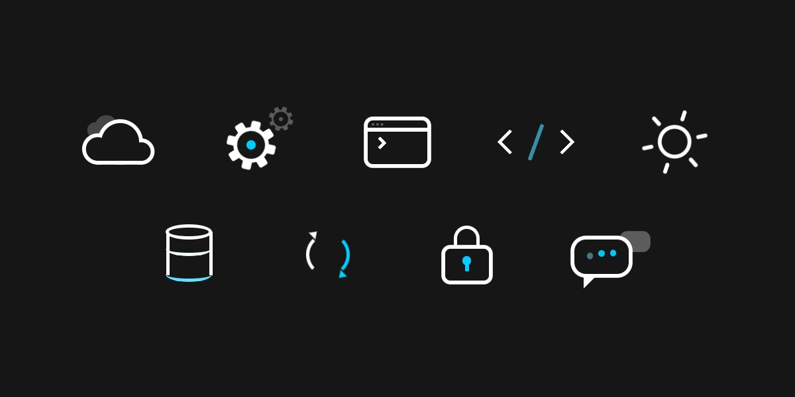

# Pure CSS Software Icons · icon set

9 icons · HTML + CSS · no SVG, no JavaScript · one HTML file per icon, plus one with the whole set

Nine software icons drawn in nothing but CSS (cloud upload, settings, terminal, code, sun, database, sync, lock and chat), white on near-black with a cyan accent, each idling on its own loop and doing its job when the pointer lands on it.

**Use it:** [instalanding.ai/icons/css-software-icons](https://instalanding.ai/icons/css-software-icons): click an icon to copy it, or copy the whole set. Or open any file here from disk.

## Files

| File | What it is |
| --- | --- |
| [`index.html`](index.html) | The whole set, every icon live (18 KB). |
| [`cloud.html`](cloud.html) | Cloud upload: the icon on its own (17 KB). |
| [`settings.html`](settings.html) | Settings: the icon on its own (18 KB). |
| [`terminal.html`](terminal.html) | Terminal: the icon on its own (17 KB). |
| [`code.html`](code.html) | Code: the icon on its own (17 KB). |
| [`sun.html`](sun.html) | Sun: the icon on its own (17 KB). |
| [`database.html`](database.html) | Database: the icon on its own (18 KB). |
| [`sync.html`](sync.html) | Sync: the icon on its own (17 KB). |
| [`lock.html`](lock.html) | Lock: the icon on its own (17 KB). |
| [`chat.html`](chat.html) | Chat: the icon on its own (17 KB). |

## Use one icon

Each icon file is standalone, made of plain divs: size it with font-size on .icon, and set color on the page to your background, since the shapes are cut out of it.

## How they move

Hover an icon and it performs its action: the cloud uploads, the gears whir, the terminal types a command, the code brackets spring apart, the sun blooms, the database streams data, sync spins double time, the lock opens and the chat bubble pops a reply.

## Tags

css only, line icons, hover, animated, developer, app icons.

## Built on

- Hand-built CSS shapes and keyframes; no fonts, images or scripts.
