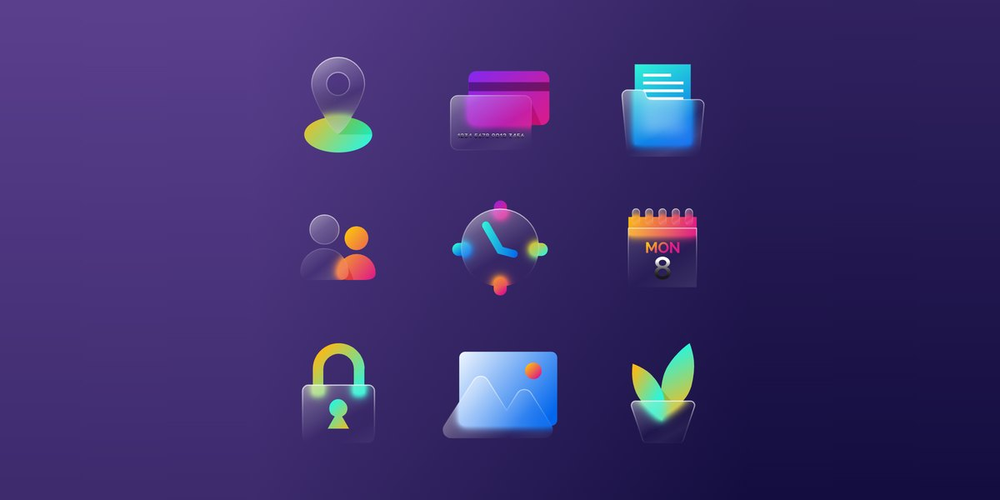

# Glassmorphism Material Icons · icon set

9 icons · Decoded Rive · Canvas 2D · no libraries · one HTML file per icon, plus one with the whole set

Nine frosted-glass icons on a deep violet field (account, lock, picture, location pin, plant, credit card, calendar, clock and documents), each lit by a neon gradient behind the glass, that lift, glow and catch a sheen of light as the pointer passes over them.

**Use it:** [instalanding.ai/icons/glassmorphism-material](https://instalanding.ai/icons/glassmorphism-material): click an icon to copy it, or copy the whole set. Or open any file here from disk.

## Files

| File | What it is |
| --- | --- |
| [`index.html`](index.html) | The whole set on its violet field, every icon live (214 KB). |
| [`pin.html`](pin.html) | Location pin: the icon on its own, transparent canvas (45 KB). |
| [`card.html`](card.html) | Credit card: the icon on its own, transparent canvas (76 KB). |
| [`docs.html`](docs.html) | Documents: the icon on its own, transparent canvas (65 KB). |
| [`account.html`](account.html) | Account: the icon on its own, transparent canvas (51 KB). |
| [`time.html`](time.html) | Clock: the icon on its own, transparent canvas (53 KB). |
| [`calendar.html`](calendar.html) | Calendar: the icon on its own, transparent canvas (88 KB). |
| [`key.html`](key.html) | Lock: the icon on its own, transparent canvas (49 KB). |
| [`pic.html`](pic.html) | Picture: the icon on its own, transparent canvas (43 KB). |
| [`plant.html`](plant.html) | Plant: the icon on its own, transparent canvas (52 KB). |

## Use one icon

Each icon file is standalone: the drawing engine, the icon and its hover, with nothing to install. The canvas is
transparent and the violet is only the page background, so it drops onto any surface. Size the `<canvas>` to place
it; it fits the icon inside with room for the hover lift. Only the credit card and calendar carry fonts, as the only
icons that draw text.

## How they move

Hover an icon and it lifts on a soft violet halo: a spotlight follows the pointer across the glass, a sheen sweeps over it once and the rim catches the light. Each icon also plays its own state-machine animation.

## Tags

glass, gradient, hover, animated, app icons.

## Built on

- Decoded from a Rive file and redrawn by a small Canvas 2D engine inlined in each file; no Rive runtime.
