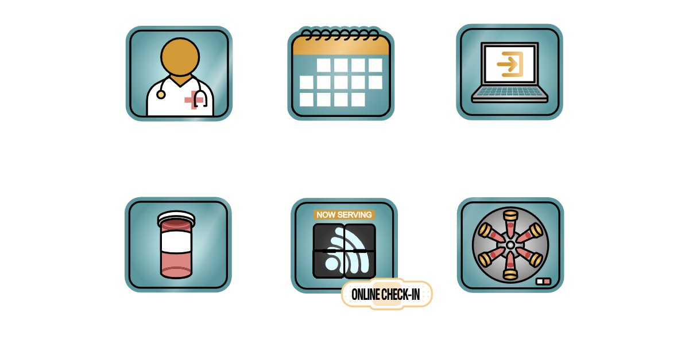

# Healthcare Buttons · icon set

6 icons · Decoded Rive · Canvas 2D · no libraries · one HTML file per icon, plus one with the whole set

Six animated buttons for a patient portal (find a doctor, schedule, virtual care, refill prescription, online check-in and lab results), teal glass tiles with flat illustrations that pop a pill, bandage or syringe label on hover and act out their task on click.

**Use it:** [instalanding.ai/icons/healthcare-buttons](https://instalanding.ai/icons/healthcare-buttons): click an icon to copy it, or copy the whole set. Or open any file here from disk.

## Files

| File | What it is |
| --- | --- |
| [`index.html`](index.html) | The whole set, every icon live (1114 KB). |
| [`doctor.html`](doctor.html) | Find a doctor: the icon on its own (224 KB). |
| [`schedule.html`](schedule.html) | Schedule an appointment: the icon on its own (450 KB). |
| [`virtual-care.html`](virtual-care.html) | Virtual care: the icon on its own (229 KB). |
| [`refill.html`](refill.html) | Refill prescription: the icon on its own (233 KB). |
| [`check-in.html`](check-in.html) | Online check-in: the icon on its own (523 KB). |
| [`lab-results.html`](lab-results.html) | Lab results: the icon on its own (323 KB). |

## Use one icon

Each icon file is standalone, with the button fitted to its canvas, label included: size the canvas to place it and change the page background to yours.

## How they move

Hover a button and its label slides out on a capsule, bandage or syringe. Click it and it acts: the doctor becomes a map pin, the calendar gets a date circled, the laptop opens a video call, the pill bottle pops its cap, the check-in board flips, and the centrifuge lifts out a sample vial.

## Tags

healthcare, medical, buttons, hover, click, animated, illustration.

## Built on

- Decoded from a Rive file and redrawn by a small Canvas 2D engine inlined in each file; no Rive runtime.
- Label font: Sofia Sans Extra Condensed, SIL Open Font License.
