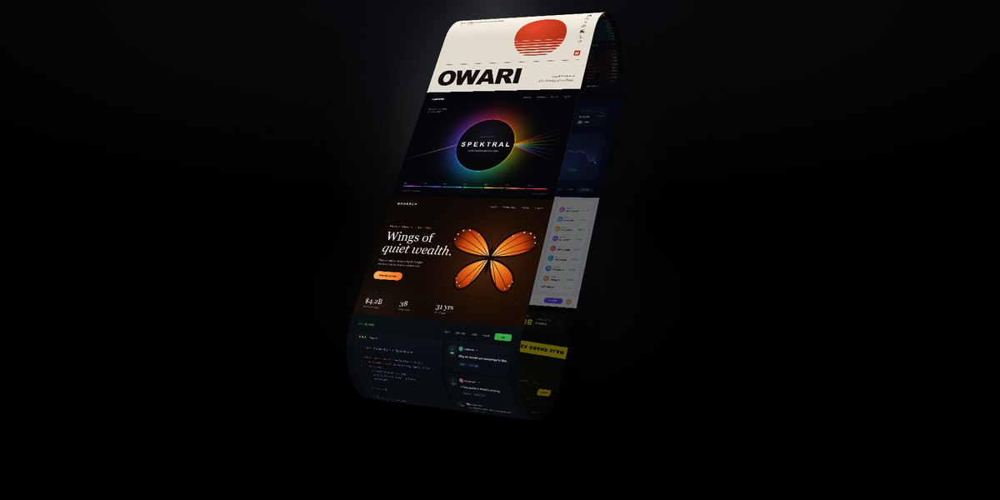

# Conveyor Gallery · motion study

Webgl Conveyor · WebGL 1.0 · no libraries · Canvas 2D covers · one HTML file

Eight project covers (a wealth office, a spectral imaging lab, a ceramics atelier, a trading desk, a crypto exchange, a traders' social feed, a grappling tour and a developer community), every one painted in code with Canvas 2D, ride one continuous ribbon wrapped round a stadium-shaped loop. The wheel, a swipe or the arrows throw it forward with momentum that bleeds off each frame, while the camera swings from an angled three-quarter view to straight on. One WebGL shader tiles the covers along the belt, lights it, and ray-casts the belt's own soft shadow onto its far side; a picking pass makes every cover clickable. No libraries.

**Open the lab:** [instalanding.ai/motion/conveyor-gallery](https://instalanding.ai/motion/conveyor-gallery) — the study running live, slowed down and taken apart.

## Files

| File | What it is |
| --- | --- |
| [`index.html`](index.html) | The study: one file, opens from disk. |
| [`PROMPT.md`](PROMPT.md) | The one-shot prompt that builds it. |

## Choreography · one step: a cover's glide and the camera's turn (1.2s)

| What moves | Change | When | Ease |
| --- | --- | --- | --- |
| offset · belt | +1 cover: a kick of velocity that keeps 94% each frame | 0s → 1.2s | `power3.out` |
| present · camera | angled → face-on, 7% of the way each frame | 0s → 1.2s | `power3.out` |
| rotation.y · belt | sways ±0.08 rad with the offset, fading out as it faces you | 0s → 1.2s | `power1.inOut` · yoyo |
| rig · parallax | tilts after the pointer at 3.2% a frame | 0s → 1.2s | `power1.out` |

## Inputs

- WHEEL / SWIPE: Throw the belt forward or back with momentum; scrolling down also turns the camera face-on, up turns it back
- ↑ / ↓ / ← / →: Move exactly one cover and turn the camera a little
- POINTER: Tilts the rig with a soft parallax; hovering a still cover shows a pointer, clicking opens it

## How it works · One ribbon, one shader, one number

1. The belt is a single strip of 257 vertex pairs that follows a stadium loop: up the front straight, over a half circle, down the back and round again. Each vertex carries its distance round the loop (0 to 1) as uv.y, and its normal in the y-z plane.
2. Every cover is painted at 1200 × 900 with Canvas 2D after the fonts load (a butterfly in bezier curves, a prism with a conic gradient, candlesticks from a seeded random walk) and packed into one texture atlas.
3. The fragment shader turns uv.y into phase = uv.y × 8 + offset: the whole part picks the cover, the fraction is the row inside it. So one number, the offset, scrolls every cover round the belt at once. No geometry moves.
4. Momentum is closed form: each frame the velocity is multiplied by 0.94 and the offset moves by v × 0.94 × (1 − 0.94ⁿ) / 0.06, so it stays right at any frame rate. That makes a step easy: a kick of 0.06 / 0.94 travels exactly one cover.
5. The camera interpolates between an angled position (−2, −9.35, 11) with the belt rotated and a straight-on one, by a smoothstep of present; the belt's sway and the parallax fade out as it faces you. Soft shadows come from casting five rays per pixel towards the light against the belt's own analytic shape, two planes and two cylinders. Picking draws the same mesh with each cover's index as its colour and reads one pixel back.

## Best for

agency and studio portfolios, selected-work and case-study indexes, product galleries and showcases, launch pages that show many screens at once.

## Pairs with

- [CRAFT Studio WebGL Landing Page](../../pages/craft-studio-webgl-landing-page)
- [Starfork Game Studio Landing Page](../../pages/starfork-game-studio-landing-page)
- [Icon-Cut Card Stack Page](../../pages/icon-cut-card-stack-page)
- [Skewed Marquee Wall](../../pages/skewed-marquee-wall)
- [Stage Light Launch Page](../../pages/stage-light-launch-page)

## Built on

- [Shakuro (Dribbble)](https://dribbble.com/shakuro) — The selected-work conveyor this study is based on, named in the original; the covers here are fictional
