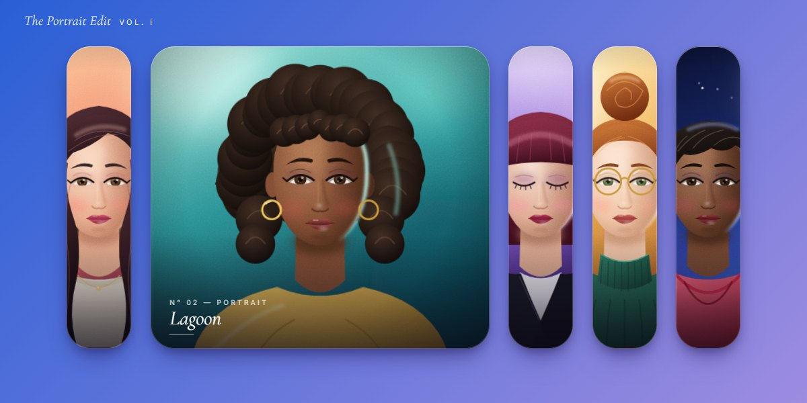

# Elastic Portrait Accordion · motion study

Accordion · GSAP 3.12.5 · one HTML file

Five painted portraits, The Portrait Edit, stand side by side. Click one and it springs to almost three times its width on a loose elastic while the others squeeze to slivers on a tighter one; the portrait eases in a touch and its italic caption rises in. Click it again and the row springs back. The art never stretches: each card is a window onto a square that stays centred.

**Open the lab:** [instalanding.ai/motion/elastic-portrait-accordion](https://instalanding.ai/motion/elastic-portrait-accordion) — the study running live, slowed down and taken apart.

## Files

| File | What it is |
| --- | --- |
| [`index.html`](index.html) | The study: one file, opens from disk. |
| [`PROMPT.md`](PROMPT.md) | The one-shot prompt that builds it. |

## Choreography · one click (2.5s)

| What moves | Change | When | Ease |
| --- | --- | --- | --- |
| width · the clicked card | 15vw → 42vw, overshoots and settles | 0s → 2.5s | `elastic.out(1, 0.3)` |
| width · every other card | 15vw → 8vw, a tighter spring | 0s → 2s | `elastic.out(1, 0.6)` |
| scale · the portrait | 1 → 1.06, a slow push in | 0s → 2.4s | `power3.out` |
| opacity · y · old caption | out and down 12px | 0s → 0.35s | `power2.in` |
| opacity · y · new caption | rises in after 0.55s | 0.55s → 1.55s | `power3.out` |

## Inputs

- CLICK: Opens that portrait, zooms it in and shows its name; the rest squeeze to slivers
- CLICK AGAIN: Springs the whole row back to equal widths
- CLICK ANOTHER: Hands the width over mid-spring, without a reset

## How it works · Two springs, one row

1. Every click tweens every card: the clicked one to 42vw over 2.5s on elastic(1, 0.3), the rest to 8vw over 2s on elastic(1, 0.6). Clicking the open card sends them all back to 15vw.
2. The two periods differ on purpose: the wide card swings longer and looser than the thin ones, so the eye follows the one that opened.
3. The finish is layered on calmer eases: every caption drops out fast (power2.in, 0.35s), the opened one rises in 0.55s later (power3.out), and its portrait pushes in to 1.06 over 2.4s. The springs bounce; the details don't.
4. Give the width and zoom tweens overwrite: true. Without it a fast second click leaves the first card's 2.5s tween running past the new one, and two cards end up open.
5. Each portrait is generated by one SVG function from a palette per sitter (gradients for skin, hair, cloth, iris and lips, soft blurred shading, a rim light, film grain), sized at least as wide as its card and cropped (xMidYMid slice), so resizing reveals more of it instead of squashing it.

## Best for

team and speaker pages, portfolio and editorial galleries, product or plan pickers, testimonial rows.

## Pairs with

- [Maasai-Inspired Event Landing Page](../../pages/maasai-inspired-event-landing-page)
- [Generative Editorial Product Page](../../pages/generative-editorial-product-page)
- [Peptide Skincare Store Landing Page](../../pages/peptide-skincare-store-landing-page)
- [Social Work Agent Swarm Landing Page](../../pages/social-work-agent-swarm-landing-page)
