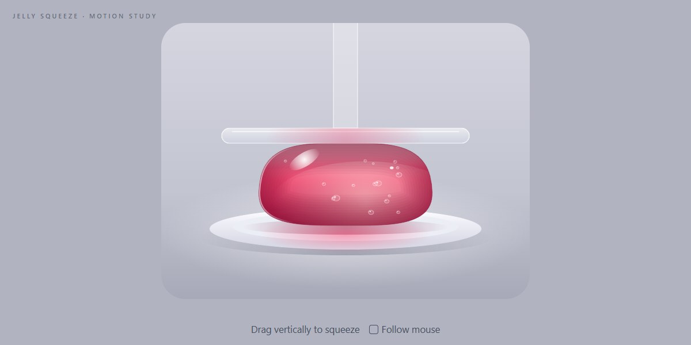

# Jelly Squeeze · motion study

Drag Scrub · Canvas 2D 1.0 · no libraries · spring physics · one HTML file

A raspberry jelly sits on a white plate under a clear acrylic press. Drag vertically and the press follows you down, lagging a touch behind the pointer, and the jelly squashes wide, bulging at the sides with its bubbles carried along. Flick and the press glides on before it stops; lift it and the jelly leaps back on a loose spring, overshooting into the press and rippling until it settles. Tick Follow mouse and the press just tracks the pointer's height. Everything is drawn live in Canvas 2D: no frames, no images.

**Open the lab:** [instalanding.ai/motion/jelly-squeeze](https://instalanding.ai/motion/jelly-squeeze) — the study running live, slowed down and taken apart.

## Files

| File | What it is |
| --- | --- |
| [`index.html`](index.html) | The study: one file, opens from disk. |
| [`PROMPT.md`](PROMPT.md) | The one-shot prompt that builds it. |

## Choreography · one press and release (1.6s)

| What moves | Change | When | Ease |
| --- | --- | --- | --- |
| y · the press | follows the drag, 0.11 lag per frame | 0s → 0.72s | `power2.inOut` |
| height · the jelly | 100% → 42%, capped by the press | 0.06s → 0.77s | `power2.inOut` |
| width · the jelly | grows as height shrinks, sides bulge | 0.06s → 0.77s | `power2.inOut` |
| height · on release | springs back, overshoots and settles | 0.8s → 1.6s | `elastic.out(1, 0.3)` |
| outline · ripple | a five-lobe wave sized by the spring's speed | 0.83s → 1.44s | `power1.out` |

## Inputs

- DRAG ↕: Moves the press; down squeezes, up lets go. A flick glides on and stops dead at either end
- FOLLOW MOUSE: The press tracks the pointer's height across the whole window, no click needed
- ↑ ↓ / PG UP/DN / HOME/END: The press is a slider: step it, jump it, or slam it fully down

## How it works · A press, a lag and a spring

1. Three numbers do the work. goal is where the pointer put the press (0 lifted, 1 full squeeze). shown chases it every frame by (goal − shown) × (1 − e^(−0.11 × 60 × dt)), the original's frame-rate independent lag. h is the jelly's height.
2. The drag adds pointer Δy ÷ travel to goal. On release the last few samples give a velocity, and goal glides on with it, losing speed over 0.28s and stopping dead at 0 or 1: Draggable's inertia, in ten lines.
3. The jelly is a damped spring pulling h toward its full height (2.1Hz, damping from the WOBBLE knob), integrated in four sub-steps per frame. The press is a ceiling: when h would pass it, h is clamped and any upward speed dropped. Lift the press fast and the spring is free to overshoot into it.
4. Width follows height so it reads as the same jelly: w = w₀ × (h₀ ÷ h)^0.55, plus a sideways bulge of sin(πv)^1.4 that grows with the squash. The outline is a superellipse (n = 3.6) sampled at 120 points and tapered 13% toward the top.
5. The spring's speed drives the life in it: a five-lobe ripple on the outline, a dome or dip on the top face, and the bubbles, which are mapped through the same function so they ride along.
6. Translucency is layering inside a clip: a vertical raspberry gradient, a warm 'screen' glow low and to the right, twelve faint strokes that darken the edges, a sheen on the top face, a rim light, two speculars, and a pink caustic thrown onto the plate.

## Best for

playful product heroes, loading and empty states, toy-like onboarding moments, food, candy and skincare brands.

## Pairs with

- [Peptide Skincare Store Landing Page](../../pages/peptide-skincare-store-landing-page)
- [Fullday AI Money Agent Page](../../pages/fullday-ai-money-agent-page)
- [Fortix AI Money Copilot App Page](../../pages/fortix-ai-money-copilot-app-page)
- [Generative Editorial Product Page](../../pages/generative-editorial-product-page)

## Built on

- [Voicu Apostol (cerpow.com)](https://www.cerpow.com) — The original jelly drag study, which scrubs 215 pre-rendered frames with GSAP Draggable; this version draws the jelly live instead
