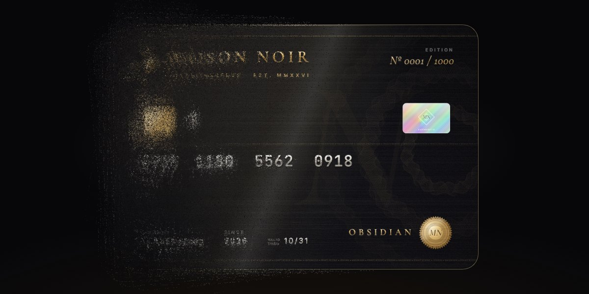

# Maison Noir Disintegrate · motion study

Disintegrate Loop · GSAP 3.12.5 · quickTo · html2canvas 1.4.1 · one HTML file

A private-reserve card in brushed black metal (foil type, an EMV chip, a hologram, a gold seal, guilloché engraving, every detail drawn in Canvas 2D) sits under a soft light. Then it comes apart: the card is photographed once with html2canvas, its pixels are dealt across 75 transparent layers weighted from left to right, and each layer drifts, turns and fades on its own timeline. The left edge goes first and the dust sweeps across, holds, then every grain flies home, on a loop. The wheel or a drag takes the card by hand; let go and the loop picks up from there.

**Open the lab:** [instalanding.ai/motion/maison-noir-disintegrate](https://instalanding.ai/motion/maison-noir-disintegrate) — the study running live, slowed down and taken apart.

## Files

| File | What it is |
| --- | --- |
| [`index.html`](index.html) | The study: one file, opens from disk. |
| [`PROMPT.md`](PROMPT.md) | The one-shot prompt that builds it. |

## Choreography · one fragment's flight (1s = ⅓ of the dissolve) (1s)

| What moves | Change | When | Ease |
| --- | --- | --- | --- |
| x · y · fragment | drifts 40px along its own random angle | 0s → 1s | `power1.out` |
| rotate · fragment | turns up to ±15° | 0s → 1s | `power1.out` |
| opacity · fragment | 1 → 0, the grains fade as they leave | 0s → 1s | `power1.out` |
| opacity · scale · contact shadow | fades and shrinks to 0.85 under the card | 0s → 0.6s | `none` |
| progress · eased follow | chases the loop or your hand over 0.9s | 0s → 1s | `power3.out` |

## Inputs

- WHEEL / DRAG: Scrub the card by hand, both ways (the page itself never scrolls); the loop resumes 3.5s after you let go
- ◀ / ▶ / ← / →: Glide to the previous or next stage: intact, crumbling, scattering, dust
- IDLE: Loops on its own: dissolve over 4s, hold as dust, reassemble, hold whole

## How it works · One photograph, dealt across 75 layers

1. The card is ordinary DOM: a 600 × 400 box of absolutely placed images. Every image is generated at load with Canvas 2D: foil and embossed text with manual letter-spacing, a chip with grooves, a conic-gradient hologram, a scalloped seal with circular microtext, and a background of guilloché rosettes, engraved bands, microprint and grain. Drawing them as images first is what lets html2canvas capture them faithfully.
2. Once fonts and images are ready, html2canvas renders the card to one canvas (scale capped at 1.5 DPR) and the live card is hidden.
3. Its pixels are dealt into 75 empty ImageData layers: every pixel is copied three times, each into the layer floor(75 × (random + 2x / width) / 3). The 2x / width term biases the left edge into early layers and the right edge into late ones, and the randomness keeps the boundary ragged.
4. Each layer becomes its own canvas stacked over the card's position, so together they still show the whole card. Each gets a paused timeline: a 1-unit tween that drifts 40px along a random angle, turns up to ±15° and fades out, delayed by (i / 75) × 2. That delay is what sweeps the dust from left to right.
5. Nothing scrolls. One number, the progress from 0 (whole) to 1 (dust), sets every timeline's progress at once. A loop tweens the goal (dissolve, hold, reassemble, hold), the wheel and a drag nudge it by hand, and gsap.quickTo eases the drawn progress after the goal over 0.9s, the same soft lag a scrubbed ScrollTrigger gives, without a scrollbar.

## Best for

premium card and fintech launches, luxury and membership brands, dramatic hero exits and section transitions, product reveals that leave the stage.

## Pairs with

- [Card Scanner Finance Page](../../pages/card-scanner-finance-page)
- [Kestrel AI Finance Landing Page](../../pages/kestrel-ai-finance-landing-page)
- [Facetry Security Landing Page](../../pages/facetry-security-landing-page)
- [Holographic Ticket Landing Page](../../pages/holographic-ticket-landing-page)
- [Stage Light Launch Page](../../pages/stage-light-launch-page)

## Built on

- [DevLoop01](https://twitter.com/DevLoop01) — The Maison Noir card and its scroll disintegration this study is built on, credited in the original
- [The disintegration technique (video)](https://www.youtube.com/watch?v=5DGZhWDl6XM) — The pixel-dealing dust effect, credited in the original's source
