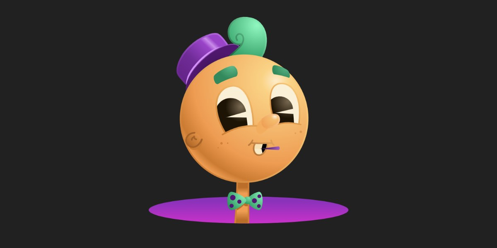

# Peekaboo Orange · motion study

Cursor-Follow Character · Canvas 2D decoded .riv · no runtime · state machine · joystick · one HTML file

A glossy 3D-style arrow, purple and gold with INSTALANDING riding on top in chunky extruded letters, bobs over a glowing purple hole on a charcoal stage. Move the pointer onto the stage and the arrow, title and all, dives into the hole; a cartoon orange with a purple top hat, a green curl and a polka-dot bow tie springs up out of it and settles into a gentle idle. From then on his head turns, tilts and leans toward wherever the pointer is, his eyes go with it, and every few seconds he blinks. Leave and he ducks back down while the arrow rises out of the hole and picks up its bob again. On a phone, a tap calls him up, a drag steers his gaze and a second tap sends him home. It is a decoded Rive file (one 500 × 500 artboard, three state-machine layers and a joystick) replayed by a small Canvas 2D runtime; the title is drawn in code and parented to the arrow so it dives with it.

**Open the lab:** [instalanding.ai/motion/peekaboo-orange](https://instalanding.ai/motion/peekaboo-orange) — the study running live, slowed down and taken apart.

## Files

| File | What it is |
| --- | --- |
| [`index.html`](index.html) | The study: one file, opens from disk. |
| [`PROMPT.md`](PROMPT.md) | The one-shot prompt that builds it. |

## Choreography · one visit: up, a look around, back down (4.4s)

| What moves | Change | When | Ease |
| --- | --- | --- | --- |
| arrow + title · dive | 0.33 s: the arrow squashes and drops into the hole, the INSTALANDING title riding it down | 0s → 0.33s | `power2.in` |
| orange · jump out | 1.33 s: he springs up out of the hole and settles | 0s → 1.32s | `power3.out` |
| orange · idle while up | a 2 s loop (frames 60 to 184 of LOOP): a small breathing sway | 1.32s → 2.99s | `power1.inOut` |
| head + eyes · follow | a joystick maps the pointer to two animations, Xaxis and Yaxis, scrubbed by position: turn, tilt and lean | 1.32s → 2.99s | `none` |
| eyes · blink | a 3 s loop on its own layer, so he blinks up or down | 0s → 4.4s | `none` |
| orange · jump in | 0.6 s: he ducks back into the hole when the pointer leaves | 2.99s → 3.61s | `power2.in` |
| arrow + title · rise | 0.47 s up out of the hole, then a 200 ms blend into the bob | 3.61s → 4.27s | `power3.out` |
| arrow · bob | a 2.5 s loop while he is down: the arrow floats up and down over the hole | 3.61s → 4.4s | `power1.inOut` |

## Inputs

- HOVER: The arrow dives into the hole and the orange pops up
- MOVE: His head turns, tilts and leans toward the pointer, and his eyes follow
- LEAVE: He jumps back in and the arrow rises out of the hole
- TAP · DRAG: On touch: a tap calls him up, a drag steers his gaze, a second tap sends him back

## How it works · A head that follows the pointer without any math in the scene

1. The .riv was decoded into plain data and is replayed by a small runtime with its own state machine, cubic eases, hit-testing and joystick; no Rive code ships.
2. An invisible handle node follows the pointer: a pointer-move listener with an align-target action sets its position to the pointer, in its parent's space.
3. A joystick reads where that handle sits inside a 500 × 500 box and turns it into two numbers from -1 to 1. Each number scrubs an animation, Xaxis and Yaxis, to that point in its timeline. Those two animations hold every head turn, tilt and eye position, keyed by hand, so the follow looks drawn rather than computed.
4. A full-stage hitbox sets one bool, HoverOn, on enter and clears it on exit. Three layers listen to it: up/down (idle in the hole, jump out, the loop while up, jump in), the arrow (bob, dive, rest in the hole, rise) and a blink that never stops.
5. INSTALANDING is not in the .riv. It is drawn in code with a subset of Fredoka, reusing the arrow's own paints, and parented to the arrow's node so it bobs, squashes and dives with it.

## Best for

mascots that greet visitors on a hero, empty states and 404 pages, playful brands, food and kids' products, a hover reward on a download or sign-up CTA.

## Pairs with

- [Oishi Taiyaki Ice Cream Page](../../pages/oishi-taiyaki-ice-cream-page)
- [Peelo AI Sticker Printer Page](../../pages/peelo-ai-sticker-printer-page)
- [Side Quest Adoption Center Page](../../pages/side-quest-adoption-center-page)
- [Sakura Corgi Game Landing Page](https://instalanding.ai/prompt/sakura-corgi-game-landing-page)

## Built on

- [Fredoka (Google Fonts)](https://fonts.google.com/specimen/Fredoka): The title's letters, SIL Open Font License, subset to INSTALANDING and inlined
