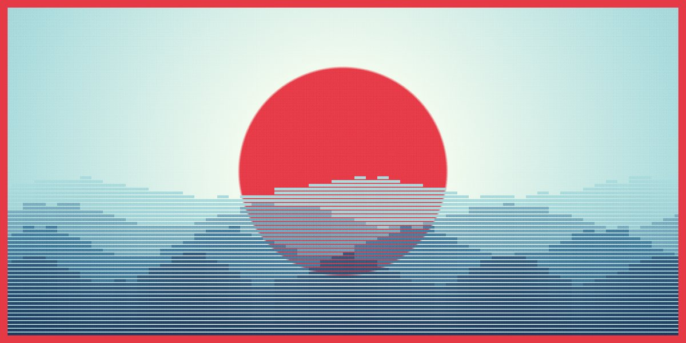

# Pixel Swell · motion study

Scroll Wave · CSS 3 · no libraries · scroll timelines · @property · sibling-index() · random() · one HTML file

A red sun sits on a honeydew sky inside a red frame, half sunk behind four bands of striped, stair-stepped waves. Scroll and the bands roll: the back two drift one way, the front two twice as fast the other, each bar rising and falling on its own sine wave. The sun scrolls up and away as the sky deepens through frosted blue to oxford navy. No canvas and no library: one registered angle driven by the page's scroll, sin() per bar, heights rounded down to 8px rungs and a mask that cuts every bar into stripes.

**Open the lab:** [instalanding.ai/motion/pixel-swell](https://instalanding.ai/motion/pixel-swell) — the study running live, slowed down and taken apart.

## Files

| File | What it is |
| --- | --- |
| [`index.html`](index.html) | The study: one file, opens from disk. |
| [`PROMPT.md`](PROMPT.md) | The one-shot prompt that builds it. |

## Choreography · one scroll, 600vh (1s = 100vh) (6s)

| What moves | Change | When | Ease |
| --- | --- | --- | --- |
| --a · scroll angle | 0° → 360° over the whole scroll, × 2 turns | 0s → 6s | `none` |
| height · band 1 (back) | 46vh ± 4vh, rolls forward one wave a turn | 0s → 6s | `power1.inOut` |
| height · band 2 | 38vh ± 5vh, rolls backward | 0s → 6s | `power1.inOut` |
| height · band 3 | 30vh ± 6vh, forward at twice the speed | 0s → 6s | `power1.inOut` |
| height · band 4 (front) | 22vh ± 6vh, backward at twice the speed | 0s → 6s | `power1.inOut` |
| sun · gradient's first stop | the 30vh red disc scrolls up out of frame | 0s → 1.2s | `none` |
| sky · body gradient | honeydew → frosted blue → oxford navy | 0.3s → 6s | `none` |

## Inputs

- SCROLL: The only clock: the scroll position is the waves' angle, both ways
- ◀ / ▶: Glide to the previous or next depth: sunrise, open water, swell, deep navy
- IDLE: Nothing moves until you scroll, except the cue bobbing in the sun

## How it works · One angle, two hundred and forty sine waves

1. A registered custom property, --a (@property, syntax <angle>, inherits), is the only thing that animates: a keyframe takes it 0° → 360° and animation-timeline: scroll(root) binds that keyframe to the page's scroll. Because it is registered it interpolates as an angle; unregistered, it would jump from start to end.
2. Each band is a fixed flex row of 60 bars, and each bar computes its own height: base + sin(--a × turns × speed + index × step + jitter) × swing × amp. The index (sibling-index()) offsets the phase along the row, so the row reads as a travelling wave rather than bars bobbing together.
3. Speed is +1, −1, +2 and −2 from back to front, so neighbouring bands roll against each other and the front ones twice as fast: that difference in speed is what reads as depth.
4. round(down, height, 8px) snaps every height to 8px rungs, and a repeating-linear-gradient mask (6px on, 2px off) cuts each bar into stripes. Together they turn a smooth sine into pixel art without a canvas.
5. random() gives each bar a slightly different amplitude (0.5–0.9) and phase (±5°), so the crests aren't machine-perfect. The sun is just the first stop of the body's radial gradient, so scrolling carries it away with no animation at all.
6. Where sibling-index(), random() or scroll timelines aren't supported yet, a few lines of script fill in: an index and a seeded jitter on each bar, and the scroll position written straight into --a.

## Best for

surf, travel and ocean brands, climate and water products, story and portfolio intros, launch pages that reward the scroll.

## Pairs with

- [Sunset Scroll Story Page](../../pages/sunset-scroll-story-page)
- [Ochre AI Meditation App Page](../../pages/ochre-ai-meditation-app-page)
- [Paper Sun Agent Page](../../pages/paper-sun-agent-page)
