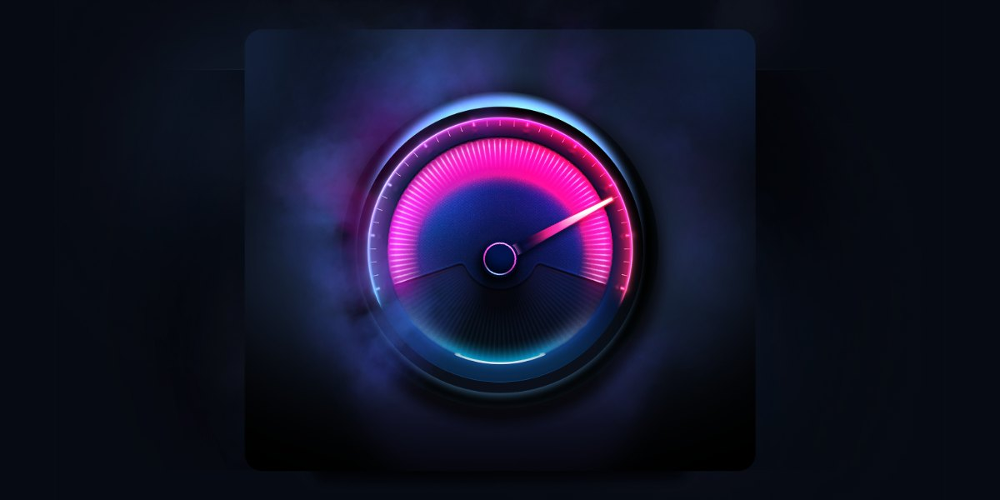

# Redline Gauge · motion study

Tap-To-Rev Gauge · Canvas 2D decoded .riv · no runtime · state machine · nested artboards · one HTML file

A glowing pink-and-cyan speedometer sits in a dark glass card, wrapped in slowly turning violet smoke. Hover and the rim lights up. Tap the dial and the needle kicks from idle to level 1; tap again while it settles and it climbs to 2, then to 3, the redline. Tap too slowly and each level falls back before the next one lands; reach the redline and the smoke blows out in a burst before the needle drops back to idle. The pink sweep inside the dial follows the needle, and the needle never sits quite still: a small wiggle loops under every pose. It is a decoded Rive file (a cover artboard, a speedometer artboard and three copies of a smoke artboard) replayed by a small Canvas 2D runtime, with WebGL for the one meshed image.

**Open the lab:** [instalanding.ai/motion/redline-gauge](https://instalanding.ai/motion/redline-gauge) — the study running live, slowed down and taken apart.

## Files

| File | What it is |
| --- | --- |
| [`index.html`](index.html) | The study: one file, opens from disk. |
| [`PROMPT.md`](PROMPT.md) | The one-shot prompt that builds it. |

## Choreography · one rev to the redline (4s)

| What moves | Change | When | Ease |
| --- | --- | --- | --- |
| needle · idle → level 1 | 500 ms: the needle swings from -150° to -55° on a fast-out cubic | 0s → 0.5s | `power3.out` |
| needle · level 1 → 2 | 500 ms: on the next tap it climbs to 0°, straight up | 0.25s → 0.75s | `power3.out` |
| needle · level 2 → 3 | 500 ms: the third tap pins it at +50°, the redline | 0.5s → 1s | `power3.out` |
| sweep · radial gradient | the pink fill's gradient end point moves with each level, so the glow follows the needle | 0s → 1s | `power3.out` |
| click · rim flash | every tap flashes a white ring over the dial, played at 10x speed | 0s → 0.12s | `none` |
| smoke · burst | 500 ms after the redline, two smoke artboards fade in and roll out at quarter speed | 1.5s → 4s | `power1.out` |
| needle · fall back | 2 s: from the redline back to idle while the smoke clears | 2s → 4s | `power2.inOut` |
| needle · wiggle | a small rotation ping-pong on the needle's parent node, looping under every pose | 0s → 4s | `power1.inOut` |

## Inputs

- HOVER: Lights the rim of the dial; it fades back when you leave
- TAP: Revs the needle one level, with a flash on the rim
- TAP · TAP · TAP: In rhythm, about four taps a second, the needle climbs 1, 2, 3 to the redline and the smoke bursts
- WAIT: Each level falls back if the next tap is late, so a slow rhythm never reaches the redline

## How it works · A rev counter built from four invisible rings

1. The .riv nests a 1575 × 1836 speedometer artboard inside a 1855 × 1044 cover, and three copies of a 1681 × 2245 smoke artboard inside the speedometer. It was decoded into plain data and is replayed by a small runtime with its own state machine, cubic eases and hit-testing; no Rive code ships.
2. The levels are four single-frame poses, level 0 to 3. Each sets the needle's rotation, the end point of the sweep's radial gradient, and the scale of four full-dial hit rings: only the ring for the next level is at scale 1, the rest are at 0.
3. So a tap always lands on exactly one live ring, and that ring's listener sets level to the next number. The state machine moves to that pose only from the one before it, over a 500 ms cubic blend.
4. Every level also has an exit: if the next tap doesn't come, the state falls back to idle. That is what makes it a rhythm: too slow and you lose the level, too fast and the tap lands mid-blend and is ignored.
5. At level 3 the state hands off to smoke-go, which fades in two smoke artboards and plays them at quarter speed, then blends back to idle over two seconds. The third smoke copy loops all the time, slowly rotated by a 200-second spin on its parent node.

## Best for

performance and speed claims (latency, throughput, benchmarks), automotive and EV launches, upgrade, boost and turbo CTAs, gamified onboarding that rewards a rhythm.

## Pairs with

- [ORVYN Autonomous Car Page](../../pages/orvyn-autonomous-car-page)
- [Neon Glass App Landing Page](../../pages/neon-glass-app-landing-page)
- [Tarn File Transfer Page](../../pages/tarn-file-transfer-page)
- [Holographic Ticket Landing Page](../../pages/holographic-ticket-landing-page)
