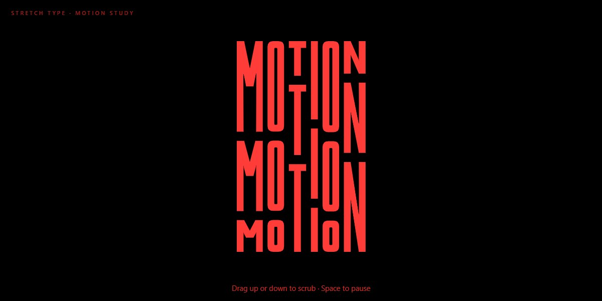

# Stretch Type · motion study

Loop · SVG 1.1 · no libraries · parametric glyphs · one HTML file

The word MOTION in condensed red block letters on black, stacked three times. In every column the top copy grows as the bottom one shrinks while the middle slides between them, eased in and out and back again, so the column always fills the same height. Each letter runs on its own offset and tempo, so the word ripples rather than pulses. Every letter is drawn from rectangles and bands as a function of its height and redrawn each frame, so strokes stay the same thickness however far it stretches. Drag up or down to scrub it; Space pauses.

**Open the lab:** [instalanding.ai/motion/stretch-type](https://instalanding.ai/motion/stretch-type) — the study running live, slowed down and taken apart.

## Files

| File | What it is |
| --- | --- |
| [`index.html`](index.html) | The study: one file, opens from disk. |
| [`PROMPT.md`](PROMPT.md) | The one-shot prompt that builds it. |

## Choreography · one stretch and back (5s)

| What moves | Change | When | Ease |
| --- | --- | --- | --- |
| height · top copy | 72 → 210 units of 486 | 0s → 5s | `power1.inOut` |
| height · bottom copy | 210 → 72, the mirror of the top | 0s → 5s | `power1.inOut` |
| y · middle copy | slides 93 → 231 at a fixed 162 tall | 0s → 5s | `power1.inOut` |
| time · per column | own offset and tempo, 0.8× to 1.2× | 0s → 5s | `none` |

## Inputs

- DRAG ↕: Scrubs time: down plays it forward, up runs it back. It holds while you drag
- SPACE: Pauses and resumes the loop
- ← → / ↑ ↓: Pauses and steps a quarter of a stretch

## How it works · Three heights that always add up

1. Each column is 486 units tall: three copies of the letter with 21-unit gaps. The middle copy is always 162 tall, so the top and bottom share what is left: when the top is 72 the bottom is 210, and the other way round.
2. One number per column, p from 0 to 1, sets both: top = 72 + 138p, bottom = 210 − 138p, and the middle sits between them. p comes from time: forward over 2.5s, back over 2.5s, through power1.inOut (2t² then 1 − (2 − 2t)²/2).
3. The original morphed between six pairs of hand-drawn paths with MorphSVG. Here each letter is a function draw(x, y, h): stems and bars are rectangles, the O is a rounded rectangle with a reversed inner one for the counter, M and N are stems plus diagonal bands. Redrawn every frame, the strokes never thin out as a letter stretches.
4. The N's diagonal keeps a constant stroke at any slope: its vertical thickness is 15.5 × √(gap² + h²) ÷ gap, capped at 42% of the height so the counters stay open on the short copy.
5. Every column gets its own clock: (t + offset) × tempo, with offsets of 0-2s and tempos of 0.8× to 1.2×, the original's seek() and timeScale(). That is what turns six pulses into a ripple. SYNC COLUMNS drops both.

## Best for

event and conference heroes, music and festival sites, studio and agency intros, loading screens with a word to say.

## Pairs with

- [KYMA AI Automation Agency Page](../../pages/kyma-ai-automation-agency-page)
- [Forgewave Vibe-Manufacturing Studio Page](../../pages/forgewave-vibe-manufacturing-studio-page)
- [Cutcrew AI Video Agents Page](../../pages/cutcrew-ai-video-agents-page)

## Built on

- [volumkonferansen.no](https://www.volumkonferansen.no/) — The stacked, stretching wordmark that inspired the original GSAP MorphSVG study; this version spells MOTION and draws the letters in code
