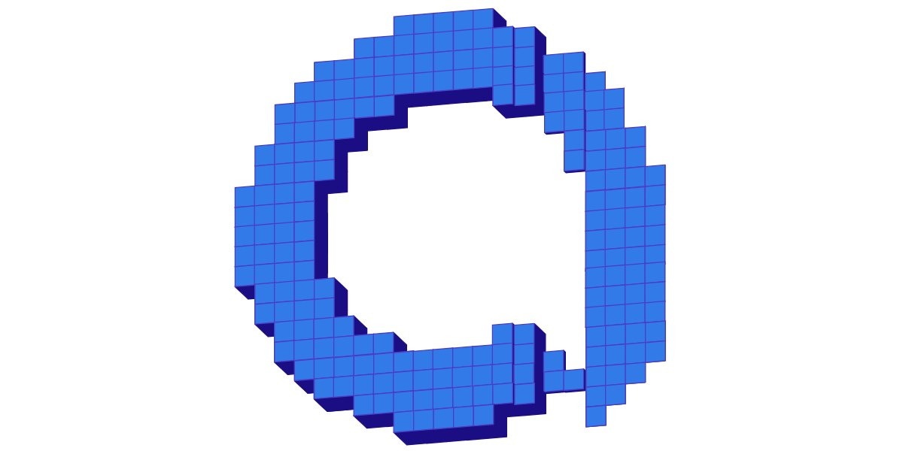

# Surprise Keys · motion study

Pressable Voxels · Canvas 2D decoded .riv · no runtime · state machine · skinned paths · one HTML file

A big lowercase a assembled from 229 little isometric keys, each a blue cap on a deep-indigo base. Left alone, every cap sinks into its base and rises again in one slow breath, so the whole letter pulses. Hover a key and it springs up higher than the rest in 70 ms; press and it slams flush in 50 ms, then eases back when you let go. Sweep the pointer across and a trail of keys pops up and settles behind it. Each key is its own copy of a tiny three-state machine (idle, hover, click) with hand-tuned cubic blends, decoded from a Rive file and replayed by a small Canvas 2D runtime; the side walls are skinned to two bones, so the extrusion stretches as the cap moves.

**Open the lab:** [instalanding.ai/motion/surprise-keys](https://instalanding.ai/motion/surprise-keys) — the study running live, slowed down and taken apart.

## Files

| File | What it is |
| --- | --- |
| [`index.html`](index.html) | The study: one file, opens from disk. |
| [`PROMPT.md`](PROMPT.md) | The one-shot prompt that builds it. |

## Choreography · one breath, one press (1.4s)

| What moves | Change | When | Ease |
| --- | --- | --- | --- |
| face · idle breath | the cap sinks from 61,61 into its base at 128,125 and rises back, ping-pong over 41 frames | 0s → 1.4s | `power1.inOut` |
| hover · idle → hover | 70 ms: the cap springs out to 49,49, above its resting height | 0s → 0.07s | `power3.out` |
| press · hover → click | 50 ms: the cap slams flush into its base | 0.14s → 0.19s | `power3.out` |
| release · click → hover | 250 ms: the cap eases back up to the hover pose | 0.28s → 0.53s | `power2.inOut` |
| leave · hover → idle | 300 ms: a slow start, then the cap drops back into the breath | 0.63s → 0.92s | `power4.inOut` |
| walls · skinned extrusion | the back corners hold on one bone while the front edge rides the cap, so the walls stretch | 0s → 1.4s | `power1.inOut` |

## Inputs

- HOVER: Pops the key under the pointer up above the rest
- PRESS: Pushes that key flush into its base; it eases back up when you let go
- SWEEP: Move across the letter and a trail of keys pops up and settles back behind you
- IDLE: Left alone, every key breathes in and out together

## How it works · 229 copies of one tiny state machine

1. The .riv holds a 600 × 589 main artboard with 229 nested instances of one 200 × 200 "buttozn" artboard, each placed with its own x, y and scale. It was decoded into plain data: the instance list, the button's shapes, two bones, six cubic eases and the state machine.
2. One button is four shapes: a hit area, the face (a square nudged into isometric perspective), and an extrusion whose five vertices are skinned to two bones. Moving the face node drags the face bone; the extrusion's back vertices stay on the fixed bone, so the side walls stretch and shrink as the cap moves.
3. All motion is the face node's x and y. Hover and click are single-frame poses; idle is a 41-frame ping-pong between the raised and the sunken pose. What you see is the blend: each transition mixes from wherever the face is to the next pose over 50 to 300 ms on its own cubic ease.
4. Every instance runs its own copy of the machine, and the pointer is hit-tested per key through the inverse of its world matrix with a winding-number test, the way Rive's listeners do. Keys are painted in reverse file order, so the front rows overlap the ones behind.
5. Here the idle breath reads one shared clock instead of restarting per key, so the letter stays in step after a hover; SPREAD shifts that clock along the diagonal to turn the pulse into a wave.

## Best for

playful brand marks and logo heroes, keyboard, gadget and hardware launches, interactive empty states and 404s, waitlist pages that reward fiddling.

## Pairs with

- [Squircle Keycap Product Page](../../pages/squircle-keycap-product-page)
- [Machine Front Panel Page](../../pages/machine-front-panel-page)
- [Notched Panel Catalog Page](../../pages/notched-panel-catalog-page)
- [LED Metro Tech Storefront](../../pages/led-metro-tech-storefront)
