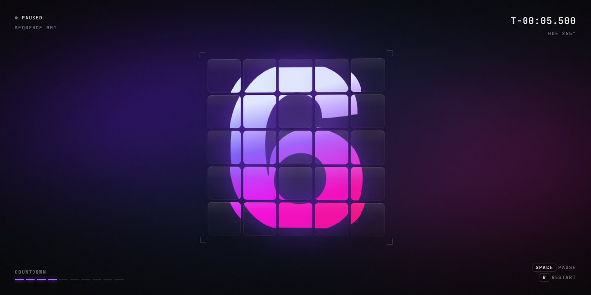

# T−Minus · motion study

Loop · CSS 3 · no libraries · @property · text-box trim · one HTML file

A countdown from nine to zero on a five-by-five grid of frosted glass tiles. Every tile shows the same digit, cropped to its own window of one giant numeral, so the grid reads as a single number. Once a second the digit zooms out to a small whole figure in every tile and back to the big shared one, and that pulse ripples outward from the centre tile ring by ring. The hue walks from cool blue through magenta to orange as the seconds fall, a timecode and ten segments count along, and zero fires a shockwave of rings and a flash. Pure CSS: registered custom properties, text-box trim and gradient-clipped text, driven by one number per tile.

**Open the lab:** [instalanding.ai/motion/t-minus](https://instalanding.ai/motion/t-minus) — the study running live, slowed down and taken apart.

## Files

| File | What it is |
| --- | --- |
| [`index.html`](index.html) | The study: one file, opens from disk. |
| [`PROMPT.md`](PROMPT.md) | The one-shot prompt that builds it. |

## Choreography · nine to zero (10s)

| What moves | Change | When | Ease |
| --- | --- | --- | --- |
| digit · every tile | 9 → 0, one a second | 0s → 10s | `none` |
| scale · digit in a tile | zooms out to a small whole digit and back, each second | 0s → 1s | `power2.inOut` |
| translate · digit in a tile | slides to the tile's own slice of one big numeral | 0s → 1s | `power2.inOut` |
| delay · per ring | +0.06s for each step out from the centre | 0s → 0.24s | `none` |
| hue · --h | 205° → 385°, blue to magenta to orange, 20° a second | 0s → 10s | `none` |
| shockwave · rings | three rings scale 0.15 → 2.8 and fade, with a flash | 9s → 10s | `power3.out` |

## Inputs

- POINTER: Tilts the grid toward the cursor and moves the light across the tiles; it sways gently when left alone
- SPACE: Pauses and resumes the countdown
- R / CLICK: Restarts from nine
- ← → / ↑ ↓: Pauses and steps a quarter second

## How it works · One numeral, cut into windows

1. Every tile is overflow: hidden and shows the same digit as a ::before, set at the full grid size (size ÷ 0.73, with text-box trimmed to the cap height so the glyph's box is the glyph).
2. Each tile knows its distance from the centre in tiles, dx and dy. It shifts its digit by −dx × pitch and −dy × pitch, where pitch is one tile plus a gap, so at full size every tile shows exactly its own slice of one big numeral and the gaps read as cuts.
3. One number per tile, --zoom from 0 to 1, drives both the shift and the scale: at 0 the shift is gone and the digit shrinks to fit inside its tile, so the grid becomes 25 small whole digits; at 1 they line up into one. --zoom is a registered @property, set each frame from a cubic in-out of the second.
4. The ripple is only a delay: each tile reads the clock minus 0.06s for every step it sits from the centre (Manhattan distance), so its digit flips and its pulse arrive later, ring by ring.
5. Colour is one registered number, --h, stepped 20° a second and transitioned over 900ms. The digit's gradient (background-clip: text) and the aurora, glow, segments and rings all read it; each tile nudges it by its position so the numeral shades across the grid.

## Best for

launch and release countdowns, event and drop pages, loading and pre-roll screens, dark product heroes with a number to show.

## Pairs with

- [Stage Light Launch Page](../../pages/stage-light-launch-page)
- [Event Horizon Orbital Page](../../pages/event-horizon-orbital-page)
- [Landra AI Landing Page Generator Page](../../pages/landra-ai-landing-page-generator-page)
