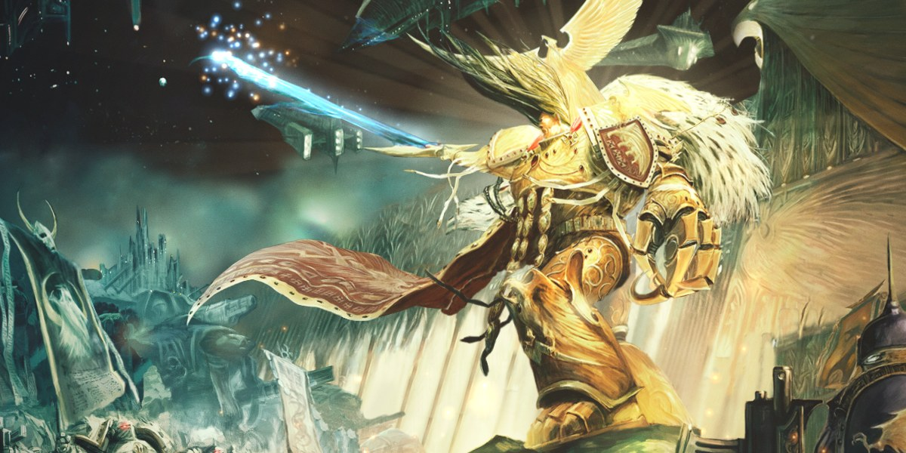

# The Emperor · motion study

Living Painting · Canvas 2D + WebGL decoded .riv · no runtime · skinned meshes · procedural particles · Web Audio · one HTML file

A painted battle scene brought to life: a winged emperor in golden armour on a rock above an army, warships in a storm sky behind. Cloth, hair, banners and cape ripple on a travelling wave of wind; embers rise from the battlefield in three depths, ash falls, god rays turn slowly behind the emperor and sheet lightning flickers through the clouds every 9 to 17 seconds. Move the pointer and the layers part in parallax; click and the sword flares, throwing sparks from its tip while embers swirl up and lightning answers. The painting is a Rive file replayed by a small runtime written for it, with the living layer drawn procedurally in the scene's own depth order; optional sound is synthesised live: wind, a low drone, crackle and thunder.

**Open the lab:** [instalanding.ai/motion/the-emperor](https://instalanding.ai/motion/the-emperor) — the study running live, slowed down and taken apart.

## Files

| File | What it is |
| --- | --- |
| [`index.html`](index.html) | The study: one file, opens from disk. |
| [`PROMPT.md`](PROMPT.md) | The one-shot prompt that builds it. |

## Choreography · one ignition (3s)

| What moves | Change | When | Ease |
| --- | --- | --- | --- |
| flare · the sword | jumps to 1.1, then burns down at 0.9 a second | 0s → 1.2s | `power3.out` |
| sparks · from the tip | 70 burst outward, drag and gravity pull them down over 0.5–1.4s | 0s → 1.41s | `power2.in` |
| gust · the wind | 1 → 0 over about 2s; cloth and embers run up to 2.6× faster | 0s → 2.19s | `power1.out` |
| flash · sheet lightning | a sharp peak, a second strike at 0.22s, then a 0.35 glow | 0s → 1.41s | `power3.out` |
| camera · parallax | eases toward the pointer, or drifts on two slow sines | 0s → 3s | `power1.inOut` |

## Inputs

- POINTER: Moves the parallax: the layers part toward where you look, and the camera leans in
- CLICK: Ignites the sword: sparks from the tip, a gust, embers swirling up and a lightning strike
- SOUND: The speaker button turns on synthesised wind, drone, crackle and thunder
- IDLE: Left alone, the parallax drifts and lightning strikes every 9 to 17 seconds

## How it works · A painting with a procedural layer threaded through its depth

1. The .riv was converted into plain data and is replayed by a small runtime written for this file: the transform tree, bones and IK, skinned image meshes (packed into an atlas and drawn in one WebGL pass per batch), clipping and the state machine.
2. The living layer isn't painted on top. The runtime calls hooks at chosen points in the draw order, so god rays and lightning draw behind the backdrop's sky, fog sits over the far army, far embers pass behind the emperor and the mid embers, dust and sparks sit in front of him.
3. Wind is a travelling wave: every bone that only drives cloth, hair or a banner gets a small rotation of sin(t × 1.6 + phase − depth × 0.75), deeper down the chain later, so motion runs from the shoulder to the hem. One noise-shaped wind curve drives the bones, the embers, the ash and the sound's filter.
4. Parallax reuses the file's own rig: a Para target drives the layers through a distance constraint. The pointer, mapped into the target's parent space, pulls it; when idle it drifts on two slow sines. The camera leans 8% the other way for depth.
5. A click sets flare to 1.1 and gust to 1, both decaying each frame; the sword's glow shapes, the god rays and the dust all read flare, and the wind reads gust. The sparks start at the blade tip, found by averaging the world points of the sword's glow shapes.

## Best for

game and fantasy launch pages, book, comic and lore sites, epic hero sections with one big image, trailers and pre-order pages.

## Pairs with

- [Starfork Game Studio Landing Page](../../pages/starfork-game-studio-landing-page)
- [Cyber Bird Arcade Game Page](../../pages/cyber-bird-arcade-game-page)
- [Latent AI Fashion Atelier Page](../../pages/latent-ai-fashion-atelier-page)

## Built on

- The painting is a Rive file depicting the Emperor of Mankind from Warhammer 40,000. That artwork and IP belong to Games Workshop and are not covered by this repo's MIT license; the runtime and the living layer (wind, particles, light, lab hooks) are.
