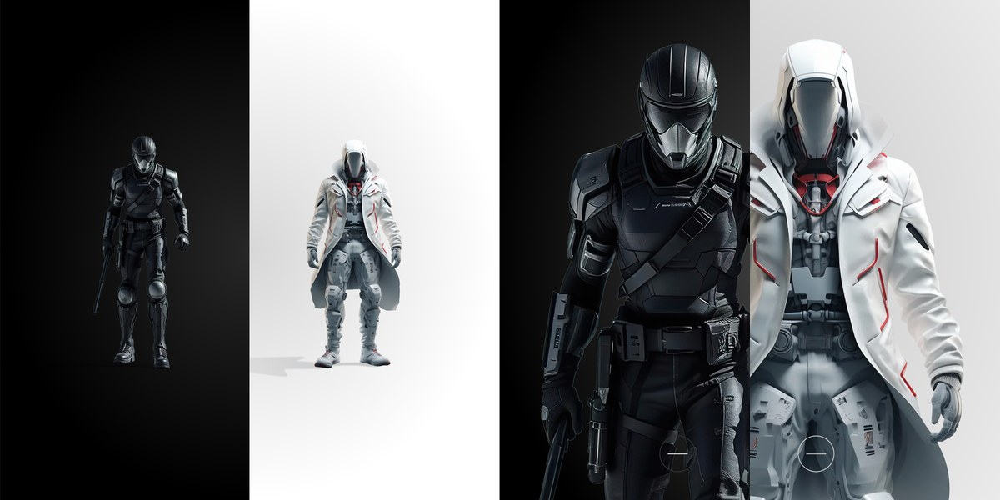

# Two Mercenaries · motion study

Character Select · Canvas 2D + WebGL decoded .riv · no runtime · state machine · skinned meshes · one HTML file

A character-select screen split down the middle: a black-armoured mercenary on a dark field, a white-coated one on a light field. Hover a side and it brightens while the other dims; click and the pick swells across the frame; click again and the camera pushes in to a close-up, and once more backs out. Both soldiers breathe the whole time on their own skeletal idle loops, so nothing ever freezes. A Rive file decoded and replayed by a small runtime written for this scene: bones, skinned image meshes drawn in WebGL, and a state machine that blends between five poses in 100 to 250 ms.

**Open the lab:** [instalanding.ai/motion/two-mercenaries](https://instalanding.ai/motion/two-mercenaries) — the study running live, slowed down and taken apart.

## Files

| File | What it is |
| --- | --- |
| [`index.html`](index.html) | The study: one file, opens from disk. |
| [`PROMPT.md`](PROMPT.md) | The one-shot prompt that builds it. |

## Choreography · hover, pick, zoom in, back out (1.5s)

| What moves | Change | When | Ease |
| --- | --- | --- | --- |
| Hover dark · input | false → true; the dark side lifts, the light side dims | 0s → 0.1s | `power2.inOut` |
| State · 0 → 1 Dark | the picked side scales to 1.1 and widens over the other | 0.3s → 0.55s | `power2.inOut` |
| State · 1 → 3 Dark ZOOM | the frame pushes in to the soldier's close-up | 0.75s → 1s | `power2.inOut` |
| State · 3 → 1 → 0 | backs out to the pick, then to both sides | 1.2s → 1.5s | `power2.inOut` |
| bones · idle breathing | 2s and 5s skeletal loops, one per soldier, under every state | 0s → 1.5s | `power1.inOut` |

## Inputs

- HOVER: Lights the side under the pointer and dims the other
- CLICK: Picks that mercenary; click again to zoom in, again to back out
- AUTOPLAY: Runs the pick: hover, select, zoom, back out, then the other side

## How it works · Five poses and a blend, over two breathing skeletons

1. The .riv was decoded into plain data: one 1080 × 1080 artboard holding two nested 1920 × 1080 artboards, one per soldier, plus five WebP images, the keyed animations and the state machine.
2. The screen's states are single-frame poses (idle, Dark, Light, Dark ZOOM, Light ZOOM), chosen by one number input, State. What reads as motion is the transition: the machine mixes from the current pose to the next over 100 to 250 ms on a cubic ease. Two booleans, Hover dark and Hover light, drive a second layer for the brighten-and-dim.
3. Each soldier is a skinned mesh: 37 bones, with vertices weighted to up to four of them, drawn as textured triangles in WebGL and composited onto the 2D canvas. Their idle timelines loop a 2s and a 5s work area at different speeds, so the two never breathe in step.
4. Pointer listeners on the artboard hit-test each half through the inverse world matrix and set the inputs, the same way the Rive editor's listeners would; the runtime only reads inputs and advances time.

## Best for

game and esports launch pages, pick-a-plan or pick-a-path choices, dark product heroes with two options, versus and comparison sections.

## Pairs with

- [Myriad Agent Swarm Page](../../pages/myriad-agent-swarm-page)
- [Starfork Game Studio Landing Page](../../pages/starfork-game-studio-landing-page)
- [Cyber Bird Arcade Game Page](../../pages/cyber-bird-arcade-game-page)
- [Latent AI Fashion Atelier Page](../../pages/latent-ai-fashion-atelier-page)
