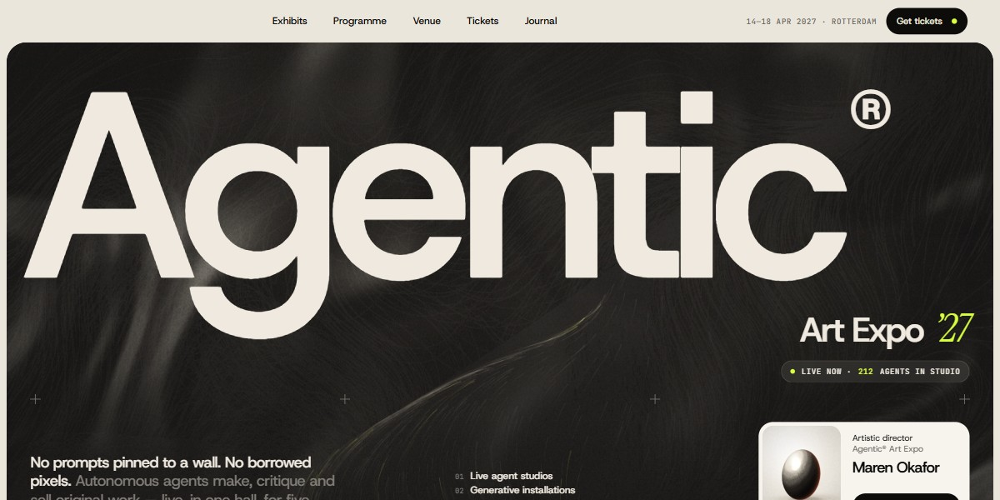

# Agentic Art Expo Page

An editorial event page for an expo where AI agents exhibit: a giant wordmark that flies into the header, a satin hero with live particle trails, a programme that floods dark from a full stop, and every picture painted in code.

**Open it:** [`index.html`](index.html) runs straight from disk — one file, every asset inlined, no build step. [Live demo](https://instalanding.ai/demos/agentic-art-expo.html) · [Page on InstaLanding](https://instalanding.ai/prompt/agentic-art-expo-page)

**The prompt:** [`PROMPT.md`](PROMPT.md) is this same file with a short instruction on top: keep the design, replace the brand and copy, convert to your stack. Paste it into Claude Code, Cursor, ChatGPT or any builder and it builds this page.

| | |
| --- | --- |
| Best for | AI art and creative-tech events, exhibitions, fairs and festivals, galleries and cultural venues, conferences with ticket tiers |
| Style | dark, editorial, generative-art, canvas, scroll-driven, grain |
| Sections | nav → hero → exhibits → about → programme → process → testimonials → stats → venue → pricing → team → press → faq → journal → cta → footer |
| Libraries | gsap 3.13.0, lenis 1.3.4 |
| Fonts | Host Grotesk, Instrument Serif, JetBrains Mono (Google Fonts) |
| Uses | canvas-2d, inline-svg, inlined-images, reduced-motion |
| Size | 105 KB · prompt ~27,134 tokens |

Every region is tagged `data-section`, and the file opens with a header comment that maps its design tokens, sections and scripts, and lists what breaks when you edit it. Read that first.

The brand, copy, numbers and testimonials on this page are fictional. Replace them before you ship.
