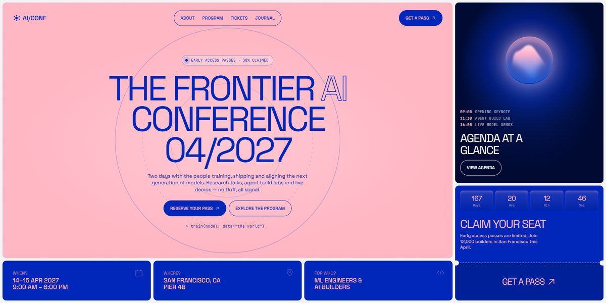

# AI/CONF Frontier AI Conference Page

A pink-and-cobalt bento page for a frontier AI conference: a huge outlined headline over slow orbit rings and a typed prompt, a sticky sidebar with a morphing glass orb agenda and a live countdown ticket, and navy scenes in liquid glass (a gooey neural net, a compute chip, an attention heatmap, test-tube benchmarks and server racks).

**Open it:** [`index.html`](index.html) runs straight from disk — one file, every asset inlined, no build step. [Live demo](https://instalanding.ai/demos/ai-conf-frontier.html) · [Page on InstaLanding](https://instalanding.ai/prompt/ai-conf-frontier-ai-conference-page)

**The prompt:** [`PROMPT.md`](PROMPT.md) is this same file with a short instruction on top: keep the design, replace the brand and copy, convert to your stack. Paste it into Claude Code, Cursor, ChatGPT or any builder and it builds this page.

| | |
| --- | --- |
| Best for | AI conferences and events, developer and research summits, ticketed launches with tiers, community meetups |
| Style | light, bento, liquid-glass, svg-illustration, brutalist-type |
| Sections | hero → nav → marquee → about → partners → program → tickets → testimonials → faq → journal → archive → sidebar → contact → footer |
| Libraries | none — plain HTML, CSS and JS |
| Fonts | Space Grotesk, JetBrains Mono (Google Fonts) |
| Uses | inline-svg, inlined-images, reduced-motion |
| Size | 91 KB · prompt ~23,572 tokens |

Every region is tagged `data-section`, and the file opens with a header comment that maps its design tokens, sections and scripts, and lists what breaks when you edit it. Read that first.

## Built on

- [Morphing orb by andrew-manzyk on Uiverse.io](https://uiverse.io/) — The agenda card's morphing glass orb (MIT)

Keep this attribution if you redistribute the component; the original's own terms apply to the parts taken from it.

The brand, copy, numbers and testimonials on this page are fictional. Replace them before you ship.
