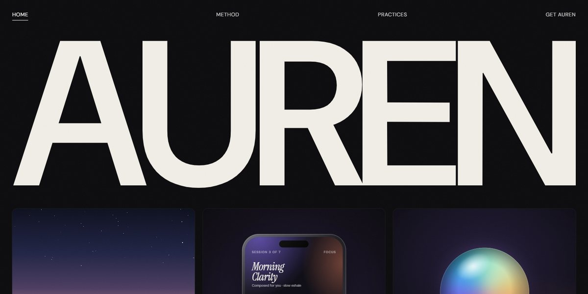

# Auren AI Meditation Guide Page

A hushed, near-black page for an AI meditation guide: a counting intro splits open on a full-width AUREN wordmark over three living tiles (misty dawn ridges, the app mid-session, a breathing glass orb), a WebGL aurora band, sticky stacked cards of paired art, marquee rows of seventeen generative scenes and a stories carousel.

**Open it:** [`index.html`](index.html) runs straight from disk — one file, every asset inlined, no build step. [Live demo](https://instalanding.ai/demos/auren-ai-meditation.html) · [Page on InstaLanding](https://instalanding.ai/prompt/auren-ai-meditation-guide-page)

**The prompt:** [`PROMPT.md`](PROMPT.md) is this same file with a short instruction on top: keep the design, replace the brand and copy, convert to your stack. Paste it into Claude Code, Cursor, ChatGPT or any builder and it builds this page.

| | |
| --- | --- |
| Best for | wellness and meditation apps, consumer AI products, audio and sleep apps, calm, premium brand launches |
| Style | dark, minimal, generative-art, webgl, scroll-driven |
| Sections | intro → nav → hero → method → practices → how-it-works → explore → stories → journal → footer |
| Libraries | none — plain HTML, CSS and JS |
| Fonts | DM Sans, Instrument Serif (Google Fonts) |
| Uses | webgl, inline-svg, inlined-images, reduced-motion |
| Size | 84 KB · prompt ~21,715 tokens |

Every region is tagged `data-section`, and the file opens with a header comment that maps its design tokens, sections and scripts, and lists what breaks when you edit it. Read that first.

The brand, copy, numbers and testimonials on this page are fictional. Replace them before you ship.
