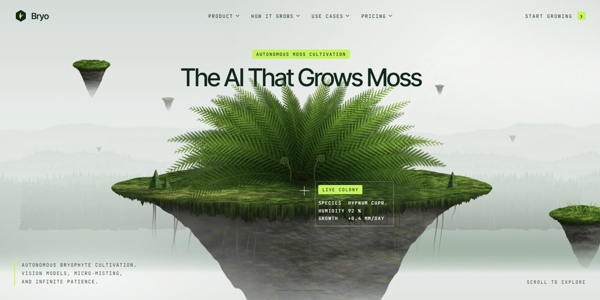

# Bryo AI Moss Cultivation Page

A misty sage-and-lime page for an AI that grows moss, painted entirely in code: a floating moss island with a fern under a scroll-driven camera that dollies down into a fogged conifer valley, telling a five-beat story (headline, word-by-word vision, an account with sensor hotspots, a field card with a coverage sparkline and a feature list), then use-case cards with generated aerial art, counting stats, four growth loops, a live moss-growth simulation with AI detection boxes, pricing, an FAQ and a waitlist CTA.

**Open it:** [`index.html`](index.html) runs straight from disk — one file, every asset inlined, no build step. [Live demo](https://instalanding.ai/demos/bryo-ai-moss-cultivation.html) · [Page on InstaLanding](https://instalanding.ai/prompt/bryo-ai-moss-cultivation-page)

**The prompt:** [`PROMPT.md`](PROMPT.md) is this same file with a short instruction on top: keep the design, replace the brand and copy, convert to your stack. Paste it into Claude Code, Cursor, ChatGPT or any builder and it builds this page.

| | |
| --- | --- |
| Best for | climate and agritech startups, AI for the physical world, hardware with a cloud service, landscape and green-infrastructure teams |
| Style | light, nature, scroll-story, canvas-art, lime |
| Sections | nav → hero → use-cases → how-it-works → product → pricing → faq → cta → footer |
| Libraries | none — plain HTML, CSS and JS |
| Fonts | Inter Tight, JetBrains Mono |
| Uses | canvas-2d, inline-svg, inlined-images, reduced-motion |
| Size | 106 KB · prompt ~27,231 tokens |

Every region is tagged `data-section`, and the file opens with a header comment that maps its design tokens, sections and scripts, and lists what breaks when you edit it. Read that first.

The brand, copy, numbers and testimonials on this page are fictional. Replace them before you ship.
