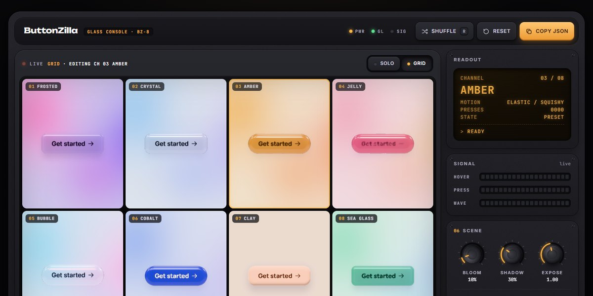

# ButtonZilla Glass Console Page

A dark hardware-style console for live 3D glass buttons: a WebGL monitor with a refracting, bevelled pill button that tilts on hover, squashes on press and sends a ripple through its surface, a solo or eight-up grid view, an amber LCD readout with signal meters, eight preset channels (Frosted, Crystal, Amber, Jelly, Bubble, Cobalt, Clay, Sea glass), and rotary knobs for shape, glass, liquid and scene, with Shuffle, Reset and Copy JSON.

**Open it:** [`index.html`](index.html) runs straight from disk — one file, every asset inlined, no build step. [Live demo](https://instalanding.ai/demos/buttonzilla-glass-console.html) · [Page on InstaLanding](https://instalanding.ai/prompt/buttonzilla-glass-console-page)

**The prompt:** [`PROMPT.md`](PROMPT.md) is this same file with a short instruction on top: keep the design, replace the brand and copy, convert to your stack. Paste it into Claude Code, Cursor, ChatGPT or any builder and it builds this page.

| | |
| --- | --- |
| Best for | UI component generators, design tool and plugin sites, 3D and WebGL showcases, interactive product playgrounds |
| Style | dark, hardware, webgl, glass, three.js |
| Sections | nav → monitor → rack → bank → modules → footer |
| Libraries | three 0.170.0 |
| Fonts | Inter, JetBrains Mono, Unbounded, Onest, Manrope, Geologica, Rubik |
| Uses | inline-svg, inlined-images, reduced-motion |
| Size | 95 KB · prompt ~24,474 tokens |

Every region is tagged `data-section`, and the file opens with a header comment that maps its design tokens, sections and scripts, and lists what breaks when you edit it. Read that first.

Built on: [ButtonZilla by Shakuro](https://buttonzilla.vercel.app) (The 3D glass buttons this console drives, credited in the page's foot line).

The brand, copy, numbers and testimonials on this page are fictional. Replace them before you ship.
