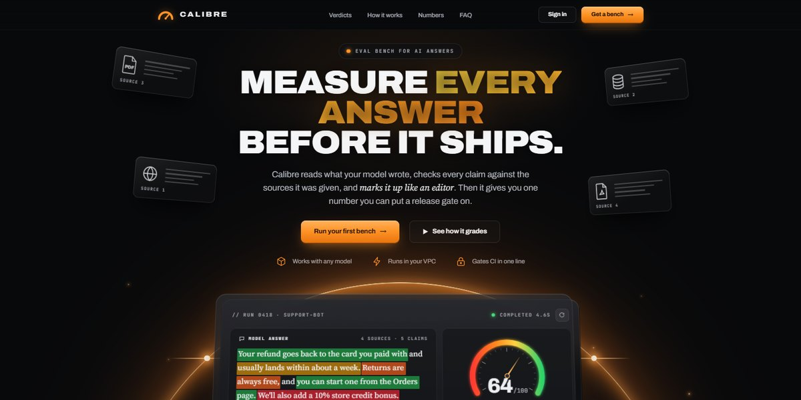

# Calibre Grading Bench Page

A glass grading bench on a planet horizon: it reads an AI answer claim by claim, highlights each one in its verdict colour and swings a needle to the score.

**Open it:** [`index.html`](index.html) runs straight from disk — one file, every asset inlined, no build step. [Live demo](https://instalanding.ai/demos/calibre-bench.html) · [Page on InstaLanding](https://instalanding.ai/prompt/calibre-grading-bench-page)

**The prompt:** [`PROMPT.md`](PROMPT.md) is this same file with a short instruction on top: keep the design, replace the brand and copy, convert to your stack. Paste it into Claude Code, Cursor, ChatGPT or any builder and it builds this page.

| | |
| --- | --- |
| Best for | AI evaluation and observability tools, LLM quality and grounding products, developer tools with a release gate, AI safety and compliance software |
| Style | dark, glass, glow, highlighter, planet horizon, bred |
| Sections | nav → hero → verdicts → how-it-works → stats → faq → cta → footer |
| Libraries | none — plain HTML, CSS and JS |
| Fonts | Archivo, JetBrains Mono, Source Serif 4 (Google Fonts) |
| Uses | inline-svg, reduced-motion |
| Size | 75 KB · prompt ~19,350 tokens |

Every region is tagged `data-section`, and the file opens with a header comment that maps its design tokens, sections and scripts, and lists what breaks when you edit it. Read that first.

The brand, copy, numbers and testimonials on this page are fictional. Replace them before you ship.
