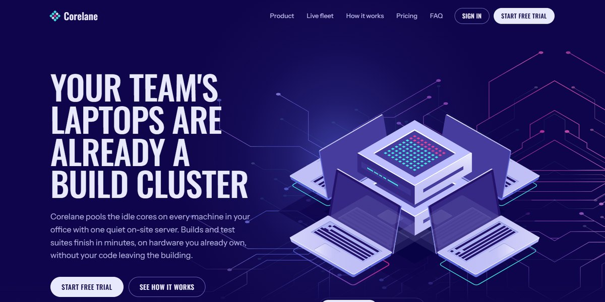

# Corelane Build Cluster Page

An isometric dev-tool landing page: laptops and a core server on a glowing circuit field, plus a 96-machine fleet board you can put to sleep and run a build across.

**Open it:** [`index.html`](index.html) runs straight from disk — one file, every asset inlined, no build step. [Live demo](https://instalanding.ai/demos/corelane-cluster.html) · [Page on InstaLanding](https://instalanding.ai/prompt/corelane-build-cluster-page)

**The prompt:** [`PROMPT.md`](PROMPT.md) is this same file with a short instruction on top: keep the design, replace the brand and copy, convert to your stack. Paste it into Claude Code, Cursor, ChatGPT or any builder and it builds this page.

| | |
| --- | --- |
| Best for | developer tools and build infrastructure, on-prem and edge compute products, B2B SaaS with per-seat pricing, AI compute and GPU-sharing products |
| Style | dark, isometric, illustrated, interactive, neon, svg-animation |
| Sections | nav → hero → product → fleet → how → pricing → faq → cta → footer |
| Libraries | none — plain HTML, CSS and JS |
| Fonts | Oswald, Instrument Sans (Google Fonts) |
| Uses | inline-svg, reduced-motion |
| Size | 448 KB · prompt ~114,977 tokens |

Every region is tagged `data-section`, and the file opens with a header comment that maps its design tokens, sections and scripts, and lists what breaks when you edit it. Read that first.

The brand, copy, numbers and testimonials on this page are fictional. Replace them before you ship.
