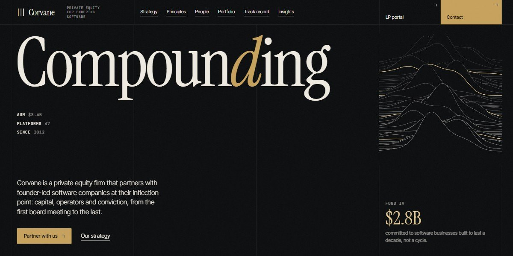

# Corvane Capital Private Equity Page

A quiet-money private equity page on a ruled four-column grid: a giant serif "Compounding" beside a window of live ridgelines that opens to full bleed as you scroll, a champagne principles field that fans six strokes into line, and a track record that flips between gross and net.

**Open it:** [`index.html`](index.html) runs straight from disk — one file, every asset inlined, no build step. [Live demo](https://instalanding.ai/demos/corvane-capital.html) · [Page on InstaLanding](https://instalanding.ai/prompt/corvane-capital-private-equity-page)

**The prompt:** [`PROMPT.md`](PROMPT.md) is this same file with a short instruction on top: keep the design, replace the brand and copy, convert to your stack. Paste it into Claude Code, Cursor, ChatGPT or any builder and it builds this page.

| | |
| --- | --- |
| Best for | private equity and venture firms, investment and wealth managers, family offices and holding companies, B2B firms that sell on trust |
| Style | dark, editorial, serif, ruled-grid, scroll-driven, gold |
| Sections | hero → about → strategy → principles → process → team → portfolio → offices → sectors → criteria → record → faq → insights → contact |
| Libraries | gsap 3.13.0, lenis 1.3.4 |
| Fonts | Instrument Serif, Inter Tight, JetBrains Mono (Google Fonts) |
| Uses | canvas-2d, inline-svg, inlined-images, reduced-motion |
| Size | 103 KB · prompt ~26,478 tokens |

Every region is tagged `data-section`, and the file opens with a header comment that maps its design tokens, sections and scripts, and lists what breaks when you edit it. Read that first.

The brand, copy, numbers and testimonials on this page are fictional. Replace them before you ship.
