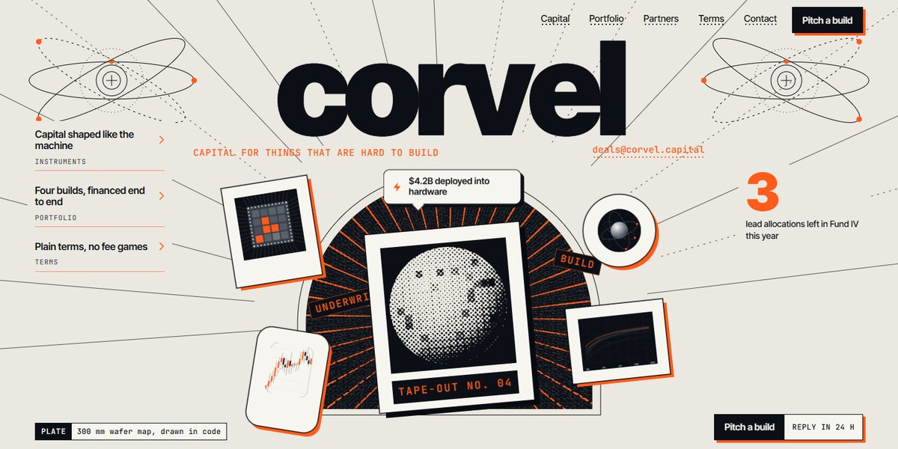

# Corvel Hard-Tech Capital Page

A risograph-print investment firm for fabs, satellites and fusion: halftone art drawn in code, a sunburst arch that blows apart on scroll and a two-plate misregistered print.

**Open it:** [`index.html`](index.html) runs straight from disk — one file, every asset inlined, no build step. [Live demo](https://instalanding.ai/demos/corvel-capital.html) · [Page on InstaLanding](https://instalanding.ai/prompt/corvel-hard-tech-capital-page)

**Build it yourself:** [`PROMPT.md`](PROMPT.md) is the one-shot brief this file was built from. Paste it into any AI builder or coding agent.

| | |
| --- | --- |
| Best for | venture and investment firms, hard-tech, deep-tech and climate funds, industrial and infrastructure finance, editorial brand sites |
| Style | light, risograph, halftone, editorial, gsap, scroll-driven |
| Sections | nav → hero → services → story → portfolio → stats → process → team → reviews → gallery → pricing → faq → contact → footer |
| Libraries | gsap 3.13.0, lenis 1.3.4 |
| Fonts | Inter Tight, JetBrains Mono, Newsreader (Google Fonts) |
| Uses | inline-svg, inlined-images, reduced-motion |
| Size | 101 KB · brief ~1,653 tokens |

Every region is tagged `data-section`, and the file opens with a header comment that maps its design tokens, sections and scripts, and lists what breaks when you edit it. Read that first.

The brand, copy, numbers and testimonials on this page are fictional. Replace them before you ship.
