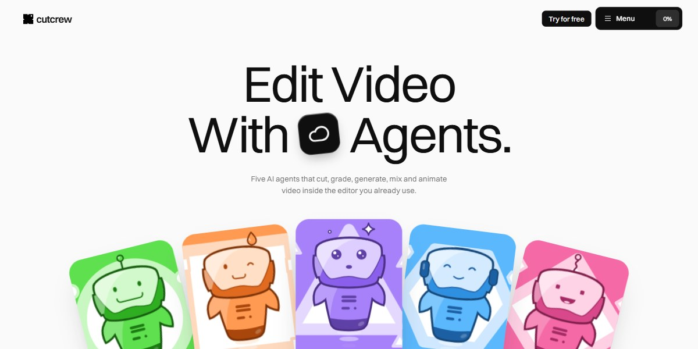

# Cutcrew AI Video Agents Page

A bright, playful page for five AI video-editing agents, each a candy-coloured robot mascot drawn in SVG that floats in place: a hero fan of agent cards, a sentence with the robots set inline, a dark timeline strip with hover tooltips, three ways to brief the agents (an accordion with a self-typing prompt and a TypeScript SDK card), a studio services index, a six-week gantt with a sweeping playhead, fanning project decks, an album gallery, a team card deck, auto-advancing stories, monthly/annual pricing and a spinning 3D ring of covers in the CTA.

**Open it:** [`index.html`](index.html) runs straight from disk — one file, every asset inlined, no build step. [Live demo](https://instalanding.ai/demos/cutcrew-ai-video-agents.html) · [Page on InstaLanding](https://instalanding.ai/prompt/cutcrew-ai-video-agents-page)

**The prompt:** [`PROMPT.md`](PROMPT.md) is this same file with a short instruction on top: keep the design, replace the brand and copy, convert to your stack. Paste it into Claude Code, Cursor, ChatGPT or any builder and it builds this page.

| | |
| --- | --- |
| Best for | AI video and creative tools, multi-agent products, SaaS with a studio or services arm, playful consumer and prosumer apps |
| Style | light, playful, svg-mascots, bento, electric-green |
| Sections | nav → hero → statement → timeline → logos → numbers → features → create → connected → agents → services → process → projects → gallery → team → stories → testimonials → pricing → faq → contact → cta → footer |
| Libraries | none — plain HTML, CSS and JS |
| Fonts | Switzer (Fontshare), Inter, Geist Mono |
| Uses | inline-svg, inlined-images, reduced-motion |
| Size | 109 KB · prompt ~28,013 tokens |

Every region is tagged `data-section`, and the file opens with a header comment that maps its design tokens, sections and scripts, and lists what breaks when you edit it. Read that first.

The brand, copy, numbers and testimonials on this page are fictional. Replace them before you ship.
