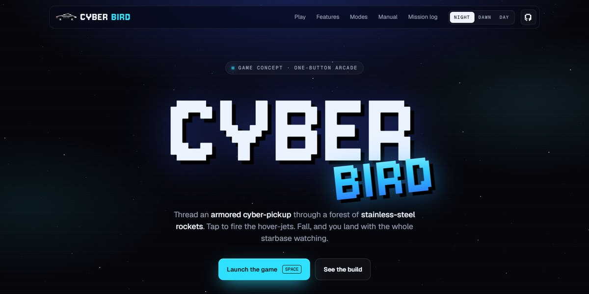

# Cyber Bird Arcade Game Page

A pixel-art arcade game launch page with the game playable right in the hero: a one-button flyer threading an armored cyber-pickup through stainless rocket stacks, night, dawn and day skies drawn by code, difficulty presets and a local mission log.

**Open it:** [`index.html`](index.html) runs straight from disk — one file, every asset inlined, no build step. [Live demo](https://instalanding.ai/demos/cyber-bird-arcade.html) · [Page on InstaLanding](https://instalanding.ai/prompt/cyber-bird-arcade-game-page)

**Build it yourself:** [`PROMPT.md`](PROMPT.md) is the one-shot brief this file was built from. Paste it into any AI builder or coding agent.

| | |
| --- | --- |
| Best for | indie games and game launches, interactive product demos, playful brand pages, pixel-art and retro sites |
| Style | dark, pixel-art, retro, playable-game, canvas, interactive |
| Sections | nav → hero → marquee → features → modes → manual → mission-log → cta → footer |
| Libraries | none — plain HTML, CSS and JS |
| Fonts | Jersey 10, Geist, Geist Mono (Google Fonts) |
| Uses | canvas-2d, inline-svg, reduced-motion |
| Size | 99 KB · brief ~1,549 tokens |

Every region is tagged `data-section`, and the file opens with a header comment that maps its design tokens, sections and scripts, and lists what breaks when you edit it. Read that first.

## Built on

- [Tesla Bird by Pavel Troshkin](https://github.com/troshkinpavel/tesla-bird) — The open-source one-button game this page's game logic is built on; the sprites here are redrawn in code

Keep this attribution if you redistribute the component; the original's own terms apply to the parts taken from it.

The brand, copy, numbers and testimonials on this page are fictional. Replace them before you ship.
