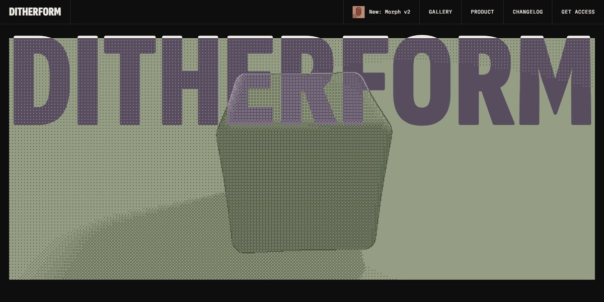

# Ditherform AI Dither Generator Page

A near-black, grid-ruled page for an AI that turns a prompt into a live 3D dither element: every picture on it is a raymarched shape morphing between a cube, sphere, torus and more, Bayer-dithered in two muted inks with a crisp outline, under fitted condensed headlines, a scroll-driven marquee, a logo wall and a cream changelog whose rows slide a plate in on hover.

**Open it:** [`index.html`](index.html) runs straight from disk — one file, every asset inlined, no build step. [Live demo](https://instalanding.ai/demos/ditherform-ai-dither.html) · [Page on InstaLanding](https://instalanding.ai/prompt/ditherform-ai-dither-generator-page)

**The prompt:** [`PROMPT.md`](PROMPT.md) is this same file with a short instruction on top: keep the design, replace the brand and copy, convert to your stack. Paste it into Claude Code, Cursor, ChatGPT or any builder and it builds this page.

| | |
| --- | --- |
| Best for | AI creative and generative tools, design and dev tool launches, WebGL and shader showcases, studios with a print or retro-computing look |
| Style | dark, webgl, dithered, bold-type, editorial |
| Sections | nav → hero → intro → gallery → marquee → clients → changelog → cta → footer |
| Libraries | none — plain HTML, CSS and JS |
| Fonts | Martian Mono, Sofia Sans Extra Condensed (Google Fonts) |
| Uses | webgl, canvas-2d, inline-svg, inlined-images, reduced-motion |
| Size | 45 KB · prompt ~11,809 tokens |

Every region is tagged `data-section`, and the file opens with a header comment that maps its design tokens, sections and scripts, and lists what breaks when you edit it. Read that first.

The brand, copy, numbers and testimonials on this page are fictional. Replace them before you ship.
