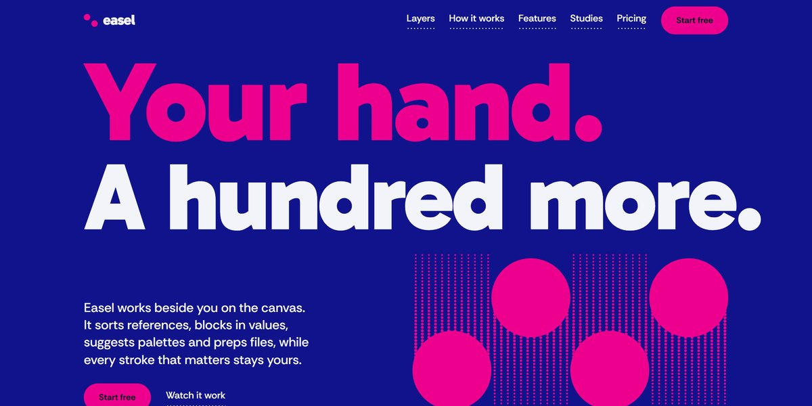

# Easel AI Artist Assistant Page

A two-ink risograph page for an AI studio assistant for artists: four pink ink drums roll down the hero and print a panel as you scroll, blue and pink plates slide into register, every illustration is greyscale SVG turned duotone by a blend, and a live plan ticket prices as you pick.

**Open it:** [`index.html`](index.html) runs straight from disk — one file, every asset inlined, no build step. [Live demo](https://instalanding.ai/demos/easel-artist-assistant.html) · [Page on InstaLanding](https://instalanding.ai/prompt/easel-ai-artist-assistant-page)

**Build it yourself:** [`PROMPT.md`](PROMPT.md) is the one-shot brief this file was built from. Paste it into any AI builder or coding agent.

| | |
| --- | --- |
| Best for | AI tools for artists and creatives, creative software launches, SaaS with plan builders, print and design studios |
| Style | risograph, two-color, bold-type, svg-illustration, scroll-driven |
| Sections | nav → hero → layers → process → features → studies → pricing → uses → faq → contact → footer |
| Libraries | gsap 3.13.0, lenis 1.3.27 |
| Fonts | system fonts only |
| Uses | inline-svg, inlined-images, reduced-motion |
| Size | 94 KB · brief ~1,105 tokens |

Every region is tagged `data-section`, and the file opens with a header comment that maps its design tokens, sections and scripts, and lists what breaks when you edit it. Read that first.

The brand, copy, numbers and testimonials on this page are fictional. Replace them before you ship.
