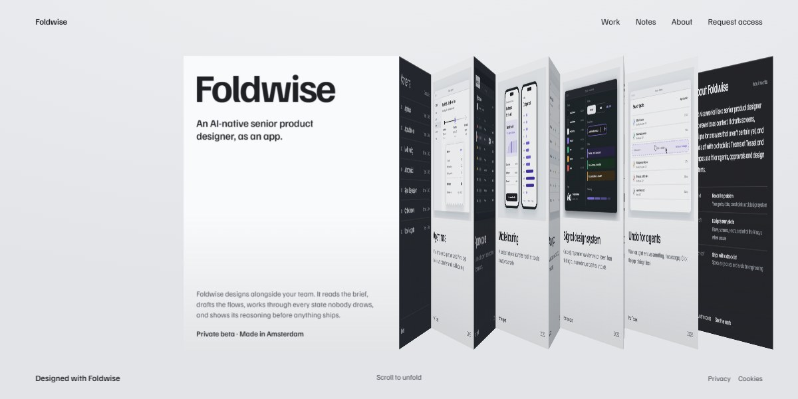

# Foldwise AI Product Designer Page

A quiet grey page for an AI-native product designer, laid out as a folding book: twelve paper and dark-stock panels (a cover, contents, seven case studies, field notes, about and a business-card contact) concertina open in 3D as you scroll, shading as they turn. Every case study plate is drawn in SVG: an agent run with a live step, an approval queue, model routing on two phones, an autonomy dial, a design system sheet, a context-window selector and an undo gap. On phones the book lies flat as one tall stack.

**Open it:** [`index.html`](index.html) runs straight from disk — one file, every asset inlined, no build step. [Live demo](https://instalanding.ai/demos/foldwise-ai-product-designer.html) · [Page on InstaLanding](https://instalanding.ai/prompt/foldwise-ai-product-designer-page)

**The prompt:** [`PROMPT.md`](PROMPT.md) is this same file with a short instruction on top: keep the design, replace the brand and copy, convert to your stack. Paste it into Claude Code, Cursor, ChatGPT or any builder and it builds this page.

| | |
| --- | --- |
| Best for | portfolios and case-study sites, AI design and agent tools, studio and agency pages, product launch microsites |
| Style | light, editorial, 3d-fold, scroll-driven, svg-illustration |
| Sections | nav → menu → fold → cover → index → agent-runs → approval-queue → model-routing → autonomy-dial → signal-design-system → context-window → undo-for-agents → notes → about → contact |
| Libraries | none — plain HTML, CSS and JS |
| Fonts | Familjen Grotesk (Google Fonts) |
| Uses | inline-svg, reduced-motion |
| Size | 44 KB · prompt ~11,592 tokens |

Every region is tagged `data-section`, and the file opens with a header comment that maps its design tokens, sections and scripts, and lists what breaks when you edit it. Read that first.

The brand, copy, numbers and testimonials on this page are fictional. Replace them before you ship.
