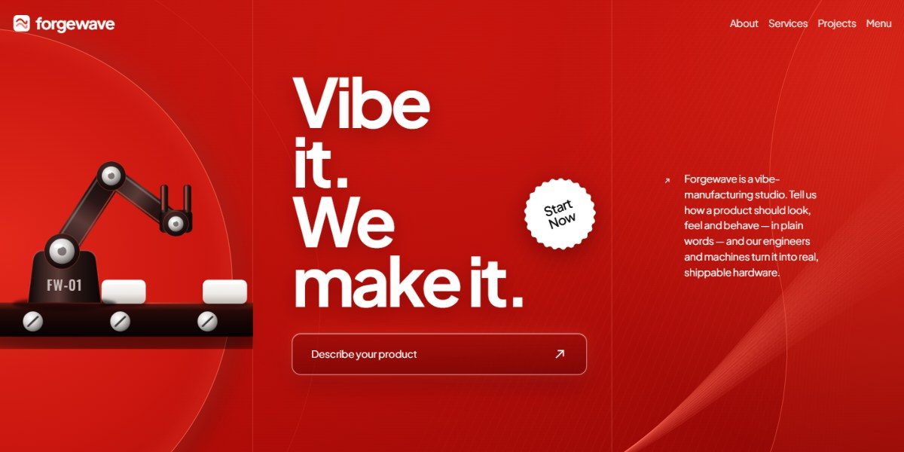

# Forgewave Vibe-Manufacturing Studio Page

A red-and-ink page for a studio that turns a described vibe into a real product, drawn entirely in animated SVG from a robot arm loading a conveyor to a factory-belt footer.

**Open it:** [`index.html`](index.html) runs straight from disk — one file, every asset inlined, no build step. [Live demo](https://instalanding.ai/demos/forgewave-vibe-manufacturing-studio.html) · [Page on InstaLanding](https://instalanding.ai/prompt/forgewave-vibe-manufacturing-studio-page)

**The prompt:** [`PROMPT.md`](PROMPT.md) is this same file with a short instruction on top: keep the design, replace the brand and copy, convert to your stack. Paste it into Claude Code, Cursor, ChatGPT or any builder and it builds this page.

| | |
| --- | --- |
| Best for | hardware and product studios, manufacturing and prototyping services, industrial design agencies, AI-to-physical product startups |
| Style | dark, factory-red, illustrated, svg-animation, sticky-cards |
| Sections | nav → hero → about → services → projects → team → pricing → strategic → testimonials → blog → footer → menu |
| Libraries | none — plain HTML, CSS and JS |
| Fonts | Plus Jakarta Sans, Inter, Oswald, Fragment Mono |
| Uses | inline-svg, inlined-images, reduced-motion |
| Size | 1365 KB · prompt ~349,536 tokens |

Every region is tagged `data-section`, and the file opens with a header comment that maps its design tokens, sections and scripts, and lists what breaks when you edit it. Read that first.

The brand, copy, numbers and testimonials on this page are fictional. Replace them before you ship.
