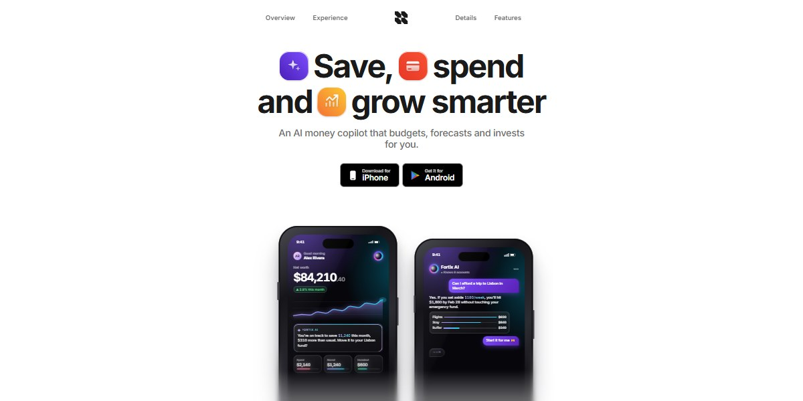

# Fortix AI Money Copilot App Page

A bright, airy app page for an AI money copilot: a headline set with glossy gradient app icons, six dark glass phone screens drawn entirely in HTML and SVG (net worth, AI chat, autopilot rules, a forecast with a confidence band, a blocked-fraud alert), a turning 3D ring of stat cards, floating badges and chat bubbles, a landscape dashboard that tips up into view and a tap-through 3D feature carousel.

**Open it:** [`index.html`](index.html) runs straight from disk — one file, every asset inlined, no build step. [Live demo](https://instalanding.ai/demos/fortix-ai-money-copilot.html) · [Page on InstaLanding](https://instalanding.ai/prompt/fortix-ai-money-copilot-app-page)

**The prompt:** [`PROMPT.md`](PROMPT.md) is this same file with a short instruction on top: keep the design, replace the brand and copy, convert to your stack. Paste it into Claude Code, Cursor, ChatGPT or any builder and it builds this page.

| | |
| --- | --- |
| Best for | fintech and personal finance apps, AI assistants and copilots, mobile app launches, consumer apps with an App Store CTA |
| Style | light, glassmorphism, phone-mockups, 3d-carousel, gradient-icons |
| Sections | nav → hero → clients → about → experience → testimonials → details → autopilot → feature-cards → cta → footer |
| Libraries | none — plain HTML, CSS and JS |
| Fonts | Inter (Google Fonts) |
| Uses | inline-svg, reduced-motion |
| Size | 63 KB · prompt ~16,367 tokens |

Every region is tagged `data-section`, and the file opens with a header comment that maps its design tokens, sections and scripts, and lists what breaks when you edit it. Read that first.

The brand, copy, numbers and testimonials on this page are fictional. Replace them before you ship.
