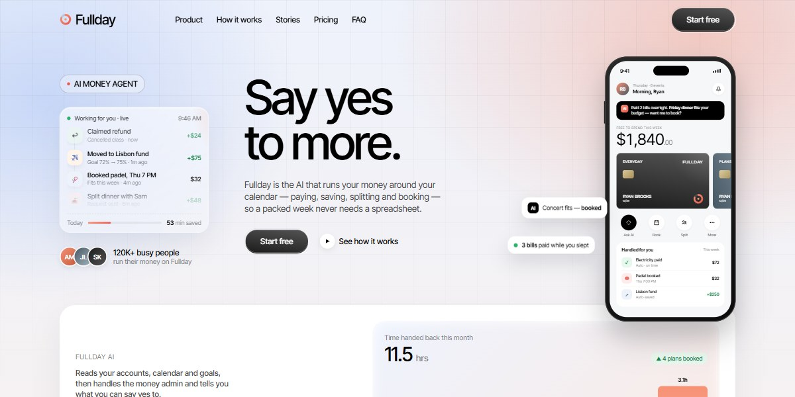

# Fullday AI Money Agent Page

A soft blue-and-peach page for an AI money agent that works around your calendar, with a live feed of finished tasks, sliding payment cards on a phone and a self-typing can I afford it prompt.

**Open it:** [`index.html`](index.html) runs straight from disk — one file, every asset inlined, no build step. [Live demo](https://instalanding.ai/demos/fullday-ai-money-agent.html) · [Page on InstaLanding](https://instalanding.ai/prompt/fullday-ai-money-agent-page)

**The prompt:** [`PROMPT.md`](PROMPT.md) is this same file with a short instruction on top: keep the design, replace the brand and copy, convert to your stack. Paste it into Claude Code, Cursor, ChatGPT or any builder and it builds this page.

| | |
| --- | --- |
| Best for | fintech and personal finance apps, AI agents that act for users, consumer subscription products, calendar and productivity tools |
| Style | light, soft-gradients, phone-mockups, scroll-reveals, rounded-sections |
| Sections | nav → hero → problem → solution → how-it-works → features → product → results → testimonials → benefits → pricing → faq → journal → cta → footer |
| Libraries | none — plain HTML, CSS and JS |
| Fonts | Inter Tight, Montserrat (Google Fonts) |
| Uses | inline-svg, reduced-motion |
| Size | 115 KB · prompt ~29,479 tokens |

Every region is tagged `data-section`, and the file opens with a header comment that maps its design tokens, sections and scripts, and lists what breaks when you edit it. Read that first.

The brand, copy, numbers and testimonials on this page are fictional. Replace them before you ship.
