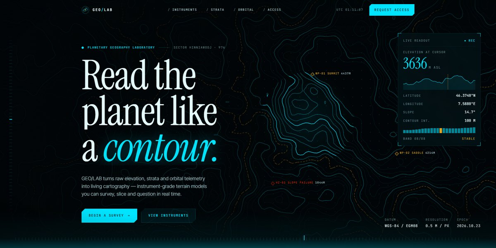

# GEO/LAB Planetary Geography Page

A cyan-on-black instrument page for a geography lab: live contour lines drift across the hero while a reticle and HUD read elevation, slope and a terrain profile under your cursor, then eight elevation bands separate in 3D as you scroll.

**Open it:** [`index.html`](index.html) runs straight from disk — one file, every asset inlined, no build step. [Live demo](https://instalanding.ai/demos/geolab-planetary-geography.html) · [Page on InstaLanding](https://instalanding.ai/prompt/geo-lab-planetary-geography-page)

**The prompt:** [`PROMPT.md`](PROMPT.md) is this same file with a short instruction on top: keep the design, replace the brand and copy, convert to your stack. Paste it into Claude Code, Cursor, ChatGPT or any builder and it builds this page.

| | |
| --- | --- |
| Best for | geospatial, mapping and earth-observation products, scientific instruments and labs, climate and hazard monitoring, data-heavy deep-tech launches |
| Style | dark, fui, hud, canvas, generative, scroll-driven |
| Sections | nav → hero → ticker → instruments → strata → orbital → metrics → protocol → pricing → cta → footer |
| Libraries | none — plain HTML, CSS and JS |
| Fonts | Instrument Serif, Inter Tight, JetBrains Mono (Google Fonts) |
| Uses | canvas-2d, inline-svg, inlined-images, reduced-motion |
| Size | 76 KB · prompt ~19,555 tokens |

Every region is tagged `data-section`, and the file opens with a header comment that maps its design tokens, sections and scripts, and lists what breaks when you edit it. Read that first.

The brand, copy, numbers and testimonials on this page are fictional. Replace them before you ship.
