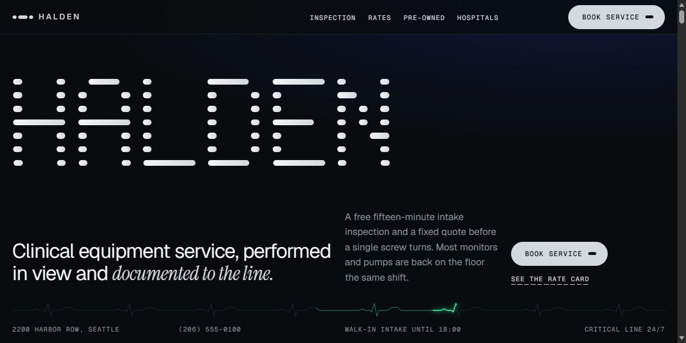

# Halden Clinical Equipment Page

A clinical equipment service in ink and paper: a dot-matrix wordmark that splits apart, a pinned 12-check inspection board, a rate card and a scroll-driven pre-owned shelf.

**Open it:** [`index.html`](index.html) runs straight from disk — one file, every asset inlined, no build step. [Live demo](https://instalanding.ai/demos/halden-clinical.html) · [Page on InstaLanding](https://instalanding.ai/prompt/halden-clinical-equipment-page)

**The prompt:** [`PROMPT.md`](PROMPT.md) is this same file with a short instruction on top: keep the design, replace the brand and copy, convert to your stack. Paste it into Claude Code, Cursor, ChatGPT or any builder and it builds this page.

| | |
| --- | --- |
| Best for | medical device and equipment services, repair and maintenance businesses, B2B service with a rate card, healthcare operations |
| Style | dark, editorial, monospace, gsap, scroll-driven, dot-matrix |
| Sections | nav → hero → diagnosis → prices → bench → parts → refurb → fleet → mailin → reviews → faq → visit → footer |
| Libraries | gsap 3.13.0, lenis 1.3.27 |
| Fonts | Geist, Geist Mono, Instrument Serif (Google Fonts) |
| Uses | inline-svg, inlined-images, reduced-motion |
| Size | 178 KB · prompt ~45,659 tokens |

Every region is tagged `data-section`, and the file opens with a header comment that maps its design tokens, sections and scripts, and lists what breaks when you edit it. Read that first.

## Built on

- [8B · Reflow template](https://8b.com/templates/reflow/) — The MIT repair-shop template this page adapts, its layout system and its scroll scenes

Keep this attribution if you redistribute the component; the original's own terms apply to the parts taken from it.

The brand, copy, numbers and testimonials on this page are fictional. Replace them before you ship.
