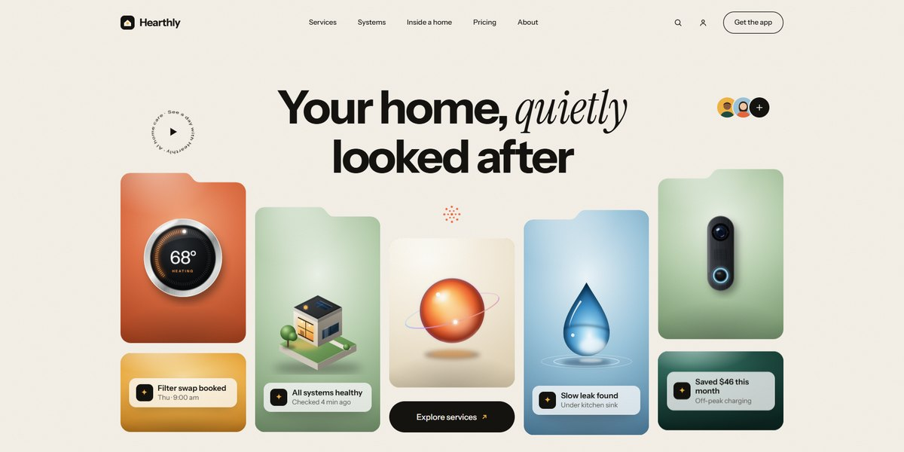

# Hearthly AI Home Care Page

A warm, illustrated page for an AI home assistant: a floating collage of glossy home-system cards that floods open into a night scene of the house, stacking service folders, arched system plates and a word-lit testimonial.

**Open it:** [`index.html`](index.html) runs straight from disk — one file, every asset inlined, no build step. [Live demo](https://instalanding.ai/demos/hearthly-home-care.html) · [Page on InstaLanding](https://instalanding.ai/prompt/hearthly-ai-home-care-page)

**The prompt:** [`PROMPT.md`](PROMPT.md) is this same file with a short instruction on top: keep the design, replace the brand and copy, convert to your stack. Paste it into Claude Code, Cursor, ChatGPT or any builder and it builds this page.

| | |
| --- | --- |
| Best for | smart home and proptech products, consumer AI assistants, home services marketplaces, warm, friendly SaaS launches |
| Style | light, illustrated, svg, gsap, scroll-driven, editorial |
| Sections | nav → hero → intro → services → systems → gallery → process → stats → team → testimonials → pricing → faq → contact → footer |
| Libraries | gsap 3.13.0, lenis 1.3.4 |
| Fonts | Instrument Sans, Instrument Serif (Google Fonts) |
| Uses | inline-svg, inlined-images, reduced-motion |
| Size | 137 KB · prompt ~35,253 tokens |

Every region is tagged `data-section`, and the file opens with a header comment that maps its design tokens, sections and scripts, and lists what breaks when you edit it. Read that first.

The brand, copy, numbers and testimonials on this page are fictional. Replace them before you ship.
