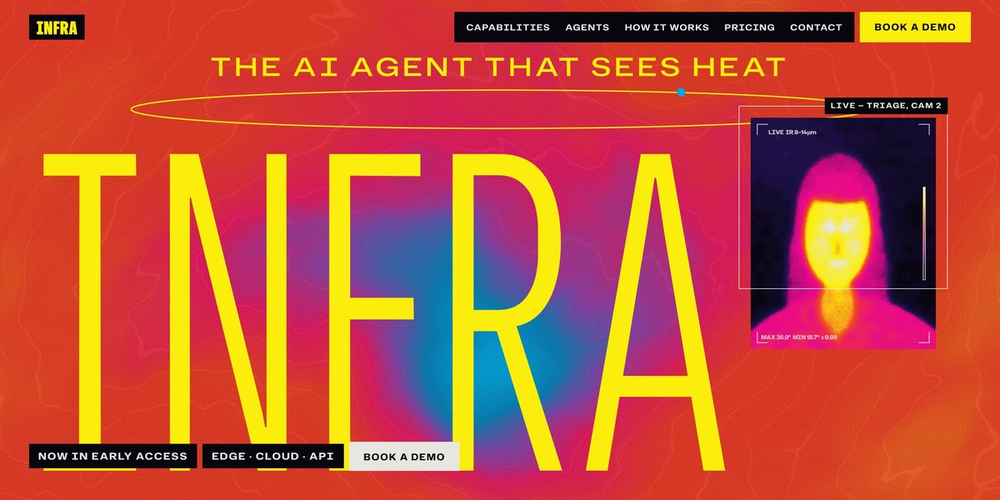

# Infra AI Thermal Agent Page

A thermal-camera page for an AI agent that sees heat: a giant condensed "INFRA" over a swirling WebGL heat plume, its letters stretching from the centre out as you scroll, every picture painted as a live heat field with a camera HUD, and a probe that reads the temperature under your cursor.

**Open it:** [`index.html`](index.html) runs straight from disk — one file, every asset inlined, no build step. [Live demo](https://instalanding.ai/demos/infra-thermal-agent.html) · [Page on InstaLanding](https://instalanding.ai/prompt/infra-ai-thermal-agent-page)

**The prompt:** [`PROMPT.md`](PROMPT.md) is this same file with a short instruction on top: keep the design, replace the brand and copy, convert to your stack. Paste it into Claude Code, Cursor, ChatGPT or any builder and it builds this page.

| | |
| --- | --- |
| Best for | computer vision and AI agents, industrial and IoT monitoring, security and safety products, developer APIs |
| Style | thermal, bold-color, canvas-art, webgl, scroll-driven |
| Sections | nav → hero → manifesto → capabilities → agents → how → gallery → alerts → api → pricing → cta → faq → contact → footer |
| Libraries | gsap 3.13.0, lenis 1.3.4 |
| Fonts | Hubot Sans, Kalnia (Google Fonts) |
| Uses | webgl, canvas-2d, inline-svg, inlined-images, reduced-motion |
| Size | 100 KB · prompt ~25,749 tokens |

Every region is tagged `data-section`, and the file opens with a header comment that maps its design tokens, sections and scripts, and lists what breaks when you edit it. Read that first.

The brand, copy, numbers and testimonials on this page are fictional. Replace them before you ship.
