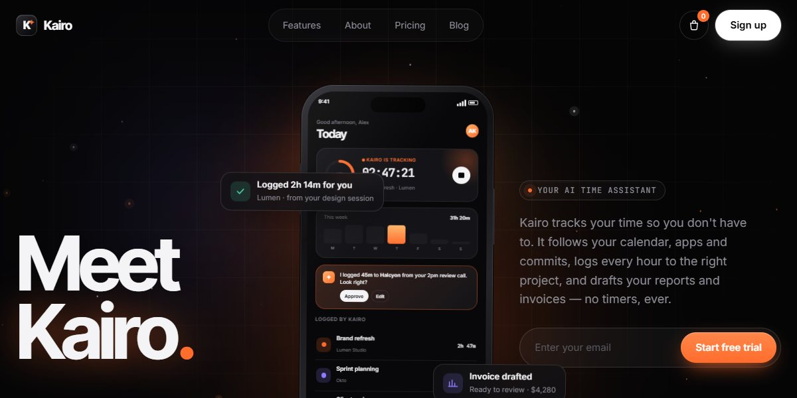

# Kairo AI Time Assistant Page

A near-black product page for an AI assistant that tracks your time: a huge glowing "Meet Kairo." splits in letter by letter beside a tilting 3D phone whose live app types out the assistant's messages, bento cards draw timelines, focus rings and charts, integrations orbit a second phone, and a dark / light switch re-skins the app.

**Open it:** [`index.html`](index.html) runs straight from disk — one file, every asset inlined, no build step. [Live demo](https://instalanding.ai/demos/kairo-time-assistant.html) · [Page on InstaLanding](https://instalanding.ai/prompt/kairo-ai-time-assistant-page)

**The prompt:** [`PROMPT.md`](PROMPT.md) is this same file with a short instruction on top: keep the design, replace the brand and copy, convert to your stack. Paste it into Claude Code, Cursor, ChatGPT or any builder and it builds this page.

| | |
| --- | --- |
| Best for | AI assistants and productivity apps, time tracking and invoicing SaaS, mobile app launches, freelancer and agency tools |
| Style | dark, bento, css-device-mockup, glow, micro-interactions |
| Sections | nav → hero → experience → integration → stats → download → sign-up → footer |
| Libraries | none — plain HTML, CSS and JS |
| Fonts | Inter, Inter Tight, JetBrains Mono (Google Fonts) |
| Uses | canvas-2d, inline-svg, inlined-images, reduced-motion |
| Size | 87 KB · prompt ~22,377 tokens |

Every region is tagged `data-section`, and the file opens with a header comment that maps its design tokens, sections and scripts, and lists what breaks when you edit it. Read that first.

The brand, copy, numbers and testimonials on this page are fictional. Replace them before you ship.
