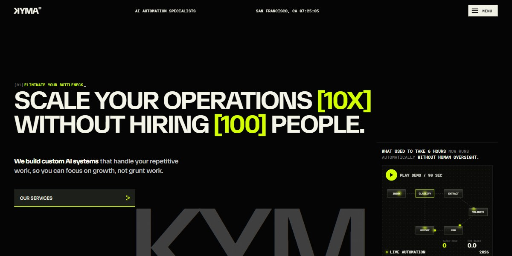

# KYMA AI Automation Agency Page

A brutalist black, paper and lime page for an AI automation agency on a visible four-column grid, with a playable automation pipeline, pain points that fly off as you scroll and an ROI calculator.

**Open it:** [`index.html`](index.html) runs straight from disk — one file, every asset inlined, no build step. [Live demo](https://instalanding.ai/demos/kyma-ai-automation-agency.html) · [Page on InstaLanding](https://instalanding.ai/prompt/kyma-ai-automation-agency-page)

**The prompt:** [`PROMPT.md`](PROMPT.md) is this same file with a short instruction on top: keep the design, replace the brand and copy, convert to your stack. Paste it into Claude Code, Cursor, ChatGPT or any builder and it builds this page.

| | |
| --- | --- |
| Best for | AI automation agencies and consultancies, B2B services with an ROI story, dev and ops studios, technical founders selling done-for-you work |
| Style | dark, brutalist, acid-lime, grid-lines, scroll-driven |
| Sections | nav → menu → hero → logos → about → pain → roi → services → process → case → testimonials → integrations → team → pricing → faq → articles → contact → footer |
| Libraries | none — plain HTML, CSS and JS |
| Fonts | TASA Orbiter, Inter Tight, Roboto Mono |
| Uses | inline-svg, inlined-images, reduced-motion |
| Size | 115 KB · prompt ~29,554 tokens |

Every region is tagged `data-section`, and the file opens with a header comment that maps its design tokens, sections and scripts, and lists what breaks when you edit it. Read that first.

The brand, copy, numbers and testimonials on this page are fictional. Replace them before you ship.
