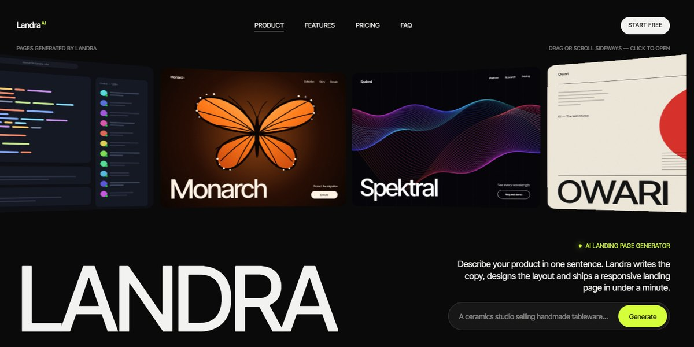

# Landra AI Landing Page Generator Page

A black-and-lime page for an AI that turns one sentence into a landing page, with a WebGL strip of generated pages that bends as you drag and a live demo that builds a mock site from your prompt.

**Open it:** [`index.html`](index.html) runs straight from disk — one file, every asset inlined, no build step. [Live demo](https://instalanding.ai/demos/landra-ai-landing-page-generator.html) · [Page on InstaLanding](https://instalanding.ai/prompt/landra-ai-landing-page-generator-page)

**The prompt:** [`PROMPT.md`](PROMPT.md) is this same file with a short instruction on top: keep the design, replace the brand and copy, convert to your stack. Paste it into Claude Code, Cursor, ChatGPT or any builder and it builds this page.

| | |
| --- | --- |
| Best for | AI website and page builders, generative design tools, no-code and marketing SaaS, AI product launches with a live demo |
| Style | dark, lime, webgl, gallery, live-demo |
| Sections | topbar → hero → logos → how-it-works → demo → features → stats → pricing → faq → cta → footer |
| Libraries | gsap 3.12.5, three 0.169.0 |
| Fonts | Inter Tight |
| Uses | canvas-2d, inline-svg, reduced-motion |
| Size | 130 KB · prompt ~33,557 tokens |

Every region is tagged `data-section`, and the file opens with a header comment that maps its design tokens, sections and scripts, and lists what breaks when you edit it. Read that first.

The brand, copy, numbers and testimonials on this page are fictional. Replace them before you ship.
