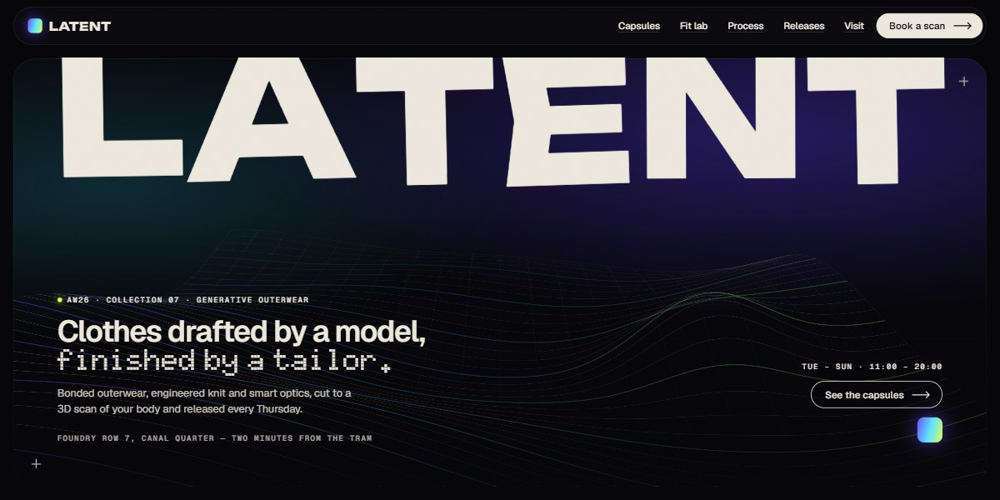

# Latent AI Fashion Atelier Page

A dark, iridescent page for an AI fashion atelier: a wireframe cloth ripples toward the pointer under a giant "Latent" that scatters as the hero tilts away, six capsules slide past sideways, a "Zero" knockout zooms open onto a gradient, and every picture is generative SVG.

**Open it:** [`index.html`](index.html) runs straight from disk — one file, every asset inlined, no build step. [Live demo](https://instalanding.ai/demos/latent-ai-fashion-atelier.html) · [Page on InstaLanding](https://instalanding.ai/prompt/latent-ai-fashion-atelier-page)

**The prompt:** [`PROMPT.md`](PROMPT.md) is this same file with a short instruction on top: keep the design, replace the brand and copy, convert to your stack. Paste it into Claude Code, Cursor, ChatGPT or any builder and it builds this page.

| | |
| --- | --- |
| Best for | AI-native consumer brands, fashion and apparel startups, generative design studios, made-to-measure and 3D-scanning products |
| Style | dark, iridescent, generative-svg, canvas, scroll-driven, horizontal-scroll |
| Sections | nav → hero → ticker → story → rails → lab → again → make → drops → studio → voices → lookbook → faq → visit → footer |
| Libraries | gsap 3.13.0, lenis 1.3.4 |
| Fonts | Unbounded, Geist, Geist Mono, Doto (Google Fonts) |
| Uses | canvas-2d, inline-svg, inlined-images, reduced-motion |
| Size | 78 KB · prompt ~20,122 tokens |

Every region is tagged `data-section`, and the file opens with a header comment that maps its design tokens, sections and scripts, and lists what breaks when you edit it. Read that first.

The brand, copy, numbers and testimonials on this page are fictional. Replace them before you ship.
