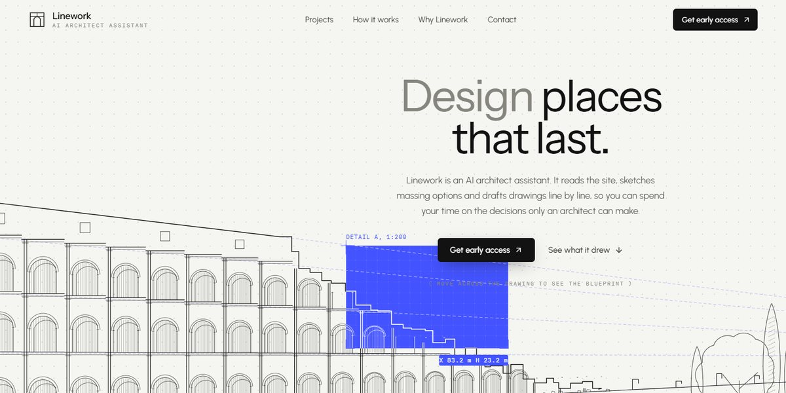

# Linework AI Architect Assistant Page

A quiet, paper-white page for an AI architect assistant where everything is drawn line by line in code: an amphitheatre in ink with a roaming blue blueprint lens, a skyline of nine procedural buildings you filter and open into a drawing-versus-render slider, a house that draws itself stage by stage as you scroll, and a harbour city footer.

**Open it:** [`index.html`](index.html) runs straight from disk — one file, every asset inlined, no build step. [Live demo](https://instalanding.ai/demos/linework-architect-assistant.html) · [Page on InstaLanding](https://instalanding.ai/prompt/linework-ai-architect-assistant-page)

**The prompt:** [`PROMPT.md`](PROMPT.md) is this same file with a short instruction on top: keep the design, replace the brand and copy, convert to your stack. Paste it into Claude Code, Cursor, ChatGPT or any builder and it builds this page.

| | |
| --- | --- |
| Best for | architecture and AEC software, design and CAD tools, AI assistants for professionals, studios with a portfolio |
| Style | light, minimal, line-drawing, svg-illustration, scroll-driven |
| Sections | nav → mobile-nav → hero → services → projects → process → studio → quotes → footer → dialogs |
| Libraries | none — plain HTML, CSS and JS |
| Fonts | IBM Plex Mono, Instrument Sans, Urbanist (Google Fonts) |
| Uses | inline-svg, inlined-images, reduced-motion |
| Size | 95 KB · prompt ~24,460 tokens |

Every region is tagged `data-section`, and the file opens with a header comment that maps its design tokens, sections and scripts, and lists what breaks when you edit it. Read that first.

The brand, copy, numbers and testimonials on this page are fictional. Replace them before you ship.
