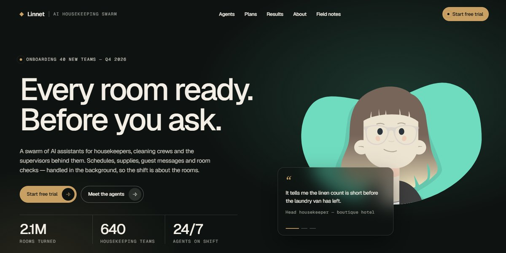

# Linnet AI Housekeeping Swarm Page

A pine-and-brass page for a swarm of AI assistants that runs housekeeping: an illustrated housekeeper in the hero who pops in, blinks and follows the pointer, a manifesto that lights word by word before a diagonal wipe, four agents on a pinned scroll stage, flip-up plan cards, sticky stacked testimonials and an about section that unmasks from an arch, every picture drawn in SVG.

**Open it:** [`index.html`](index.html) runs straight from disk — one file, every asset inlined, no build step. [Live demo](https://instalanding.ai/demos/linnet-ai-housekeeping.html) · [Page on InstaLanding](https://instalanding.ai/prompt/linnet-ai-housekeeping-swarm-page)

**The prompt:** [`PROMPT.md`](PROMPT.md) is this same file with a short instruction on top: keep the design, replace the brand and copy, convert to your stack. Paste it into Claude Code, Cursor, ChatGPT or any builder and it builds this page.

| | |
| --- | --- |
| Best for | AI agents and assistant swarms, vertical SaaS for operations teams, hospitality and cleaning businesses, B2B products with a warm, editorial feel |
| Style | dark, editorial, scroll-driven, svg-illustration, character-animation |
| Sections | nav → hero → clients → manifesto → who → how-it-works → pricing → results → testimonials → about → insights → faq → cta → footer |
| Libraries | gsap 3.13.0 |
| Fonts | Geist, Geist Mono, Instrument Serif (Google Fonts) |
| Uses | inline-svg, inlined-images, reduced-motion |
| Size | 95 KB · prompt ~24,326 tokens |

Every region is tagged `data-section`, and the file opens with a header comment that maps its design tokens, sections and scripts, and lists what breaks when you edit it. Read that first.

The brand, copy, numbers and testimonials on this page are fictional. Replace them before you ship.
