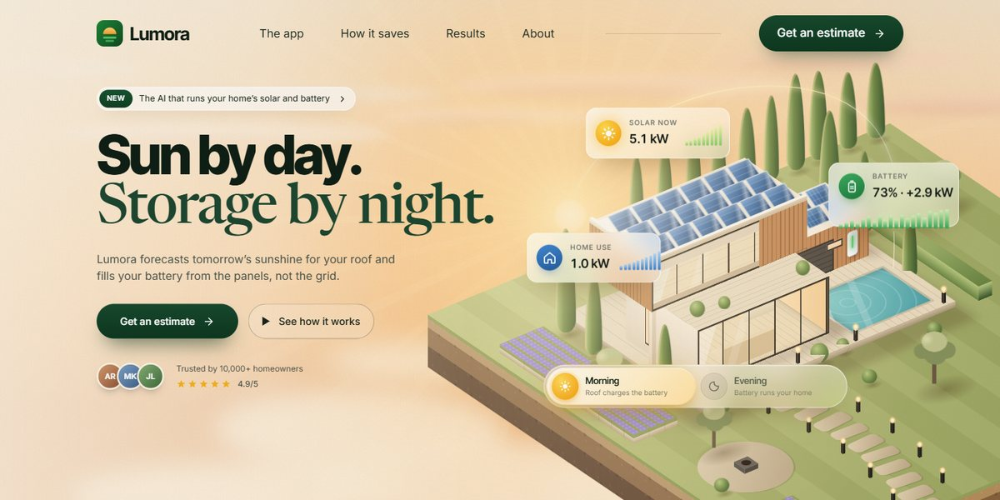

# Lumora AI Home Solar Page

A warm, sunlit page for an AI that runs a home's solar and battery: a 3D modernist villa built from CSS boxes sits in a golden landscape and turns to evening with one switch, a manifesto lights word by word, a working energy dashboard tilts up into view, and Forecast, Store and Save slide past on a pinned horizontal track.

**Open it:** [`index.html`](index.html) runs straight from disk — one file, every asset inlined, no build step. [Live demo](https://instalanding.ai/demos/lumora-home-solar.html) · [Page on InstaLanding](https://instalanding.ai/prompt/lumora-ai-home-solar-page)

**The prompt:** [`PROMPT.md`](PROMPT.md) is this same file with a short instruction on top: keep the design, replace the brand and copy, convert to your stack. Paste it into Claude Code, Cursor, ChatGPT or any builder and it builds this page.

| | |
| --- | --- |
| Best for | climate tech and home energy, smart home and IoT apps, consumer AI products, subscription apps with a dashboard |
| Style | light, 3d-css, svg-illustration, scroll-driven, interactive |
| Sections | nav → hero → partners → manifesto → product → solutions → results → how-it-works → about → faq → estimate → early-access → footer |
| Libraries | none — plain HTML, CSS and JS |
| Fonts | Inter, Inter Tight, Newsreader, JetBrains Mono (Google Fonts) |
| Uses | inline-svg, inlined-images, reduced-motion |
| Size | 209 KB · prompt ~53,749 tokens |

Every region is tagged `data-section`, and the file opens with a header comment that maps its design tokens, sections and scripts, and lists what breaks when you edit it. Read that first.

The brand, copy, numbers and testimonials on this page are fictional. Replace them before you ship.
