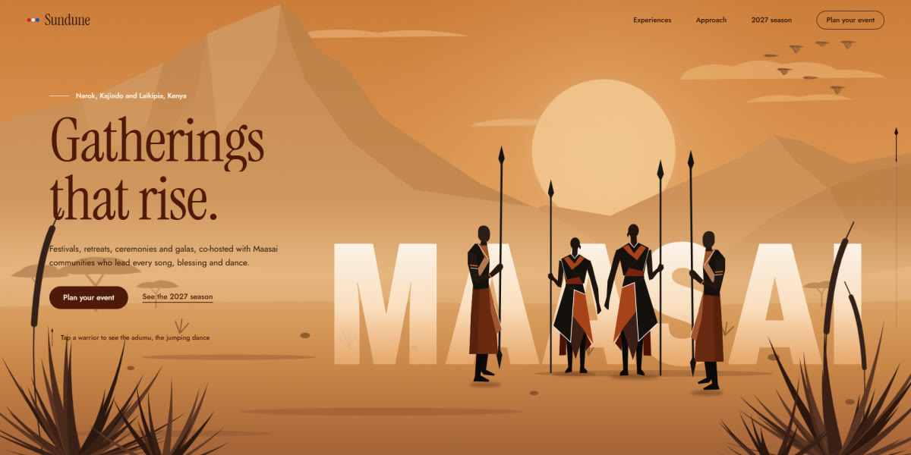

# Maasai-Inspired Event Landing Page

A cultural events studio page on Maasai-inspired dusk: a Rive hero rebuilt in SVG where four warriors leap into the adumu, a scroll-driven frieze of leaping silhouettes, generated beadwork and gala art, and textures cut from the warriors' own shapes.

**Open it:** [`index.html`](index.html) runs straight from disk — one file, every asset inlined, no build step. [Live demo](https://instalanding.ai/demos/maasai-event-hero.html) · [Page on InstaLanding](https://instalanding.ai/prompt/maasai-inspired-event-landing-page)

**The prompt:** [`PROMPT.md`](PROMPT.md) is this same file with a short instruction on top: keep the design, replace the brand and copy, convert to your stack. Paste it into Claude Code, Cursor, ChatGPT or any builder and it builds this page.

| | |
| --- | --- |
| Best for | event and experience studios, cultural festivals and tourism, hospitality and destination brands, interactive illustrated heroes |
| Style | light, warm, editorial, illustrated, svg, dark-mode |
| Sections | nav → hero → frieze → approach → experiences → stats → season → process → testimonial → cta → footer |
| Libraries | none — plain HTML, CSS and JS |
| Fonts | Archivo Black, Instrument Serif, Jost (Google Fonts) |
| Uses | inline-svg, inlined-images, reduced-motion |
| Size | 100 KB · prompt ~25,870 tokens |

Every region is tagged `data-section`, and the file opens with a header comment that maps its design tokens, sections and scripts, and lists what breaks when you edit it. Read that first.

## Built on

- [Maasai-Inspired Event Hero Banner Concept — Rive Marketplace](https://rive.app/marketplace/27773-52471-maasai-inspired-event-hero-banner-concept/) — The Rive file whose hero this page recreates in plain SVG and CSS, with no Rive runtime

Keep this attribution if you redistribute the component; the original's own terms apply to the parts taken from it.

The brand, copy, numbers and testimonials on this page are fictional. Replace them before you ship.
