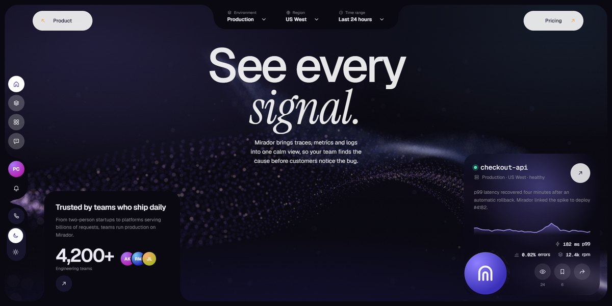

# Mirador Observability Page

An observability platform in a framed night console: a WebGL ribbon of glowing fibers behind the hero, plates cut out of the frame with inverted corners, stacking feature cards with live trace mockups and a dark/light switch.

**Open it:** [`index.html`](index.html) runs straight from disk — one file, every asset inlined, no build step. [Live demo](https://instalanding.ai/demos/mirador-observability.html) · [Page on InstaLanding](https://instalanding.ai/prompt/mirador-observability-page)

**The prompt:** [`PROMPT.md`](PROMPT.md) is this same file with a short instruction on top: keep the design, replace the brand and copy, convert to your stack. Paste it into Claude Code, Cursor, ChatGPT or any builder and it builds this page.

| | |
| --- | --- |
| Best for | observability and monitoring tools, developer platforms and infrastructure, B2B SaaS dashboards, data and analytics products |
| Style | dark, webgl, gsap, glass, dashboard, scroll-driven |
| Sections | nav → hero → intro → features → integrations → gallery → process → pricing → team → reviews → faq → security → contact → footer |
| Libraries | gsap 3.13.0, lenis 1.3.4 |
| Fonts | Geist, Geist Mono, Instrument Serif (Google Fonts) |
| Uses | webgl, canvas-2d, inline-svg, reduced-motion |
| Size | 165 KB · prompt ~42,356 tokens |

Every region is tagged `data-section`, and the file opens with a header comment that maps its design tokens, sections and scripts, and lists what breaks when you edit it. Read that first.

The brand, copy, numbers and testimonials on this page are fictional. Replace them before you ship.
