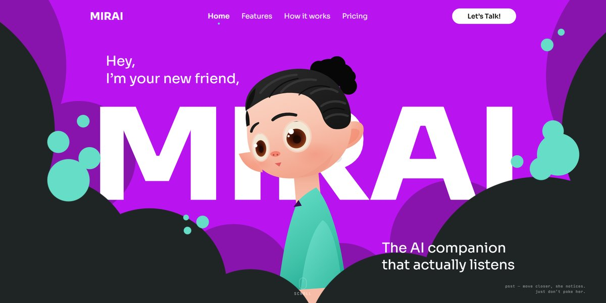

# Mirai AI Companion Page

A purple, mint and charcoal page for an AI companion: an illustrated character peeks over giant type between clouds, follows your cursor with her eyes, blinks, perks up when you come close and frowns when you poke her.

**Open it:** [`index.html`](index.html) runs straight from disk — one file, every asset inlined, no build step. [Live demo](https://instalanding.ai/demos/mirai-ai-companion.html) · [Page on InstaLanding](https://instalanding.ai/prompt/mirai-ai-companion-page)

**The prompt:** [`PROMPT.md`](PROMPT.md) is this same file with a short instruction on top: keep the design, replace the brand and copy, convert to your stack. Paste it into Claude Code, Cursor, ChatGPT or any builder and it builds this page.

| | |
| --- | --- |
| Best for | AI companion and assistant apps, consumer AI and wellbeing products, character-led brands and mascots, playful app launches |
| Style | dark, illustrated, svg, character, playful, interactive |
| Sections | nav → hero → ticker → features → stats → how-it-works → demo → pricing → faq → waitlist → footer |
| Libraries | none — plain HTML, CSS and JS |
| Fonts | Sora, JetBrains Mono (Google Fonts) |
| Uses | inline-svg, inlined-images, reduced-motion |
| Size | 65 KB · prompt ~16,686 tokens |

Every region is tagged `data-section`, and the file opens with a header comment that maps its design tokens, sections and scripts, and lists what breaks when you edit it. Read that first.

The brand, copy, numbers and testimonials on this page are fictional. Replace them before you ship.
