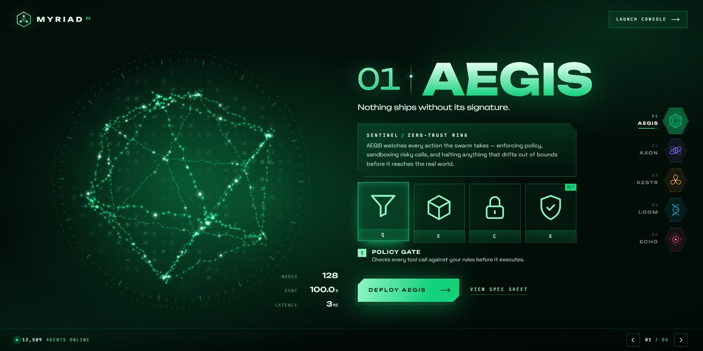

# Myriad Agent Swarm Page

An agent-select screen for an AI swarm: pick one of five agents and a 640-point particle swarm reforms into its shape while the whole page recolours to match.

**Open it:** [`index.html`](index.html) runs straight from disk — one file, every asset inlined, no build step. [Live demo](https://instalanding.ai/demos/myriad-agent-swarm.html) · [Page on InstaLanding](https://instalanding.ai/prompt/myriad-agent-swarm-page)

**Build it yourself:** [`PROMPT.md`](PROMPT.md) is the one-shot brief this file was built from. Paste it into any AI builder or coding agent.

| | |
| --- | --- |
| Best for | multi-agent and AI platform launches, AI product or model line-ups, games and character-select screens, developer tools with a strong visual identity |
| Style | dark, canvas, particles, game-ui, neon, interactive |
| Sections | nav → hero → status |
| Libraries | none — plain HTML, CSS and JS |
| Fonts | Unbounded, Space Grotesk, JetBrains Mono (Google Fonts) |
| Uses | canvas-2d, inline-svg, inlined-images, reduced-motion |
| Size | 53 KB · brief ~1,344 tokens |

Every region is tagged `data-section`, and the file opens with a header comment that maps its design tokens, sections and scripts, and lists what breaks when you edit it. Read that first.

The brand, copy, numbers and testimonials on this page are fictional. Replace them before you ship.
